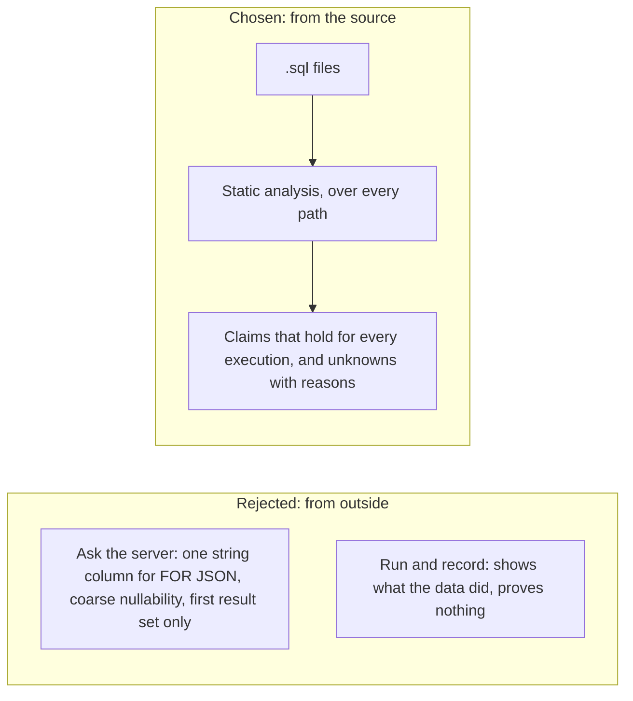

# The shape of the problem

One question drives haruspex: what exactly does each stored procedure in a SQL Server database return? It answers by
reading the project's source, never by running anything, and it answers soundly: every claim it makes holds for every
execution, and where it can't prove something it says so. This chapter says why the question matters, why it is answered
from the source, and why soundness is the rule.

## What haruspex is for

Many applications talk to their database through stored procedures. The procedures are the database's API: they hide the
tables, hold the rules shared by several applications, and return a whole nested payload in one round trip, often built
with `FOR JSON`. But nothing at the boundary is typed. The application receives rows or a string of JSON, and its
developers write types for them by hand, which nothing checks and which drift as the SQL changes.

That is the gap haruspex fills: it reads the procedures and writes those types. Here is a procedure from an invented shop, with the two tables it
reads:

```sql haruspex-example
CREATE TABLE shop.category
(
    category_id int          NOT NULL PRIMARY KEY,
    name        nvarchar(40) NOT NULL
);
GO
CREATE TABLE shop.product
(
    product_id  int           NOT NULL PRIMARY KEY,
    category_id int           NOT NULL REFERENCES shop.category (category_id),
    name        nvarchar(80)  NOT NULL,
    price       decimal(9, 2) NULL
);
GO
CREATE PROCEDURE shop.get_category @category_id int
AS
SELECT c.category_id AS id,
       c.name,
       (SELECT p.product_id AS id, p.name, p.price
        FROM shop.product AS p
        WHERE p.category_id = c.category_id
        ORDER BY p.product_id
        FOR JSON PATH) AS products
FROM shop.category AS c
WHERE c.category_id = @category_id
FOR JSON PATH, WITHOUT_ARRAY_WRAPPER;
```

And here is what haruspex generates for it (the module's header is left out):

```ts haruspex-zod
export const GetCategoryProductSchema = z.object({
  id: z.int32(),
  name: z.string().max(80),
  price: z.number().min(-9999999.99).max(9999999.99).multipleOf(1e-2).optional(),
})
export type GetCategoryProduct = z.infer<typeof GetCategoryProductSchema>

export const GetCategoryRowSchema = z.object({
  id: z.int32(),
  name: z.string().max(40),
  products: z.array(GetCategoryProductSchema).min(1).optional(),
})
export type GetCategoryRow = z.infer<typeof GetCategoryRowSchema>

/** shop.get_category: returns JSON, null when no rows match. */
export const GetCategorySchema = GetCategoryRowSchema.nullable()
export type GetCategory = z.infer<typeof GetCategorySchema>
```

Every line is a claim, and each has a reason in the SQL:

- **`id` is a 32-bit integer and never null**: `category_id` is an `int` declared `NOT NULL`, and is the primary key too.
- **`name` is at most 40 characters**: `nvarchar(40)` counts UTF-16 code units, as JavaScript's `length` does, so the
  bound is exact.
- **`price` may be absent, but is never `null`**: the column allows NULL, and `FOR JSON` leaves a null key out of the
  object rather than writing `null`. Its range and its step of 0.01 come from `decimal(9, 2)`.
- **`products` has at least one item when it is there, and may be absent**: a `FOR JSON` subquery over no rows gives NULL,
  not `[]`, and the null key is left out.
- **The whole result is one object or null**: `WITHOUT_ARRAY_WRAPPER` writes one object, the filter on the primary key
  proves at most one row, and a `FOR JSON` query that matches no rows returns no row at all, which a reader takes as
  null.

Several of those rules are not in SQL Server's documentation, or not plainly. Each is observed on a real server by a test
([chapter 9](09-observing-the-engine.md)), and the code that relies on it names that test.

## Why not ask the server

The obvious way to learn a result's shape is to ask SQL Server. `sp_describe_first_result_set` describes the columns of a
procedure's first result set, with their types and whether each allows NULL. It falls short in three ways, each from its
own documentation:

- **`FOR JSON` is one column.** A `FOR JSON` query returns a single `nvarchar(max)` column of text
  ([Microsoft's documentation](https://learn.microsoft.com/sql/relational-databases/json/format-query-results-as-json-with-for-json-sql-server)),
  and that is all the server describes. The objects, keys and nesting inside it, which are the payload, are invisible.
- **Nullability is coarse.** `is_nullable` is 1 when the column allows NULL, and also 1 "if it cannot be determined"
  ([the procedure's documentation](https://learn.microsoft.com/sql/relational-databases/system-stored-procedures/sp-describe-first-result-set-transact-sql)).
  Nothing in it reflects what a filter, a key or the procedure's flow proves.
- **Only the first result set.** A procedure that returns several, or different ones on different paths, is described by
  its first, or not at all.

It also needs the database deployed and a login to it, which a build or a CI job may not have.

The next idea is to run each procedure and record what comes back. That is what an augur did: read the future from outside
behaviour, the flight of birds. (A haruspex read it from the insides.) A recording shows only what the data at hand
produced. An empty table proves nothing, and no number of runs proves a value is never null; it shows only that it wasn't
null this time. Recording needs data, credentials and a safe way to call every procedure, including those that write.

So haruspex reads the source. Everything that decides a result's shape is there: the query, the schema it reads, and the
rules SQL Server applies to both. An analysis of a program's text that runs nothing is a **static analysis**, and one that
claims only what holds on every run is **sound**. The decision and its alternatives are recorded in
[decision 0001](../decisions/0001-infer-from-source-never-a-live-database.md).



## Sound by default

A static analysis can't know everything about a program. Rice's theorem says that any interesting property of what a
program does is undecidable in general, so an analysis that always answers must sometimes be wrong or sometimes say "I
don't know". It can be **sound** (everything it claims is true, but it misses some truths) or **complete** (it claims every
truth, but some claims are false), never both.

The analysis here is sound, and the reason is the cost of each mistake to the person using it. A claim that is too cautious costs a
`.nullable()` the developer can see, question, and override in the config file with a reason. A claim that is wrong costs
a failure in production: code that trusted a field to be present, on the day it wasn't. A user forgives the first and not
the second ([decision 0002](../decisions/0002-unknown-with-a-reason-never-a-guess.md)).

In the literature this is an **over-approximation**: the set of values haruspex says a field may take always contains
every value it can really take. "Nullable" means "may be null", never "is sometimes null"; "non-null" means "is never
null". When haruspex can't bound the set at all, the field is **unknown**.

### Why not "soundy"?

Many typed-SQL tools make the other trade on purpose: sound except for known holes, a position Livshits and others named
*soundiness* and defended. A sceptic will point out that haruspex generates a runtime validator, so a wrong claim would fail
loudly at the parse rather than silently. Why not accept a few wrong claims, then, and type more fields?

Because a loud failure is still a failure, and it comes at the worst time. A wrong non-null claim, met by a null in
production, fails the parse of that result for every call that returns such a row: the procedure stops working for those
users until someone writes an override and redeploys. The types the application was compiled against were wrong too, so
the code never handled the case. A sound `.nullable()` costs a check the compiler shows the developer before anything ships.
The runtime check is there so that the application can trust its types, and so that the claims a *person* makes
(overrides, declared results) fail loudly when wrong; it isn't meant as a net under haruspex's own.

Nor is haruspex free of assumptions. It states each one where it is made rather than leaving holes to be found, for
example that a caller doesn't read uncommitted data
([decision 0016](../decisions/0016-visible-read-uncommitted-drops-key-claims.md)).

### What unknown means

An unknown is never a silent `any`. It always carries a reason from a closed list (`IrUnknownReason`), a sentence saying
why, and where in the source it arose. Here a procedure runs a query built as a string, so its shape is in no source file:

```sql haruspex-example
CREATE PROCEDURE shop.search_products @where nvarchar(400)
AS
DECLARE @sql nvarchar(max) = N'SELECT p.product_id, p.name FROM shop.product AS p WHERE ' + @where;
EXEC sp_executesql @sql;
```

The IR says what is known (the parameter's type) and lists the unknown, with its reason and location:

```json haruspex-ir
{
  "irVersion": "0.16",
  "source": {
    "dialect": "tsql"
  },
  "objects": [
    {
      "id": "shop.search_products",
      "name": "SearchProducts",
      "kind": "procedure",
      "at": "example.sql:1:1",
      "parameters": [
        {
          "name": "@where",
          "type": {
            "kind": "string",
            "sql": "nvarchar(400)"
          },
          "hasDefault": false,
          "output": false
        }
      ],
      "results": null
    }
  ],
  "types": {},
  "unknowns": [
    {
      "object": "shop.search_products",
      "path": "results",
      "reason": "dynamic-sql",
      "detail": "EXEC sp_executesql @sql runs dynamic SQL, a string built when the procedure runs, so its result sets are not known.",
      "at": "example.sql:4:1"
    }
  ],
  "overrides": []
}
```

The generated Zod says the same, in its own terms:

```ts haruspex-zod
/** shop.search_products: its result sets cannot be listed; see the unknowns in the IR. */
export const SearchProductsSchema = z.unknown()
export type SearchProducts = z.infer<typeof SearchProductsSchema>
```

Three things follow from making unknown explicit:

- **Unknowns stay as local as they can.** One unmodelled column makes that column unknown, not its row or its procedure,
  so everything around it is still typed. Results that can't be listed, as here, make the results of a procedure that
  calls this one unknown too, with the call named in the detail; its parameters stay typed.
- **Unknowns can be resolved.** The reason says what would help. Here the config file can declare the results, as a
  JSON Schema that the generated code still checks at runtime
  ([decision 0013](../decisions/0013-results-that-cannot-be-inferred-are-declared.md)).
- **Coverage can grow safely.** Anything not modelled is unknown by default, so teaching haruspex a new construct only
  turns unknowns into claims; it never makes an existing claim wrong.

### Claiming everything it can

Soundness alone would be satisfied by typing every field as an unknown. The converse rule keeps haruspex useful: **claim
everything the engine does guarantee**. A length, a range, a decimal's step or a set of values from a `CHECK` constraint
becomes a check in the generated code wherever the target can hold it exactly
([decision 0005](../decisions/0005-claim-everything-the-engine-guarantees.md)). Throwing a proved fact away is a defect too.

The two rules together sometimes give a type looser than intuition expects. `COUNT(*)` is nullable, because past
2,147,483,647 rows it returns NULL under session options the caller controls
([decision 0014](../decisions/0014-count-is-nullable.md)). That `.nullable()` is not caution for its own sake: it is
something SQL Server really does, and `COUNT_BIG` is the way out. The other way out is to say what the callers do: those
options belong to the session that calls the procedure, which haruspex can't see, so the config file may declare them, and
with `ANSI_WARNINGS` declared on the overflow is an error and `COUNT` never null
([decision 0038](../decisions/0038-the-callers-session-is-declared.md)). Left undeclared, nothing is assumed. A tool may claim
what it is told only when the telling is written down, so the IR records the declaration and the generated file says it.

## The alternatives, and why they lost

| Approach | What it gives | Why not |
|---|---|---|
| Ask the server (`sp_describe_first_result_set`) | Column types of the first result set | `FOR JSON` is one string column; nullability is "1 when unsure"; one result set; needs a deployed database |
| Run each procedure and record | Shapes the data happened to show | Proves nothing about the cases the data lacked; needs data, credentials and safe calls |
| Write the types by hand | Whatever the author believes | Nothing checks it, and it drifts from the SQL |
| Type tables, not procedures (as ORMs and table generators do) | Each table's columns | Says nothing about what a query returns, least of all its JSON |
| Guess where unsure | More fields typed | The wrong guesses are found at runtime, by a user, with no sign of which they were |
| **Infer from the source, soundly** | Every claim true on every run; each unknown with its reason | Some fields are unknown, and some types are looser than intuition; both are stated |

The limits are real. Dynamic SQL, `EXEC @name`, CLR procedures and objects outside the project can't be typed from the
source, because their shape isn't in it; they are unknowns, with reasons, unless declared. A rule the database doesn't
declare ("a closed order always has `closed_at`") isn't seen, so the field is nullable as declared, until an override says
otherwise with a reason.

## Read more

- Anders Møller and Michael I. Schwartzbach, *Static Program Analysis*, chapter 1, on undecidability, soundness and
  approximation (free at <https://cs.au.dk/~amoeller/spa/>).
- Flemming Nielson, Hanne Riis Nielson and Chris Hankin, *Principles of Program Analysis*, chapter 1, for the same ideas
  more formally.
- Benjamin Livshits and others, the manifesto on soundiness, *Communications of the ACM*, volume 58, 2015: the case for
  the other trade, made well.
- H. G. Rice, "Classes of recursively enumerable sets and their decision problems", *Transactions of the American
  Mathematical Society*, 1953: the theorem itself.

## In the code

- `IrInference.Infer` is the front door of inference: a model and the procedures to infer, in; an IR document, out.
- `IrUnknownReason` and `IrNullRule` are the closed lists of reasons for an unknown and for a value that may be null.
- `SqlProject` is the composition the CLI and the tests use: read a folder, infer, apply the config file.
- [`src/Haruspex.Ir/README.md`](../../src/Haruspex.Ir/README.md) specifies what each claim in the IR means.
