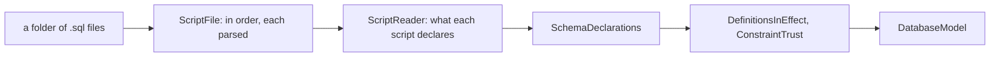
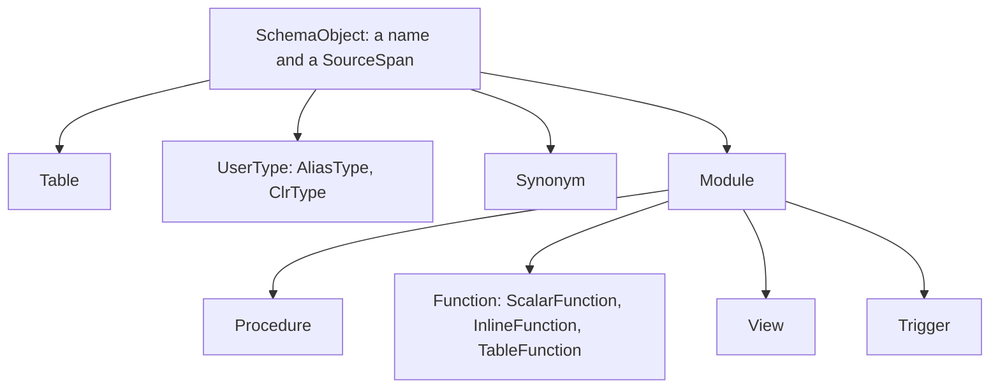

# The inputs and the model

What haruspex reads is a SQL Server database project: a folder of `.sql` scripts, in no particular order, that together
define a schema, or the DACPAC a project builds from them. Before anything can be inferred, those scripts become a *model*: the schema as data, each table, type, procedure,
function, view, trigger and synonym a value with a name and a place in the source. This chapter is about that step: what is
read, how a script becomes the model, why the model hides the parser it was read with, and the one order everything in it is
kept in. The code is in three projects, each a layer with a chapter of its own in brief:
[Sources](../../src/Haruspex.SqlServer.Sources/README.md) reads the folder or the package,
[Syntax](../../src/Haruspex.SqlServer.Syntax/README.md) reads what the parser parsed into model values, and
[Model](../../src/Haruspex.SqlServer.Model/README.md) is the model.

## What is read

A database project's scripts are written to be deployed, not read in order. An SSDT or `Microsoft.Build.Sql` project keeps
one object to a file, in folders by schema and kind, and the build works out the order to create them in. So the folder is a
set, not a sequence, and haruspex reads it as one: every `*.sql` file under it (or the ones a project file builds, when it is
given them), each decoded as UTF-8 unless a byte order mark says otherwise, since SQL Server Management Studio saves UTF-16.
A script written for sqlcmd is read as the server would receive it, with each `:setvar` variable replaced. Each is parsed
with [ScriptDom](https://www.nuget.org/packages/Microsoft.SqlServer.TransactSql.ScriptDom), Microsoft's own T-SQL parser, and
never with DacFx, whose licence no free tool should have to take on
([decision 0004](../decisions/0004-scriptdom-is-the-only-sql-dependency.md)).

What a script defines is read: `CREATE TABLE` with its columns, keys and CHECK constraints; `CREATE TYPE`; procedures,
functions, views and DML triggers with their parameters and bodies; synonyms; and foreign keys with an `ON DELETE` or
`ON UPDATE` action, since those fire the referencing table's triggers. So is anything that changes a definition later (an
`ALTER` or a `DROP`), and anything that may disable a constraint (`ALTER TABLE … NOCHECK CONSTRAINT`,
`ALTER INDEX … DISABLE`). Everything else, data and permissions and the rest of what indexes do, is passed over: it can't
change what a table's columns are or what a procedure returns.

## A script becomes the model, in three steps



`SqlScriptFolder.Read` is those three steps and nothing else.

1. **Which scripts, in which order** (`ScriptFile`). The scripts are read in ordinal order of their paths relative to the
   folder, whatever order the file system or the caller lists them in. A folder says no order, so haruspex picks one that
   depends only on the paths: two runs over the same files read them alike, and the first of two definitions of one name is
   the same one each time.
2. **What each script declares** (`ScriptReader`). One reader per script walks its statements in order and adds what each
   defines or changes to `SchemaDeclarations`, the reading's one piece of mutable state. It applies nothing. A statement that
   alters or drops an object is recorded beside the object's definition, not used to replace it.
3. **What is in effect** (`DefinitionsInEffect`, `ConstraintTrust`). Once every script is read, the passes decide what the
   model says of each object.

The second step applies nothing because nothing tells it what to apply. A procedure created in one file and altered in
another has two definitions, and which is in effect on a server depends on the order the scripts ran there, which the folder
doesn't record. Guessing an order would make a claim haruspex can't support, so the model keeps the `CREATE` (for the
procedure's parameters) and records the doubt as a `Redefinition`. Inference then says the procedure's results are unknown,
and why:

```sql haruspex-example
CREATE TABLE shop.product (product_id int NOT NULL PRIMARY KEY, name nvarchar(80) NOT NULL);
GO
CREATE PROCEDURE shop.list_products
AS
SELECT p.product_id, p.name FROM shop.product AS p;
GO
ALTER PROCEDURE shop.list_products
AS
SELECT p.product_id FROM shop.product AS p;
```

```json haruspex-ir unknowns
[
  {
    "object": "shop.list_products",
    "path": "results",
    "reason": "redefined",
    "detail": "shop.list_products is changed by ALTER PROCEDURE at example.sql:7:1, and which definition applies depends on the order the scripts run.",
    "at": "example.sql:7:1"
  }
]
```

The same rule covers a function altered or dropped, a view defined twice, and a table changed by `ALTER TABLE` in a way that
could change a column. An `ALTER TABLE` that can only tighten a table (adding a constraint, checking one, rebuilding) is no
doubt, since ignoring it can only leave a column more nullable than it is (`ScriptReader.OnlyTightens`).

A CHECK constraint and a unique key are only claims while SQL Server trusts them. `ALTER TABLE … NOCHECK CONSTRAINT` and
`ALTER INDEX … DISABLE` stop the server checking rows, and rows written meanwhile stay after a plain re-enable. So
`ConstraintTrust` marks each check or key that such a statement may name, wherever it is (inside a procedure, under `IF`),
since whether it runs isn't knowable. A key, once marked, stays so: re-enabling an index (a rebuild) isn't followed, which
only claims less. A check is trusted again only when a `WITH CHECK CHECK CONSTRAINT`, which validates every row, certainly
runs after the `NOCHECK` on it: both are statements of batches (not inside a body, a block or an `IF`) in the same script,
the re-enable comes later, names the table with its schema, and names the check, or `ALL`. The model records where a check or
key may be disabled (`CheckConstraint.DisabledAt`, `UniqueKey.DisabledAt`), and the schema's rules claim nothing from it.

One setting is read in order within a file: `ANSI_NULLS`. SQL Server keeps the setting in force when a procedure, function
or view is created, and it changes what `= NULL` means in its body, so a `SET ANSI_NULLS OFF` before a definition in the
same script is kept with it (`Procedure.AnsiNullsOff`). Another file's `SET` may run before it too, in an order the folder
doesn't say; that isn't followed, and the default every client library uses, on, is assumed.

## Why the model hides ScriptDom

The parser's syntax tree already holds every declaration, so the model could be the tree with an index over it. Then every
reader of the model would need ScriptDom to know what an object is: a function's kind read from the type of its return clause
at each use, a CLR body found as a statement list that is null, a parameter's type read from its declaration's syntax, each
reader reading the same syntax in its own way.

So the model is its own values, and ScriptDom stays where only syntax can say something: a body's statements, a view's
query, a default or a computed column's expression. A name, a type, a parameter, a function's kind and its options are
records the model defines. `ModelSurfaceTests` holds the line: by reflection over the model's public surface, the only
ScriptDom types it may show are `StatementList`, `SelectStatement`, `ScalarExpression` and `BooleanExpression`. Reading the
syntax into those values is one layer, Syntax (`SyntaxReader`, `ModuleReader`), which Sources reads scripts with and which
inference reads a body's own `CREATE TABLE #t` and `DECLARE @t TABLE` with, so a table declared in a body means what the
same declaration means in the schema.

What is one of several kinds is a *sum type*, the idea functional languages call an algebraic data type: a value is exactly
one of a closed set of cases, each with its own fields. A function is a `ScalarFunction`, an `InlineFunction` or a
`TableFunction`; what a module runs, its `ModuleBody`, is a `SqlBody`, a `ClrBody`, a `NoBody` or an `EncryptedBody`; a user type is an
`AliasType` or a `ClrType`. C# has no sum types as such, so each is a *closed hierarchy*: an abstract record whose
constructor only its own assembly can call, with a sealed record for each case. A reader matches on the case and gets
exactly its fields; there is no field that is null for every case but one, and no case can be added from outside, so a
`switch` over the cases is known to be complete. The alternative, one record with a kind and a field for each kind's data,
makes every reader check the kind and then trust that the right field is set
([decision 0031](../decisions/0031-the-model-is-closed-hierarchies-of-records.md)).



A synonym is a schema object but not a module: SQL Server keeps a definition for its modules (`sys.sql_modules`), and a
synonym has none, only the name it stands for.

## A DACPAC becomes the same model

A DACPAC is what a database project's build makes of its scripts: an OPC zip (the format of `.docx` files) whose
`model.xml` holds the schema, with `Origin.xml` saying what made it and when. DacFx, the library that writes and deploys one,
is the obvious way to read one too, and the one haruspex can't use, for the licence reason above. So `DacpacReader` reads
`model.xml` itself, with .NET's own zip and XML readers, into the same model a folder gives. `model.xml` has no published
specification: everything the reader knows of it was read from packages DacFx made, kept in
[`tests/dacpacs`](../../tests/dacpacs/README.md) with how each was built, and its words are in one place (`ModelXml`).

Its elements come in two kinds, and each is read the way that keeps one meaning for one thing:

- **Tables are data.** A table is an element listing its columns, each with a type, whether it is nullable and its
  collation; its constraints and indexes are elements of their own that name it. `TableReader` builds the model's `Table`
  from them directly. Only the expressions in them (a CHECK's condition, a computed column's) are text, parsed by ScriptDom
  as a folder's are. DacFx has already resolved what the script said, so a column's nullability is the one it deploys, and a
  type has all its arguments: `decimal` is there as `decimal(18,0)`, which is how haruspex spells it from a folder too.
- **Modules are text.** A procedure, function, view or trigger keeps its definition as written: the header DacFx stores in
  an annotation (`CREATE PROCEDURE … AS`, with any comment before it) and the body. `ModuleTextReader` puts the two back
  together, parses them with ScriptDom and hands the statement to the same `ModuleReader` a folder's scripts go through. So
  there is one reading of what a procedure is, not two that can drift. The settings a module was created with, which SQL
  Server keeps, reach the parse: one created with `QUOTED_IDENTIFIER` off reads `"word"` as the string it is there.

Every element is read, passed over for a reason the reader states (permissions, storage, documentation, defaults: nothing
that changes a shape), or counted in one note ([HAR1004](../diagnostics/HAR1004.md)), so a kind of element a newer DacFx
writes is never lost in silence.

**Built or extracted.** A package made by a project's build and one SqlPackage extracted from a database differ in what they
can know. A build keeps every module's text, encrypted or not; an extract can't, since SQL Server gives no one an encrypted
module's text, and keeps a placeholder that, read as a body, would claim the procedure returns nothing. A CLR module has no
text in either. Such a module is still read, from its element, which keeps what a caller needs: its parameters, a scalar
function's return type, a table function's columns, a view's column names, a trigger's table and events. Its body is a
`ClrBody` (the element names the assembly, class and method) or an `EncryptedBody`, so what calls it is typed from what it
declares, and what it does is unknown with the true reason (`external-code`, `encrypted-definition`). An extract records
which constraints the server doesn't trust; a build doesn't say whether a check added by `ALTER TABLE … WITH NOCHECK` is
trusted, so unless a package is an extract only a check written in its table is read, as a folder reads none that
`ALTER TABLE` adds. A package is taken for an extract only when its `Origin.xml` names the server it came from; one made any
other way, by the DacFx API as community SDKs make one, is read as a build, the side that claims less.

**References.** A database split across projects builds a package per project, each referring to the ones it uses. The
reader follows them, breadth first, reading each package of the same database once into the one model, which is what the
database is: the sum of its packages. It looks for each beside the package that refers to it, where a build leaves it, then
in the folders the config file's `references` names, and only last at the path recorded when the package was built, which is a
path on another machine ([decision 0040](../decisions/0040-a-dacpac-is-read-with-the-packages-of-its-database.md)). A package
of another database, or `master.dacpac`, is read the same way into a model of its own, which the model holds under the name a
body writes the database by (`DatabaseModel.Databases`). A three-part name then reads a table there, handed on as this database
sees it: named with its database, with its alias types resolved there and each column's collation that database's
([decision 0042](../decisions/0042-a-table-of-another-database-is-read-as-its-package-declares-it.md)); a SQLCMD variable is
bound only through the reference that names it. A view, function or procedure of another database stays unknown, since its
body binds against its own database. The system's views, in every database, are read from `master` by their two-part names;
`master.dacpac` lists their columns without types. A reference found nowhere is one warning, and a name that binds to nothing then says
where it may be defined (`DatabaseModel.Unread`), so the cause is found once rather than chased name by name.

**What the database itself says.** A package records the database's settings: its default collation, compatibility level
and the defaults of its `SET` options. It writes each only where it differs from DacFx's own default, so an option absent is
at that default, and an extract taken at its provider's level records no level, which is then the provider's. The model keeps them (`DatabaseSettings`), and applies none: a column's collation is
the one it declares, and a caller's options are the caller's ([decision
0038](../decisions/0038-the-callers-session-is-declared.md)).

**Where things are, in a package.** A package keeps no file names, so a location names the package and the object, and a
line in the object's own text: `sales.dacpac/[sales].[get_order]:3:5`
([decision 0039](../decisions/0039-a-location-in-a-dacpac-names-the-package-and-the-object.md)). An extract keeps only that
text, so a line means the same however the package was made. A table has no text, so its parts are numbered by their place
in its list.

**The proof.** For every fixture that builds as a project, and for WideWorldImporters, the IR and Zod inferred from the
package are byte for byte those inferred from the folder, once each of the folder's locations is rewritten as the package's
(`DacpacEquivalenceTests`). The rewriting is built from names and texts, never from the reader's own positions, which would
agree with any reader. Nothing else differs, though a package can't know how a type was written, because haruspex never
writes a type as written: a column declared `decimal` is `decimal(18,0)` in the output from either
([decision 0041](../decisions/0041-a-type-is-spelt-with-its-defaults-written-out.md)).

## Where things are

Every object knows where it was read: its `SourceSpan`, the file and where the object starts and ends, captured once, when it
is read. Every location haruspex reports from inside an object (a diagnostic, an `at` in the IR) is a position in its span's
file, so a file name never travels apart from the span it belongs to. A point, such as where a column is declared, is a
`SourceLocation`.

Positions are ScriptDom's: lines and columns from 1, a tab counted as one column, and a line ended by CRLF, LF or a lone
carriage return. The `plots` fixture holds them to that: its scripts have byte order marks, one is UTF-16, and they mix CRLF,
LF and a lone CR, with tabs before objects and objects after `GO` written in each way it can be
([its README](../../tests/fixtures/plots/README.md)). `ModelLocationsTests` keeps the location of every object of every
fixture and both public corpora as a snapshot, so a change that moves one fails there, object by object.

## One order

The model keeps every collection of schema objects in *source order*: by file, in ordinal order of the relative paths, then
by where each object starts (`SourceSpan.InSourceOrder`). `DatabaseModel` sorts them itself, so the order is the model's,
whatever order a reader hands them over in, and the same folder gives the same model however its files are listed
(`ShuffledReadTests`, `DatabaseModelOrderTests`).

Source order rather than name order, because it is the order the objects are in, and it also orders the definitions of one
name, which triggers have. A reader that wants names in order, to list them in a message or a file, sorts for itself: the CLI
lists procedures by name, and when an unqualified name could mean either of two objects, the message names them by name
(`ExecTests`, `TableFunctionTests`).

## What it deliberately doesn't do

- **No order of scripts.** Nothing in a folder says which script runs first, so no change after a definition is applied.
  That is the price of reading a project as it is kept rather than a deployment as it ran.
- **No running anything.** A change made by code that would have to run, such as `EXEC sp_rename` or dynamic SQL, isn't
  seen. A database project defines its objects declaratively; such scripts belong in deployment.
- **One database.** `USE` isn't followed, and every object the scripts define is read into one model. A DACPAC's packages of
  the same database are composed into that one model; another database's package is found but not read.
- **No `:r`.** A sqlcmd include isn't followed, so a script that uses one fails to parse rather than being read as a different
  script from the one that runs.

## Reading further

- Yaron Minsky's talk "Effective ML", and his post "Effective ML Revisited" on the Jane Street blog (2011): the source of the
  maxim "make illegal states unrepresentable", which is the argument for sum types over a kind and nullable fields.
- Benjamin C. Pierce, *Types and Programming Languages* (MIT Press, 2002), chapter 11, on sums and variants.
- Microsoft's documentation of `sys.sql_modules`, for which objects SQL Server keeps a definition of.
