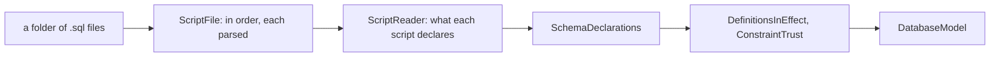
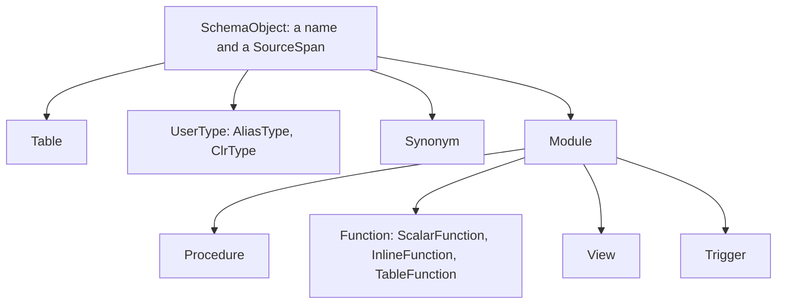

# The inputs and the model

What haruspex reads is a SQL Server database project: a folder of `.sql` scripts, in no particular order, that together
define a schema. Before anything can be inferred, those scripts become a *model*: the schema as data, each table, type, procedure,
function, view, trigger and synonym a value with a name and a place in the source. This chapter is about that step: what is
read, how a script becomes the model, why the model hides the parser it was read with, and the one order everything in it is
kept in. The code is in three projects, each a layer with a chapter of its own in brief:
[Sources](../../src/Haruspex.SqlServer.Sources/README.md) reads the folder,
[Syntax](../../src/Haruspex.SqlServer.Syntax/README.md) reads what the parser parsed into model values, and
[Model](../../src/Haruspex.SqlServer.Model/README.md) is the model.

## What is read

A database project's scripts are written to be deployed, not read in order. An SSDT or `Microsoft.Build.Sql` project keeps
one object to a file, in folders by schema and kind, and the build works out the order to create them in. So the folder is a
set, not a sequence, and haruspex reads it as one: every `*.sql` file under it (or the ones a project file builds, when it is
given them), each decoded as UTF-8 unless a byte order mark says otherwise, since SQL Server Management Studio saves UTF-16.
A script written for sqlcmd is read as the server would receive it, with each `:setvar` variable replaced. Each is parsed
with [ScriptDom](https://www.nuget.org/packages/Microsoft.SqlServer.TransactSql.ScriptDom), Microsoft's own T-SQL parser, and
never with DacFx, whose licence no free tool should have to take on
([decision 0004](../decisions/0004-scriptdom-is-the-only-sql-dependency.md)).

What a script defines is read: `CREATE TABLE` with its columns, keys and CHECK constraints; `CREATE TYPE`; procedures,
functions, views and DML triggers with their parameters and bodies; synonyms; and foreign keys with an `ON DELETE` or
`ON UPDATE` action, since those fire the referencing table's triggers. So is anything that changes a definition later (an
`ALTER` or a `DROP`), and anything that may disable a constraint. Everything else, data and permissions and indexes, is
passed over: it can't change what a table's columns are or what a procedure returns.

## A script becomes the model, in three steps



`SqlScriptFolder.Read` is those three steps and nothing else.

1. **Which scripts, in which order** (`ScriptFile`). The scripts are read in ordinal order of their paths relative to the
   folder, whatever order the file system or the caller lists them in. A folder says no order, so haruspex picks one that
   depends only on the paths: two runs over the same files read them alike, and the first of two definitions of one name is
   the same one each time.
2. **What each script declares** (`ScriptReader`). One reader per script walks its statements in order and adds what each
   defines or changes to `SchemaDeclarations`, the reading's one piece of mutable state. It applies nothing. A statement that
   alters or drops an object is recorded beside the object's definition, not used to replace it.
3. **What is in effect** (`DefinitionsInEffect`, `ConstraintTrust`). Once every script is read, the passes decide what the
   model says of each object.

The second step applies nothing because nothing tells it what to apply. A procedure created in one file and altered in
another has two definitions, and which is in effect on a server depends on the order the scripts ran there, which the folder
doesn't record. Guessing an order would make a claim haruspex can't support, so the model keeps the `CREATE` (for the
procedure's parameters) and records the doubt as a `Redefinition`. Inference then says the procedure's results are unknown,
and why:

```sql haruspex-example
CREATE TABLE shop.product (product_id int NOT NULL PRIMARY KEY, name nvarchar(80) NOT NULL);
GO
CREATE PROCEDURE shop.list_products
AS
SELECT p.product_id, p.name FROM shop.product AS p;
GO
ALTER PROCEDURE shop.list_products
AS
SELECT p.product_id FROM shop.product AS p;
```

```json haruspex-ir unknowns
[
  {
    "object": "shop.list_products",
    "path": "results",
    "reason": "redefined",
    "detail": "shop.list_products is changed by ALTER PROCEDURE at example.sql:7:1, and which definition applies depends on the order the scripts run.",
    "at": "example.sql:7:1"
  }
]
```

The same rule covers a function altered or dropped, a view defined twice, and a table changed by `ALTER TABLE` in a way that
could change a column. An `ALTER TABLE` that can only tighten a table (adding a constraint, checking one, rebuilding) is no
doubt, since ignoring it can only leave a column more nullable than it is (`ScriptReader.OnlyTightens`).

A CHECK constraint and a unique key are only claims while SQL Server trusts them. `ALTER TABLE … NOCHECK CONSTRAINT` and
`ALTER INDEX … DISABLE` stop the server checking rows, and rows written meanwhile stay after a plain re-enable. So
`ConstraintTrust` marks each check or key that such a statement may name, wherever it is (inside a procedure, under `IF`),
since whether it runs isn't knowable; only a `WITH CHECK CHECK CONSTRAINT` later in the same script, which validates every
row, undoes it. The model records where (`CheckConstraint.DisabledAt`), and the schema's rules claim nothing from it.

One setting is read in order within a file: `ANSI_NULLS`. SQL Server keeps the setting in force when a procedure, function
or view is created, and it changes what `= NULL` means in its body, so a `SET ANSI_NULLS OFF` before a definition in the
same script is kept with it (`Procedure.AnsiNullsOff`). Another file's `SET` may run before it too, in an order the folder
doesn't say; that isn't followed, and the default every client library uses, on, is assumed.

## Why the model hides ScriptDom

The parser's syntax tree already holds every declaration, so the model could be the tree with an index over it. Then every
reader of the model would need ScriptDom to know what an object is: a function's kind read from the type of its return clause
at each use, a CLR body found as a statement list that is null, a parameter's type read from its declaration's syntax, each
reader reading the same syntax in its own way.

So the model is its own values, and ScriptDom stays where only syntax can say something: a body's statements, a view's
query, a default or a computed column's expression. A name, a type, a parameter, a function's kind and its options are
records the model defines. `ModelSurfaceTests` holds the line: by reflection over the model's public surface, the only
ScriptDom types it may show are `StatementList`, `SelectStatement`, `ScalarExpression` and `BooleanExpression`. Reading the
syntax into those values is one layer, Syntax (`SyntaxReader`, `ModuleReader`), which Sources reads scripts with and which
inference reads a body's own `CREATE TABLE #t` and `DECLARE @t TABLE` with, so a table declared in a body means what the
same declaration means in the schema.

What is one of several kinds is a *sum type*, the idea functional languages call an algebraic data type: a value is exactly
one of a closed set of cases, each with its own fields. A function is a `ScalarFunction`, an `InlineFunction` or a
`TableFunction`; what a module runs, its `ModuleBody`, is a `SqlBody`, a `ClrBody` or a `NoBody`; a user type is an
`AliasType` or a `ClrType`. C# has no sum types as such, so each is a *closed hierarchy*: an abstract record whose
constructor only its own assembly can call, with a sealed record for each case. A reader matches on the case and gets
exactly its fields; there is no field that is null for every case but one, and no case can be added from outside, so a
`switch` over the cases is known to be complete. The alternative, one record with a kind and a field for each kind's data,
makes every reader check the kind and then trust that the right field is set
([decision 0031](../decisions/0031-the-model-is-closed-hierarchies-of-records.md)).



A synonym is a schema object but not a module: SQL Server keeps a definition for its modules (`sys.sql_modules`), and a
synonym has none, only the name it stands for.

## Where things are

Every object knows where it was read: its `SourceSpan`, the file and where the object starts and ends, captured once, when it
is read. Every location haruspex reports from inside an object (a diagnostic, an `at` in the IR) is a position in its span's
file, so a file name never travels apart from the span it belongs to. A point, such as where a column is declared, is a
`SourceLocation`.

Positions are ScriptDom's: lines and columns from 1, a tab counted as one column, and a line ended by CRLF, LF or a lone
carriage return. The `plots` fixture holds them to that: its scripts have byte order marks, one is UTF-16, and they mix CRLF,
LF and a lone CR, with tabs before objects and objects after `GO` written in each way it can be
([its README](../../tests/fixtures/plots/README.md)). `ModelLocationsTests` keeps the location of every object of every
fixture and both public corpora as a snapshot, so a change that moves one fails there, object by object.

## One order

The model keeps every collection of schema objects in *source order*: by file, in ordinal order of the relative paths, then
by where each object starts (`SourceSpan.InSourceOrder`). `DatabaseModel` sorts them itself, so the order is the model's,
whatever order a reader hands them over in, and the same folder gives the same model however its files are listed
(`ShuffledReadTests`, `DatabaseModelOrderTests`).

Source order rather than name order, because it is the order the objects are in, and it also orders the definitions of one
name, which triggers have. A reader that wants names in order, to list them in a message or a file, sorts for itself: the CLI
lists procedures by name, and when an unqualified name could mean either of two objects, the message names them by name
(`ExecTests`, `TableFunctionTests`).

## What it deliberately doesn't do

- **No order of scripts.** Nothing in a folder says which script runs first, so no change after a definition is applied.
  That is the price of reading a project as it is kept rather than a deployment as it ran.
- **No running anything.** A change made by code that would have to run, such as `EXEC sp_rename` or dynamic SQL, isn't
  seen. A database project defines its objects declaratively; such scripts belong in deployment.
- **One database.** `USE` isn't followed, and every object the scripts define is read into one model.
- **No `:r`.** A sqlcmd include isn't followed, so a script that uses one fails to parse rather than being read as a different
  script from the one that runs.

## Reading further

- Yaron Minsky's talk "Effective ML", and his post "Effective ML Revisited" on the Jane Street blog (2011): the source of the
  maxim "make illegal states unrepresentable", which is the argument for sum types over a kind and nullable fields.
- Benjamin C. Pierce, *Types and Programming Languages* (MIT Press, 2002), chapter 11, on sums and variants.
- Microsoft's documentation of `sys.sql_modules`, for which objects SQL Server keeps a definition of.
