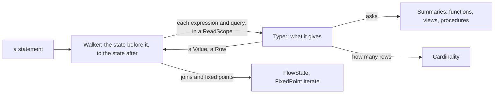

# Abstract interpretation (the typer and the walker)

Each procedure is run the way SQL Server would run it, but over descriptions of values instead of values: "an `int` that is
never null" in place of `3`. That is *abstract interpretation*, and this chapter says what it is, what makes its answers
sound, and how haruspex divides the work between two parts: the **typer**, which says what an expression or a query gives,
and the **walker**, which carries the state of a body from statement to statement.

## The idea: running a program over descriptions

A program's **concrete semantics** says what it does with real values: from this state, this statement leads to that
state. Asking it every question is running the program, once for every input, which is impossible. **Abstract
interpretation** (Cousot and Cousot, 1977) runs it instead over an **abstract domain**: a set of descriptions, each of which
stands for a set of concrete values, ordered by how much they allow. An `int` that is never null stands for every `int`;
an `int` that may be null stands for those and `NULL` too, so it is above the first in the order. Two maps tie the worlds
together. *Abstraction* (α) takes a set of concrete values to the most precise description of them; *concretisation* (γ)
takes a description back to every value it allows. The two agree: a set of values lies within what a description allows
exactly when the set's abstraction is below that description; a pair of maps with that property is a **Galois
connection**, and it is what lets an argument about descriptions be read as one about values.

Each construct of the language gets an **abstract transfer function**: the description of its result, from the
descriptions of its inputs. Addition of two never-null `int`s gives an `int` that may be null, since an overflow is `NULL`
under some session options; `ISNULL` of anything with a never-null second argument gives a never-null result. Where paths
meet, the descriptions are **joined**: the least description above both ([Values as a lattice](05-values-as-a-lattice.md)
gives the order and the joins). Where a program describes itself (a loop, recursion), the description is the **least fixed
point** of its transfer function ([Flow, joins and fixed points](06-flow-joins-and-fixed-points.md)), found by applying the
step until the description stops changing. Some descriptions can climb for ever (an array of arrays of arrays), so the
iteration must also be made to stop: a **widening** replaces a description that may go on climbing with one above it, where
the climb stops. The coarsest in haruspex is a cap on the passes (`FixedPoint.MostPasses`): a fixed point not reached by then is
unknown, the top, which allows every value and so is sound, and the analysis always ends.

**Soundness** is one property of each transfer function: whatever concrete values its inputs hold, the concrete result is
among those its output allows. If every transfer function and every join is sound, so is the whole analysis, by induction
over the program, and through the fixed points, since iterating a sound step from a sound start stays sound (the argument
is the 1977 paper's). That is why
haruspex can argue for a claim one rule at a time, and why each rule is observed on a real server
([decision 0007](../decisions/0007-every-engine-rule-is-observed.md)): a rule observed is a transfer function shown sound
on its cases.

**Unknown** is the top of every domain: the description that allows every value. A transfer function that doesn't model a
construct gives it, and it is always sound, because it claims nothing. Every unknown says why
([decision 0002](../decisions/0002-unknown-with-a-reason-never-a-guess.md)), so a reader can tell "may be anything" from
"haruspex can't say yet".

## Two semantics: expressions and statements

The textbooks give a language two kinds of semantics. An **expression** is given a *compositional* meaning: its value in a
state is a function of its parts' values in that state, and of nothing else, so the meaning of `a + b` is built from the
meanings of `a` and `b`. A **statement** is given a *state transformer*: the state after it, from the state before. Nielson
and Nielson's *Semantics with Applications* sets them out this way, an arithmetic expression's meaning as a function of a
state and a statement's as a change of state, and *Principles of Program Analysis* (Nielson, Nielson and Hankin) builds its
analyses the same way.

The abstract versions keep the split. The expression semantics stays compositional: the description of an expression is a
function of the expression and the descriptions it reads. The statement semantics is **flow-sensitive**: it keeps a
description of the whole state at each point of the body, and its transfer functions change that state, join it where
paths meet and iterate it where they loop. It is a **dataflow analysis** in the compiler's sense.

Each semantics is a part of haruspex of its own:

| | The typer (`Typer`) | The walker (`Walker`) |
|---|---|---|
| Gives | what an expression gives (`Value`), what a query returns (columns, keys, how many rows) | the state at each point (`FlowState`), and each statement's `Outcome` |
| Reads | the expression, its `ReadScope`, and what it was built with | the statement and the state before it |
| Semantics | compositional | flow-sensitive |
| Holds | readonly fields only: the model, the binder, the `Summaries`, a function's argument values, `ANSI_NULLS`, whether the body is read uncommitted | the state of one walk: what it found so far, and its fixed points |



**The typer's context is one argument.** Everything an expression's value depends on besides the expression itself is a
`ReadScope`: the state the statement starts from, what each source of the query holds, what the conditions around it prove
(`Facts`), and the construct it is read inside: a query's select list (`ReadScope.Selecting`), a branch
(`ReadScope.Branching`), an aggregate's arguments (`ReadScope.InAggregate`), `json_query`'s argument, a write's `OUTPUT`
(`OutputReading`) or a cursor's row. A scope is immutable: entering a subquery or a branch gives a new one, and leaving it
leaves the old one as it was. So `Typer.Expression` is a function in the mathematician's sense: read one expression twice
in one scope and it gives one value.

**The walker owns the flow.** It walks a body from `Walker.Walk`, carrying a `FlowState`; each statement gives an `Outcome`
(where control goes next, and what reaches a `BREAK` or a `CONTINUE`); paths meet in `FlowState.Join`; loops and recursion
settle in `FixedPoint.Iterate`. It asks the typer for each expression and query a statement reads, with the scope of the
state before the statement, and applies the answer: an assignment sets a variable, a `SELECT` appends a result set, an
`INSERT` joins what it writes into a temporary table's columns. Writes, cursors and calls are statements, so they are the
walker's (`Walker.Writes.cs`, `Walker.Calls.cs`); what an `OUTPUT` knows of its write is passed to the typer as an argument.

**Collaborators take their inputs as arguments.** How many rows a query returns is `Cardinality`'s to say, asked with the
query's scope and whether the statement reads uncommitted. What a function returns, what a view holds and what a called
procedure does are summaries ([Summaries and recursion](07-summaries-and-recursion.md)), all reached through one root,
`Summaries`, which `IrInference` builds and hands to each body it reads; no summary holds another.

## An example

```sql haruspex-example
CREATE TABLE shop.product
(
    product_id int          NOT NULL PRIMARY KEY,
    name       nvarchar(40) NOT NULL,
    price      decimal(9,2) NULL
);
GO
CREATE PROCEDURE shop.sale_price @product_id int, @member bit
AS
DECLARE @rate decimal(3,2) = 1.00;
IF @member = 1
    SET @rate = 0.90;
SELECT p.name,
       p.price * @rate AS listed,
       CASE WHEN p.price IS NULL THEN 0 ELSE p.price * @rate END AS charged
FROM shop.product AS p
WHERE p.product_id = @product_id;
```

```ts haruspex-zod
export const SalePriceRowSchema = z.object({
  name: z.string().max(40),
  listed: z.number().min(-999999999.9999).max(999999999.9999).multipleOf(1e-4).nullable(),
  charged: z.number().min(-999999999.9999).max(999999999.9999).multipleOf(1e-4),
})
export type SalePriceRow = z.infer<typeof SalePriceRowSchema>

/** shop.sale_price: returns rows. */
export const SalePriceSchema = z.array(SalePriceRowSchema).max(1)
export type SalePrice = z.infer<typeof SalePriceSchema>
```

The walker does the statements:

1. `DECLARE @rate decimal(3,2) = 1.00`: the typer reads the literal, the walker converts it to the variable's type and
   stores it. The state now holds `@rate` as a `decimal(3,2)` that is never null.
2. `IF @member = 1`: two paths. On one, `SET @rate = 0.90` stores another never-null `decimal(3,2)`; on the other, nothing
   changes. Where they meet, `FlowState.Join` joins the two states variable by variable: `@rate` is still never null, since
   it is on both.
3. `SELECT`: the walker asks the typer for the query's row, in the scope of the state after the `IF`, and appends it as the
   first result set.

The typer does the query, each expression from its parts:

- `p.name` reads a `NOT NULL` column: never null, at most 40 characters.
- `p.price * @rate` is the product of a `decimal(9,2)` that may be null and a `decimal(3,2)` that is never null. SQL
  Server's rule for multiplying decimals gives `decimal(13,4)`, which this product can't overflow, so the result may be null
  only because `price` may: hence `listed`'s range, its four places and `.nullable()`.
- The `CASE` reads its `ELSE` branch in a scope whose facts say that `p.price IS NULL` was not TRUE
  (`ReadScope.Branching`), so there `p.price` is proved non-null and the same product is never null. The `THEN` branch is a
  literal. Neither branch is null, so `charged` is never null. The product is the same expression in both columns; its two
  values differ only because the two scopes do.
- How many rows: `WHERE` compares the table's primary key with `=` to a parameter, so at most one row (`Cardinality`):
  hence `.max(1)`.

## Why the typer holds no state

The walker's fixed points compare states: a loop has settled when a pass gives back the state it started from. That test
is only right if each pass computes its state from the state before it and the program, and from nothing else. If the
typer kept something between reads (a list of facts pushed before a read and popped after, a flag set around an `OUTPUT`),
a value would depend on what happened to be set when it was read, and two passes from equal states could disagree. The
argument for soundness (each transfer function sound, so the whole) would then need a premise nobody could check: that
every field was set and reset at the right moments on every path.

So the typer holds readonly fields only, all fixed when it is built, and reads none of the walker's state. An architecture
test reads both from their compiled code (`TyperAndWalkerTests`): every field of `Typer` and `Cardinality` is readonly; none
holds a walker; none holds what can change, since a readonly list can still be added to, unless it is listed with why it is
no state of a read (the memo tables of `Binder` and `Summaries`, whose answer to a question never depends on the questions
before it, and the model); and no method of theirs, lambdas and nested types included, uses a field, property, method or
constructor of `Walker` or a type nested in it. Types planted to break each rule show the test sees each break.

## Alternatives

- **One type for both semantics**, with the expression's context in fields the statement walk sets before a read and
  resets after. It is the obvious way to start, and it works while there are a few such fields; with more, each may be
  right and still the typer's results can't be stated as a function of anything a reader can see.
- **A visitor per construct**, the typer split into many classes. A compositional semantics is one function defined by
  cases over the syntax; its cases call each other (a subquery inside a `CASE` inside an aggregate), and splitting them into
  types with references between them would bring back the shared state the split removes. The typer is one type in several
  files, one family of constructs to each.
- **Typing every expression in a pass before the walk.** An expression's value depends on the state at its statement: a
  variable's value, a temporary table's columns on that path. A pass before the walk would need the walk's states, so it
  would be the walk.
- **A relational domain**, describing variables together ("`@a` is null exactly when `@b` is"), as octagons or polyhedra
  do for numbers. The claims are about each column on its own, and conditions are kept as facts while their scope
  lasts, which recovers the relations a claim needs. A relational domain costs more at every join.
- **Path-sensitive analysis**, keeping each path's state apart. [Flow, joins and fixed points](06-flow-joins-and-fixed-points.md),
  "Where paths meet", gives why joins win here.

## What it deliberately doesn't do

- **No relation between variables.** After a join, haruspex knows each variable's description, not how they depend on each
  other. A claim that needs one is not made; it says less, never something wrong.
- **No values, only descriptions of them.** The analysis never computes `@rate * 100` as `90`; it computes "a `decimal` that is
  never null". A value set (a closed set of literals) is the nearest it comes, and only where a construct gives one.

## In the code

- `Typer` (`Typer.cs` and its parts): the expression and query semantics; `Typer.Expression`, `Typer.ReadView`,
  `Typer.ReadInline`, `Typer.Return`.
- `ReadScope`: the typer's whole context, immutable; `OutputReading` for a write's `OUTPUT`.
- `Walker` (`Walker.cs` and its parts): the statement semantics; `Walker.Walk`, `FlowState`, `Outcome`.
- `Cardinality`: how many rows a query returns.
- `Summaries`: the root of the summaries every body reads through.
- `TyperAndWalkerTests`: the architecture test that the typer holds no state and reads none of the walker's.
- [Decision 0035](../decisions/0035-the-typer-apart-from-the-walker.md): why the typer and the walker are apart.

## Reading further

- Patrick Cousot and Radhia Cousot, "Abstract interpretation: a unified lattice model for static analysis of programs by
  construction or approximation of fixpoints" (POPL 1977): abstract domains, the maps between values and descriptions, and soundness
  through fixed points.
- Flemming Nielson, Hanne Riis Nielson and Chris Hankin, *Principles of Program Analysis* (Springer, 1999), chapter 4:
  abstract interpretation; chapter 2: dataflow analysis.
- Hanne Riis Nielson and Flemming Nielson, *Semantics with Applications* (Springer, 2007): expressions given
  a compositional meaning in a state, statements a change of state.
- Anders Møller and Michael I. Schwartzbach, *Static Program Analysis*, chapters 4 to 6: lattices, dataflow analysis and
  widening.
