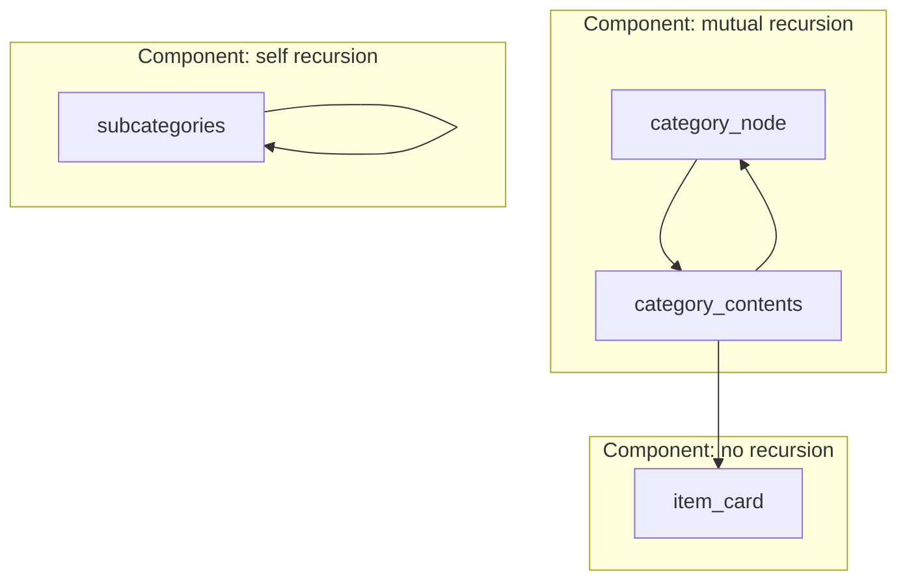

# Summaries and recursion

A procedure's results depend on code written elsewhere: the views it reads, the functions it calls, the triggers its writes
fire, the procedures it runs with `EXEC`. This chapter is about how haruspex analyses that code once and uses what it found
at each call, how it handles code that calls itself, and how it keeps track of result sets that several procedures
contribute to.

## The idea: analyse a callee once, use it many times

An analysis that meets a call has two broad choices.

- **Inline the callee**: analyse its body again at every call, with what is known at that call. This is precise, since
  each call sees its own arguments, but it costs a fresh analysis per call, and it never ends on a function that calls
  itself.
- **Summarise the callee**: analyse its body once, producing a *summary* (what it returns, for any call), and use the
  summary at every call. This is cheap and handles recursion, but a summary that must hold for every call can't use what
  one call knows.

The literature calls this **interprocedural analysis**. A summary that ignores the caller is *context-insensitive*; one
computed per kind of caller, and reused for each caller of that kind, is *context-sensitive*. Sharir and Pnueli's
"functional approach" (1981) makes summaries the unit of the analysis: a summary is a function from what is known at the
call to what is known after it, computed once per input that occurs.

The choice is made per kind of callee, by asking what a call can pass in that changes the answer.

| Callee | Summarised | Keyed by | Why |
|---|---|---|---|
| View | once per document | the view, and whether it is read uncommitted | A view takes no arguments. Read uncommitted withdraws its keys' claims, so it is a second reading. |
| Table-valued function | once per set of arguments | the function, the shape of each argument, and read uncommitted | An inline function is a view with parameters; what an argument is known to be (never null, a set of values) flows into its rows. |
| Scalar function | once per document | the function, and read uncommitted | Its result must hold for every call, so each parameter is assumed nullable (unless `RETURNS NULL ON NULL INPUT` says the body never sees a null). |
| Trigger | not as a shape | the write that fires it | Only whether it may return a result set matters: one that may makes the procedure's results unknown. |
| Procedure | once per call context | the callee, the caller's temporary tables at the call, and flags such as read uncommitted | A callee reads and writes its caller's temporary tables, so the same procedure called from two places can return different shapes. |

The last row is the expensive one, and the cache makes it affordable: a callee walked from the same temporary tables with
the same flags gives the same outcome, so it is walked once per distinct context.

Two choices here were weighed against the obvious alternative:

- **Scalar functions are not specialised to their arguments.** Specialising would type a call with a non-null argument more
  tightly, but scalar functions that build JSON call themselves to build trees, and a summary per argument shape would
  have to be solved as a fixed point per shape. One summary per function, assuming the worst of its parameters, is sound,
  and loses precision only where a caller knows more about an argument than its declared type says.
- **Procedures are not summarised once.** A single summary would have to assume nothing about the caller's temporary
  tables, which is where many procedures read their input; most such callees would be unknown. Walking per context keeps
  them typed.

## Recursion

A summary needs the summaries of everything its body calls. When the calls form a cycle (a function that calls itself, or
two that call each other) there is no order in which every summary can be computed before it is needed. The way out has
two parts: find the cycles, and solve each cycle as a whole.

### Finding the cycles: strongly connected components

Draw the **call graph**: one node per function, an edge from caller to callee. A **strongly connected component** (SCC) is
a largest set of nodes each reachable from every other: one function that calls itself, or a group that call each other.
Collapsing each component to a single node leaves a graph with no cycles, so the components can be solved in an order where
every callee comes first.

In this graph, `category_node` and `category_contents` call each other, `subcategories` calls itself, and `item_card`
calls neither:



`FunctionSummaries` finds the components with **Tarjan's algorithm** (1972), which does it in one depth-first walk of the
graph, in time linear in its size. It gives each node the lowest index reachable from it through nodes still on the walk's
stack; a node whose lowest index is its own closes a component, which is everything above it on the stack. It completes
components callees first, which is an order they can be solved in. `FunctionSummaries` doesn't loop over them in that
order, though: it solves a component when one of its functions is first called (`FunctionSummaries.Return`), and reading
that component's bodies calls into the components below it, which are solved first by the same rule. The order is the
same, reached on demand, so a function no procedure calls is never read. A component of one function that doesn't call
itself is not recursive, and is read once.

### Shapes, ordered

A summary is a description of values, not a value: "an `int32`, never null", "an array of these objects, or absent". The
guide calls such a description an **abstract value**, and the idea of computing with them **abstract interpretation**
(chapters 4 and 5, planned, cover both properly). Four ideas about them are enough for this chapter.

- **Descriptions are ordered by how much they allow.** "`int32`, never null" allows less than "`int32`, may be null", which
  allows less than "unknown". Allowing less is being more precise; it is never less sound, as long as every real value is
  still allowed.
- **The join** of two descriptions is the most precise description that allows everything either allows. Where two paths
  meet, or two calls may return, the join is what holds of both: the join of "never null" and "may be null" is "may be
  null".
- **Bottom and top.** At the bottom is "never returns" (`NeverShape`), which allows no value at all. At the top is
  "unknown", which allows anything. An ordered set like this, where any two elements have a join, is a **lattice**.
- **A step is monotone** when reading a body with an assumption that allows more never gives a result that allows less. A
  nullable argument may make a result nullable; it must never make it non-null.

### Solving recursion: the least fixed point

### Solving recursion: the least fixed point

A recursive component is solved by iteration. Start by assuming each function in it *never returns*: the bottom.
Read every body in the component, with each call into the component giving what is assumed so far. That gives a new
assumption. Repeat until a step changes nothing.

This is **Kleene iteration** to the **least fixed point**. A fixed point is a summary that, assumed at every call, gives
itself back when the bodies are read. When each step is monotone, starting from the bottom makes each assumption allow at
least as much as the one before, and the first one that repeats is the *least* fixed point. That is what makes it sound:
after k steps, the assumption describes every call that returns after at most k levels of nesting, and any call that
returns does so after finitely many levels, so the fixed point describes every call that returns.

Least does not mean exact. The least fixed point is the most precise of the sound summaries the shapes can express, and it
is still an over-approximation, as everything in chapter 1 is: in the example below, `id` is any `int32`, and nothing ties a
child's `id` to its parent's. Starting from the top ("unknown") instead would also reach a fixed point, a sound one, but it
would say nothing.

The argument needs each step to be monotone. `FunctionSummaries.Solve` replaces each assumption with the next reading
rather than joining the two, which comes to the same thing only when reading is monotone. The rules are written to be
(a nullable argument never makes a result non-null), but no test checks that yet; property tests of the lattice's laws
belong with chapter 5.

Here a function builds a tree of categories by calling itself for each child, and a procedure returns the roots:

```sql haruspex-example
CREATE TABLE shop.category
(
    category_id int          NOT NULL PRIMARY KEY,
    parent_id   int          NULL REFERENCES shop.category (category_id),
    name        nvarchar(40) NOT NULL
);
GO
CREATE FUNCTION shop.subcategories(@parent_id int)
RETURNS nvarchar(max)
AS
BEGIN
    RETURN (
        SELECT c.category_id AS id,
               c.name,
               json_query(shop.subcategories(c.category_id)) AS children
        FROM shop.category AS c
        WHERE c.parent_id = @parent_id
        ORDER BY c.category_id
        FOR JSON PATH);
END
GO
CREATE PROCEDURE shop.category_tree
AS
SELECT c.category_id AS id,
       c.name,
       json_query(shop.subcategories(c.category_id)) AS children
FROM shop.category AS c
WHERE c.parent_id IS NULL
ORDER BY c.category_id
FOR JSON PATH;
```

```ts haruspex-zod
export const SubcategoriesNodeSchema = z.object({
  id: z.int32(),
  name: z.string().max(40),
  get children() { return z.array(SubcategoriesNodeSchema).min(1).optional() },
})
export type SubcategoriesNode = z.infer<typeof SubcategoriesNodeSchema>

export const CategoryTreeRowSchema = z.object({
  id: z.int32(),
  name: z.string().max(40),
  children: z.array(SubcategoriesNodeSchema).min(1).optional(),
})
export type CategoryTreeRow = z.infer<typeof CategoryTreeRowSchema>

/** shop.category_tree: returns JSON, [] when no rows match. */
export const CategoryTreeSchema = z.array(CategoryTreeRowSchema)
export type CategoryTree = z.infer<typeof CategoryTreeSchema>
```

The steps, for `subcategories`:

1. **Assume** it never returns, and read the body. The `FOR JSON` query gives an array of objects with `id` and `name`,
   and a `children` key whose value comes from the inner call, of which nothing is known yet.
2. **Read again**, the inner call now giving a reference to that object. `children` is an array of the same objects, and
   may be absent: a category with no children gets NULL from `FOR JSON` over no rows, and the null key is left out.
3. **Read again**: nothing changes. The fixed point is reached, and the object becomes a named, recursive type,
   `SubcategoriesNode`, which Zod writes with a getter so that the type can refer to itself.

### Why it ends

Shapes can grow for ever: an array of arrays of arrays, a tuple holding a tuple. A lattice with ascending chains that never
end needs **widening**: an operator that, when an iteration may climb without end, jumps to an upper bound at which it can
stop and still be sound. The bound on steps is haruspex's widening, in its coarsest form. `FunctionSummaries` stops after
`FunctionSummaries.StepsPerFunction` steps per function in the component, plus `FunctionSummaries.ExtraSteps`, and a
component that hasn't settled by then jumps to the top: unknown (`unresolved-recursion`), which claims nothing and so is
always sound. A finer widening would keep more of what was found; this one keeps nothing, and is simple to trust.

That bound is what guarantees the iteration ends. Two things make the common cases settle well inside it:

- **The recursive node is named.** A call into the component gives a *reference* to the function's object
  (`RecursiveShape`), not the object itself. Without that, each step would nest the tree one level deeper. With it, every
  step's shape is finite, and after the first step that finds an object, its structure is fixed.
- **What can still change is small.** Once the structure is fixed, what is left to change is the reasons a value may be
  null, which a monotone step only adds to, and of which there are finitely many (each is a rule at a place in the source).

So a component of n functions settles in a few steps per function. Shapes that are not named (a tuple, a record) don't
settle, and reach the bound.

Two outcomes of a settled iteration are still refused:

- A function whose every return calls itself again never returns a value, and is unknown.
- A node that no finite value can have (each cycle through it passes through keys that are always present and never null)
  describes no tree that ends. SQL Server stops such a call at 32 levels with error 217 (observed), which is an error, not
  a value, so the component is withdrawn rather than typed with a type nothing can inhabit.

The 32-level limit also explains why the type has no depth: the limit ends the call in an error, which the IR doesn't
describe, rather than bounding what a successful call returns.

### Procedures that call themselves

Procedures are solved by the same iteration, in `ProcedureCalls`, but their cycles are found another way. A procedure is
walked once per call context, not summarised once, so there is no single summary per procedure to put in order ahead of
time, and no call graph is built. A cycle shows up instead on the stack of walks: a call of a procedure already being
walked (`ProcedureCalls.Follow`) marks that walk as recursive, and every walk above it as resting on an assumption, so that
none of them is cached.

The recursive call is not walked again. At first it is assumed to return nothing (the path through the call ends), then to
return what the last walk returned, until a walk returns what was assumed. One thing is harder than for functions: a
procedure may write a temporary table before calling itself, so the recursive call may start from wider tables than the
outer one. The walk starts from the join of both, and starts again whenever a call widens them. With monotone steps each
walk returns at least what the last did, so this too reaches the least fixed point; the bound, `ProcedureCalls.MostPasses`
walks, is again what makes it end. A procedure that returns more result sets at each depth never settles, and is
unknown.

The rejected alternatives are in [decision 0012](../decisions/0012-recursion-is-solved-as-a-fixed-point.md): reporting
recursion as unknown would leave every tree untyped, and unrolling k levels gives a type that is wrong at level k + 1.

## Result sets are positions: `ResultTrack`

A procedure can return several result sets, from its own statements and from the procedures it calls. A client receives
them in order, and one that a path doesn't run is not there at all: the next one takes its place (observed:
`A_branch_not_taken_returns_no_result_set_at_all_so_later_ones_move_up`). So "the second result" means "whatever arrives
second", which may come from different statements on different paths.

`ResultTrack` is the abstract value that tracks this. It holds two things:

- for each position, every result some path returns there;
- the set of counts: how many result sets the paths reaching this point have returned so far.

A `SELECT` that returns a result lands at every position in the set of counts, and adds one to each count
(`ResultTrack.Append`). Where two paths meet, the tracks join: positions merge their results, and the counts are the union
(`ResultTrack.Join`). A call places the callee's track at every count the caller is at (`ResultTrack.Then`), which is how
a callee's result sets arrive in the caller's stream where it is called (observed:
`A_callees_result_sets_arrive_in_the_callers_stream_where_it_is_called`).

```sql haruspex-example
CREATE TABLE shop.product
(
    product_id int          NOT NULL PRIMARY KEY,
    name       nvarchar(80) NOT NULL
);
GO
CREATE TABLE shop.review
(
    review_id  int     NOT NULL PRIMARY KEY,
    product_id int     NOT NULL REFERENCES shop.product (product_id),
    rating     tinyint NOT NULL CHECK (rating BETWEEN 1 AND 5)
);
GO
CREATE PROCEDURE shop.product_header @product_id int
AS
SELECT p.product_id, p.name FROM shop.product AS p WHERE p.product_id = @product_id;
GO
CREATE PROCEDURE shop.product_page @product_id int, @with_reviews bit
AS
EXEC shop.product_header @product_id;
IF @with_reviews = 1
    SELECT r.review_id, r.rating FROM shop.review AS r WHERE r.product_id = @product_id;
```

The track through `product_page`:

| After | Counts | Position 0 | Position 1 |
|---|---|---|---|
| the start | {0} | | |
| `EXEC shop.product_header` | {1} | the header's rows | |
| the `IF`'s branch | {2} | the header's rows | the reviews |
| the `IF`, joined with the path that skips it | {1, 2} | the header's rows | the reviews |

At the end, one path returned one result set and the other two. So position 1 may be missing, and the IR says why
(`not-run`, at the `SELECT`); the generated code reads a missing rowset as an empty array:

```ts haruspex-zod
export const ProductHeaderRowSchema = z.object({
  product_id: z.int32(),
  name: z.string().max(80),
})
export type ProductHeaderRow = z.infer<typeof ProductHeaderRowSchema>

/** shop.product_header: returns rows. */
export const ProductHeaderSchema = z.array(ProductHeaderRowSchema).max(1)
export type ProductHeader = z.infer<typeof ProductHeaderSchema>

export const ProductPageResult1RowSchema = z.object({
  product_id: z.int32(),
  name: z.string().max(80),
})
export type ProductPageResult1Row = z.infer<typeof ProductPageResult1RowSchema>

export const ProductPageResult2RowSchema = z.object({
  review_id: z.int32(),
  rating: z.int().min(1).max(5),
})
export type ProductPageResult2Row = z.infer<typeof ProductPageResult2RowSchema>

/** shop.product_page: returns 2 result sets: rows; rows, [] when it does not run. */
export const ProductPageSchema = z.tuple([z.array(ProductPageResult1RowSchema).max(1), z.array(ProductPageResult2RowSchema)])
export type ProductPage = z.infer<typeof ProductPageSchema>
```

The header's `.max(1)` comes from the filter on the primary key, through the call: a callee's claims arrive with its
results.

Why a set of counts, rather than something simpler:

- **One shape per `SELECT` statement**, as a reading of the text would give, is wrong as soon as a branch is skipped: the
  statement's result arrives at a different position on different paths.
- **Enumerating paths** would be exact, but a procedure with n independent `IF`s has 2ⁿ of them.
- **A set of counts** is the abstraction that keeps what decides positions and nothing else, so it stays small however
  many paths there are. It is exact for the common shapes: a fixed sequence, and trailing results that may not run. Where
  a rowset and JSON meet at one position, or a loop returns results so that their number isn't known, the results are
  unknown (`varying-results`), with the reason.

When an error cuts a call short, a client has received some prefix of the result sets: `ResultTrack.Prefixes` gives every
such prefix, which is what a `CATCH` block starts from.

## Read more

- Anders Møller and Michael I. Schwartzbach, *Static Program Analysis*, the chapters on lattices and fixed points, on
  widening, and on interprocedural analysis (free at <https://cs.au.dk/~amoeller/spa/>).
- Flemming Nielson, Hanne Riis Nielson and Chris Hankin, *Principles of Program Analysis*, chapter 2, section 2.5, on
  interprocedural analysis and the functional approach.
- Robert Tarjan, "Depth-first search and linear graph algorithms", *SIAM Journal on Computing*, 1972: the algorithm.
- Micha Sharir and Amir Pnueli, "Two approaches to interprocedural data flow analysis", in *Program Flow Analysis: Theory
  and Applications*, Prentice Hall, 1981: summaries as functions, and call strings.

## In the code

- `FunctionSummaries`: scalar functions' summaries; Tarjan's algorithm in `FunctionSummaries.FindComponents`, and the
  iteration in `FunctionSummaries.Solve`.
- `ViewSummaries`: views, read once per way of reading them (`ViewSummaries.Read`), and table-valued functions, read once
  per set of arguments (`ViewSummaries.Function`).
- `DmlTriggers`: whether the triggers a write fires may return result sets, followed through cascades and other triggers.
- `ProcedureCalls`: following `EXEC`, the cache of walks, and the fixed point for procedures that call themselves.
- `ResultTrack`: result sets as positions; `CallContext`: what a callee is walked from.
- The rules each relies on are in [the Inference README](../../src/Haruspex.SqlServer.Inference/README.md), "Calls",
  "Triggers", "Views" and "Table-valued functions", each with the test that observed it.
