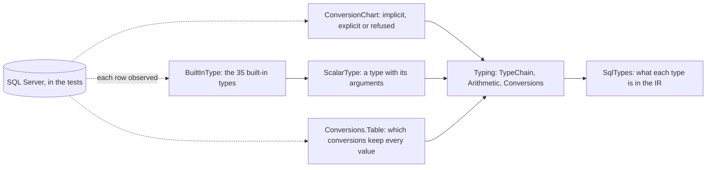

# The SQL Server type system, as data

Every rule haruspex applies to a value starts from its type: what `COALESCE` of an `int` and a `money` is, whether a
`decimal(5,2)` fits in a `decimal(4,2)`, how long the text of a `bigint` can be. SQL Server's types and the rules over them
are a fixed, finite table that Microsoft publishes and the server obeys. So haruspex holds them as a table too: one catalogue
of built-in types, one conversion chart and one table of conversions that keep every value, each row checked against a real
server. This chapter is about that table, why it is data rather than code, and how a row of it is observed.

## A type system is a table

A compiler for a language with a few dozen primitive types, and the rules for mixing them, has two ways to write those
rules. It can write each as code (a `switch` over the left type, then the right), or it can write the facts as rows and one
small interpreter over them. Databases have long done the second: PostgreSQL keeps its types in the system catalogue
`pg_type`, with a category and a preferred type for each, and its casts in `pg_cast`, a row per pair saying whether the cast
is implicit, allowed in assignment, or explicit only (see the PostgreSQL manual, "System Catalogs", `pg_type` and
`pg_cast`). The planner reads the rows. Adding a type is adding rows.

SQL Server publishes its own as documentation rather than as a queryable table: "Data type precedence (Transact-SQL)", the
pages for each type with its range and storage, and the conversion chart in "Data type conversion (Database Engine)". The
server's behaviour is the authority, and the pages are mostly, but not entirely, right about it. The catalogue takes the
PostgreSQL shape and fills it from the server: the facts are rows, the rules read the rows, and a test reads every row back
from SQL Server.



## The catalogue of built-in types

`BuiltInType` is the catalogue. Each of SQL Server's built-in types, from `bit` to `hierarchyid`, is one static instance,
and `BuiltInType.All` lists them. It is a sealed class with a private constructor, so the set is closed: nothing outside
can make a 36th. Each row says:

| Attribute | For example | Where it comes from |
|---|---|---|
| `BuiltInType.Family` | `int` is an integer, `money` money, `datetime2` a date and time | groups the types the rules treat alike |
| `BuiltInType.Precedence` | `datetimeoffset` 4, `int` 16, `binary` 30 | its place in Microsoft's list, from 1, the highest |
| `BuiltInType.Arguments` | a length, a precision and scale, fractional seconds | what `varchar(10)` or `decimal(19,2)` give it |
| `BuiltInType.Digits` | `int` (10, 0), `money` (19, 4) | the digits of a type whose digits are fixed |
| `BuiltInType.Least`, `BuiltInType.Greatest` | `tinyint` 0 to 255 | the range of an exact type of fixed digits |
| `BuiltInType.FractionalSeconds` | `datetime` 3, `smalldatetime` 0 | a date or time type that takes no argument for them |
| `BuiltInType.LongestText` | `int` 11, `uniqueidentifier` 36 | the characters of its longest value written as text |

and the defaults a declaration and a conversion apply: `decimal` alone is `decimal(18,0)`, `char` alone is `char(1)` in a
declaration but `char(30)` in a `CAST`, `datetime2` alone has 7 fractional digits. An argument can also pick the type:
`float(n)` of 24 bits or fewer is `real` (observed: `A_float_of_24_bits_or_fewer_is_real_and_of_25_to_53_is_float`). An
argument a type doesn't take gives no type at all, so it is unknown rather than read as something else.

A type with its arguments is a `ScalarType`: `decimal(19,2)` is `BuiltInType.Decimal` with precision 19 and scale 2. It is
what Semantics reads a column's facts from (`SchemaRules.TypeFacts`) and what Inference's rules compute with, so both layers
read one copy. `BuiltInType.Named` is the only place a type's name is compared as a string; everything else compares
catalogue entries.

A value carries its `ScalarType` beside what the IR says of it (`ScalarShape.BuiltIn`), and the rules read that. The IR's
`sql` is the type as the source wrote it, for people (`decimal`, where the server describes `decimal(18,0)`), so it is never
read back, except where a scalar comes in from the IR itself, a declared result's (`ScalarShape.FromIr`). Two values are of
one type when their `ScalarType` records are equal (`ScalarShape.SameType`), whatever text they were declared with.

**Every type, modelled or not.** The catalogue lists the types haruspex doesn't type a value of (`xml`, `sql_variant`, the
binary types), because what isn't modelled should be listed rather than found by accident. Which ones Inference models is its
own table, `SqlTypes`, keyed by the catalogue: what each is in the IR. A type outside that table reaches the IR as unknown,
with the reason `unsupported-sql-type`.

### Families

A family is a set of types one rule treats alike: `TypeFamily.Integer` for `tinyint` to `bigint`, `TypeFamily.Decimal` for
`decimal` and `numeric`, `TypeFamily.Money`, `TypeFamily.String` for the four character types. It is finer than Microsoft's
categories, which put `bit`, the integers, the decimals and money together as "exact numerics", because the server doesn't
treat them alike: `bit` beside a number takes that number's type, an integer beside `money` becomes `money` whatever its
range, and only a decimal's digits grow under arithmetic. A family is a grouping for rules, so it is observed through the
rules that read it, in their own observation tests.

### Data type precedence

When two values of different types meet (both sides of an `=`, the arguments of `COALESCE`, the branches of `CASE`, the
queries of a `UNION`), SQL Server converts the one of lower precedence to the other's type. Microsoft lists the order, and
`BuiltInType.Precedence` is a type's place in it. `BuiltInType.RanksAtLeast` compares two, and the server's type rule for a
chain of values (`TypeChain.Of`, in [Values as a lattice](05-values-as-a-lattice.md), "Why the server's rule is not a join")
reads it.

The list is observed rather than trusted: `Of_two_types_that_convert_coalesce_gives_the_one_of_higher_precedence` asks the
server for the type of `COALESCE` over every ordered pair of the 30 ranked types, and every pair the server accepts gives the
higher one. Two of a length are the exception the rule already models: `nchar` with `varchar` is `nvarchar`, national if
either is and varying if either is. Microsoft's list leaves out `json`, `vector` and the .NET system types, and so does the
catalogue: it claims no precedence for them, and a rule that would need one says unknown.

### Ranges and digits

An exact type's range is a claim haruspex passes on: a `tinyint` column is a number from 0 to 255, and the generated schema
says so. `An_exact_types_range_holds_its_least_and_greatest_and_nothing_past_them` converts each type's least and greatest
values, and one step past each, and checks that the edges come back exactly and nothing past them does. `bit` is the one
type where a value past the range is not refused but folded in: any number but 0 is 1. The digits, fractional seconds and
defaults are what the server describes for a column of each type
(`Each_types_name_digits_and_defaults_are_what_the_server_describes`).

No range is claimed for `float` and `real`: their values are any finite double, and a bound written as a decimal would claim
digits the double doesn't have.

## Conversions: what is allowed, and what keeps every value

Two questions about converting a value sound alike, and the catalogue keeps them apart.

**Is it allowed?** That is the conversion chart. Every pair of built-in types is implicit (the server converts without being
asked), explicit only (`CAST` or `CONVERT` is needed), or refused (even `CAST` is an error). `ConversionChart.Of` gives it,
as `ConversionKind`. The chart was read from the server, `CAST` for explicit and `ISNULL`'s second argument for implicit, and
`The_conversion_chart_is_what_the_server_allows_implicitly_explicitly_or_not_at_all` checks all 1,225 cells. Two cells differ
from Microsoft's published chart, and the server's are kept: `timestamp` converts implicitly to `varchar` and `char` but not
to `nvarchar` or `nchar`, and `json` converts to a string only explicitly. A conversion the chart refuses makes a procedure
fail when it is created, so haruspex says unknown for it rather than describe something that never runs.

**Does it keep every value?** That is a fact the chart doesn't give, and the one that matters for a claim: a conversion that
may overflow is an error by default and NULL under a caller's `ANSI_WARNINGS` and `ARITHABORT` off, so the result may be
NULL, unless the config file declares the callers' sessions set either on ([decision 0038](../decisions/0038-the-callers-session-is-declared.md)):
the table below says whether an overflow can happen, and the declared session whether it is NULL or an error. `Conversions.Table` lists, for the types inference models, the conversions that can't overflow: a row is a set of
target types, a set of source types, and a condition on their arguments (`ConversionCondition`).

| Into | From | Keeps every value when |
|---|---|---|
| a string | a string, a date or a time | always: a string is cut short, which is not an overflow |
| a string | `bit`, an integer, a decimal, `uniqueidentifier` | the string is as long as the source's longest text |
| an integer | `bit` or an integer | the target has as many integer digits |
| `smallint`, `int`, `bigint`, `smallmoney`, `money` | a decimal | the decimal has fewer integer digits than the target |
| a decimal | an exact number | the target holds its integer digits, and one more if it rounds to fewer places |
| `datetime2`, `datetimeoffset`, `time` | a date or time | always: rounded to fewer fractional digits, the greatest value is kept, not overflowed (`A_date_or_time_rounded_to_fewer_fractional_digits_never_overflows_since_the_greatest_is_kept`) |

with a few rows of `ConversionCondition.Always` besides (an exact number into `bit` or `float`, a `tinyint` into `datetime`). Written as rows,
two limits the code had spelt out, `smallmoney`'s "at most 5 integer digits" and `money`'s "at most 14", turned out to be the
integers' rule: one fewer integer digit than the target's own, since its top digit is never free (`int`'s greatest value is
2147483647).

**Does it round to fewer places?** A third question, which neither the chart nor the table answers. By default the server
rounds a decimal silently, but a caller with `NUMERIC_ROUNDABORT` on gets an error, or NULL when `ANSI_WARNINGS` and
`ARITHABORT` are off as well, so a conversion that may round is nullable for `precision-loss` unless the declared session rules
that out. It is two lines rather than a column of the table, because it turns on one argument of each side and nothing else:
into a decimal of fewer places than a decimal's, money's four, or a string's (`Conversions.Rounds`). Arithmetic has the same
question, and its answer comes from the same arguments: a product or a sum whose scale the server cuts past 38 digits rounds,
and a quotient whose scale falls below the dividend's places and the divisor's integer digits (`Arithmetic.Rounds`). Both are
the server's rules, not Microsoft's pages, which say nothing of them: each case is observed under the eight combinations of the
three options (`PrecisionLossObservationTests`), and `PrecisionLossGridTests` holds the rules to the server over a grid of
types and values. In the example below, `decimal(5,2)` into `decimal(4,2)` keeps both places, so it may overflow but never
rounds.

Each row names the observation tests it rests on, and `ConversionsTests` checks that each named test exists and reads the
table, so that it checks the rows that cite it: a test about something else can't stand as a row's evidence. The evidence is
`Each_conversion_the_table_lists_keeps_every_value_at_the_edges_of_its_types`: it takes every modelled type over a grid of
arguments (lengths about each type's longest text, decimals of places only, of none and of 38 digits, fractional seconds of
0, 3 and 7), and for every pair a row allows, converts the source type's least and greatest values under the options that
would turn an overflow into NULL. None may come back NULL, and every row must be reached.

Here a `decimal(5,2)` goes into a type that holds it and into one that doesn't, and only the second may be NULL:

```sql haruspex-example
CREATE TABLE shop.price
(
    price_id int          NOT NULL PRIMARY KEY,
    amount   decimal(5,2) NOT NULL
);
GO
CREATE PROCEDURE shop.price_forms
AS
SELECT CAST(p.amount AS decimal(6,2)) AS wide, CAST(p.amount AS decimal(4,2)) AS narrow, CAST(p.amount AS varchar(7)) AS text
FROM shop.price AS p;
```

```ts haruspex-zod
export const PriceFormsRowSchema = z.object({
  wide: z.number().min(-9999.99).max(9999.99).multipleOf(1e-2),
  narrow: z.number().min(-99.99).max(99.99).multipleOf(1e-2).nullable(),
  /** varchar(7) counts bytes and its collation isn't declared, so the length is at most 7. */
  text: z.string().max(7),
})
export type PriceFormsRow = z.infer<typeof PriceFormsRowSchema>

/** shop.price_forms: returns rows. */
export const PriceFormsSchema = z.array(PriceFormsRowSchema)
export type PriceForms = z.infer<typeof PriceFormsSchema>
```

`-999.99` is seven characters, so `varchar(7)` holds every value, and is never NULL.

## Functions

A built-in function is the other half of the type system: `DATEDIFF` gives an `int`, `SUM` of an `int` is an `int` that may
overflow, `LAG` is NULL past the edge of its partition. They are held the way types are, in two parts.

**Which functions there are** is a catalogue in Semantics, `BuiltInFunctions`, by form: `ScalarFunctions`,
`AggregateFunctions`, `WindowFunctions` (called with `OVER`) and `RowsetFunctions` (read in `FROM`). `COUNT` as an aggregate
and `COUNT` over a window are two entries, because they give different things. The functions ScriptDom parses as syntax of
their own (`CAST`, `COALESCE`, `LEFT`, `CURRENT_TIMESTAMP`, `OPENJSON`) are entries too, so every function has one entry
however it is written. `BuiltInFunctions.Named` is the only place a function's name is compared, and the CHECK reader (for
`LEN`) and the binder (for `GENERATE_SERIES`) use it as inference does.

**How each is typed** is a table in Inference, the function table (`FunctionTyping`, one row per entry): the numbers of
arguments it reads, what other forms give, its rule in words, the reasons to be NULL it adds to its arguments', the
observation tests that establish it, whether it reads only its arguments (so a `COALESCE` may read it twice), and the method
that types a call. One arm of the expression switch looks a call up and types it through its row; nothing else matches a
function by name. Window functions go a step further: their rows hold a `WindowRule` (what the function gives, and whether it
adds `count-overflow`, `empty-frame` or `too-few-values`, or is refused over `bit`), which one method reads, so the eight kinds
of window function are data rather than eight branches.

Every entry has a **stable code**, its form and name: `scalar.datediff`, `window.count`. Explaining why a value is as it is will
cite the function's code, and a code is a link that must last, so a code is never changed or reused: `BuiltInFunctionsTests`
holds the list as a snapshot, so a change to one shows in review, and checks no two entries share one.

`FunctionTableTests` holds the table to the catalogue and to the code:

- every entry has one row, and every row an entry;
- each row cites observation tests that exist and call its function in its form, a window function followed by `OVER` and any
  other without it, so a citation of a test about another function, or about the same function in the other form, fails;
- every reason the sweep finds a call may be NULL is one its row declares, so a row says no less than the code does;
- the sweep reaches every function the table types (but `GROUPING` and `GROUPING_ID`, which need a `GROUP BY`);
- a function's name is read nowhere else in Semantics or Inference.

The sweep runs every function with each type in its argument, and `CatalogueSweepGridTests` holds what it types to the
server twice. It asks the server for each call's type, which found calls haruspex typed and the server refuses when the
procedure is created (`JSON_VALUE` of a number, `EOMONTH` with a date as its offset, `STRING_AGG` of a GUID, a percentile
ordered by a constant), now unknown. And it runs each call haruspex claims never NULL, or within a range or a length, over rows
of every type's least and greatest values, with `ANSI_WARNINGS` and `ARITHABORT` off so that an overflow gives NULL, and fails
on a NULL or a value outside the claim. That found a date function given an integer claimed never NULL: the integer converts to
`datetime`, which a large one overflows, and so does a `date` before 1753 beside it.

The catalogue lists the functions haruspex reads, not every function SQL Server has: a call of one it lacks is unknown. That
list, the entries and their codes, is what a coverage table of functions can be generated from.

## Why data beats code here

The catalogue of types replaced the same facts written out five times: a family as a `switch` in the schema rules, again in the
CHECK reader, again in the type's own predicates, again in the IR mapping, and as literal names through the analyser, with
one method, `Conversions.Converts`, of 80 lines. Each copy was right, as far as anyone checked, but checking meant reading all five.

- **One place to be wrong.** A wrong digit is wrong in one row, and every rule that reads it is wrong the same way, so a
  test of the row catches it everywhere.
- **A table can be tested whole.** A rule written as code is tested where its cases are reached; a table is tested by reading
  every row back from the server, used by a fixture or not. The catalogue's own test fails on a wrong range for `smallmoney`
  or a wrong rank for `image`, planted to see, though no fixture has either.
- **A table can be listed.** What haruspex models and what it doesn't is the catalogue less `SqlTypes`' rows, so a coverage
  table can be generated from it rather than kept by hand.

What was considered instead:

- *An enum of type names*, with each attribute a `switch`. That is the shape the code had, and it is how the families came to
  be written out five times: an enum names the types and puts their facts elsewhere.
- *Reading `sys.types` and the conversion rules from a server.* The tool never connects to a database
  ([decision 0001](../decisions/0001-infer-from-source-never-a-live-database.md)), and the facts don't change between
  databases, only between versions of SQL Server. They belong in the code, observed by its tests.
- *Generating the tables from Microsoft's pages.* The pages are prose and tables for people, and they differ from the server
  in places (the chart's `timestamp` row). The server is the authority, so the tests read the server.

## Guarding every entry, not only those a fixture reaches

A fixture types what its procedures use, and an entry nothing uses can be wrong for a long time: a rule's slip for one type
was once found only in a private corpus. So a sweep, `CatalogueSweep`, runs a column of every built-in type and a literal of
each kind through the operators that type a value (`+`, `-`, `*`, `/`, `%`, a sign, `CAST` into every type, `ISNULL` over
every pair, the aggregates, and the counts beside every operand): nearly 11,000 expressions, each a procedure of its own.
`CatalogueSweepTests` holds what haruspex infers for each as a snapshot, so a change to any row changes a line.
`CatalogueSweepGridTests` asks the server for the type of each one haruspex types, and runs those it claims never NULL or
bounded over rows at every type's edges, so the snapshot holds only what the server does. What it found wrong was one kind of claim: expressions the server refuses when the procedure is created (a `CAST` the
chart refuses, an `ISNULL` whose values don't convert implicitly, `MIN` of a `bit`), which haruspex typed. They are unknown
now. One kind is counted and left: `ISNULL` whose second value is of a type inference doesn't model, whose
value haruspex can't see, so can't see the refusal either.

## Limits

- **One version of SQL Server.** The rows are observed on SQL Server 2025, which the tests run. A fact that differs in an
  earlier version (the types 2025 added, `json` and `vector`, don't exist there) is that version's to observe when haruspex
  targets it.
- **The chart is per type, not per value.** A conversion it allows can still fail for a value (`'abc'` into `int`), which is
  an error under any options, and is not a NULL haruspex must account for.
- **Types without a precedence get no rule that needs one.** The catalogue claims no place in the order for `json`, `vector`
  and the .NET system types, so no rule may rank them until it is observed.
