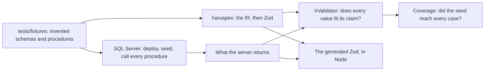

# Observing the engine

*This chapter is in outline. It says what the differential harness is for and how it is built; the full chapter, with the
harness's design argued in detail, is to come.*

The claims haruspex makes are only as good as its model of SQL Server: which result sets arrive when a branch is skipped, what
`FOR JSON` writes for a NULL, when an expression overflows to NULL rather than failing. So every such rule is **observed**:
run on a real SQL Server by a test, which fails if the server ever behaves otherwise. And every claim haruspex makes about
the fixtures is checked against what the server really returns.

## The idea: differential testing

**Differential testing** checks one program against another that should agree with it, and treats any disagreement as a
bug in one of them (McKeeman, 1998). Compilers are tested against each other this way, and databases against a reference
engine. Here the two programs are haruspex, which predicts what a procedure can return, and SQL Server, which returns it.
A value SQL Server returns that the prediction excludes is a soundness bug in haruspex: a claim stronger than the engine
guarantees.

Snapshot tests can't do this. A snapshot records what haruspex says; it can't say whether SQL Server agrees, so a wrong rule
passes for ever. The decision is recorded in [decision 0007](../decisions/0007-every-engine-rule-is-observed.md).

## Two kinds of test

- **Observation tests** pin one rule each, and are named for it:
  `Count_over_more_rows_than_int_holds_is_null_under_the_callers_ansi_warnings_and_arithabort_off`,
  `A_callees_result_sets_arrive_in_the_callers_stream_where_it_is_called`. They are grouped by the part of the inference that
  relies on them (`ExecObservationTests`, `RefinementObservationTests`, `ForJsonObservationTests` and others), and the code
  and READMEs that use a rule name its test. A rule with no observation behind it is a guess.
- **Runs** deploy every fixture, seed it, call every procedure, and check every result against the IR inferred for it.

## How a claim is checked

`IrValidator` reads the IR directly, never through an emitter, so it can't share an emitter's mistakes. For each value the
server returns, it checks the claim at that path: a field with no reason to be null is never null; a key that is always
present is there; a result returns no more rows than its cardinality allows; a string keeps its length, a number its range
and digits, a value its set. Separately, `ZodAcceptanceTests` parses every run's output with the Zod generated for its
procedure, so the emitter is held to the same data, and `DescribedTypeTests` checks the SQL type of each column against the
one SQL Server describes.

## The seed must reach every case

A claim that a field may be null is only tested by data in which it is null; a claim that it never is, only by data that
could have made it so. So the validator records what it saw at every path, and
`The_seed_reaches_every_case_the_ir_allows` fails unless every nullable field was seen null, every field was seen with a
value, and every result that may be absent was seen absent. For the fixtures about scalar facts,
`The_seed_reaches_every_edge_the_ir_claims` also requires each bound, each full length and each value of each set to be
reached: a maximum of 255 is not shown to hold by values of 7. `Every_procedure_is_run_or_excluded_with_a_reason` makes
sure no fixture procedure is forgotten.

In the literature this is **coverage**, here measured over the claims rather than over the code: the question is not "did
the test run this line?" but "did the data give this claim a chance to fail?".

## What it can't show

Some claims can't be broken by any seed a test can afford: no fixture has 2,147,483,648 rows to overflow `COUNT`, and
under default session options an overflow is an error, not a NULL. Those rules are observed directly, in their own tests,
instead. A rule about concurrency, such as a read-uncommitted scan returning a row twice, can't be observed reliably at all;
where haruspex relies on such a rule it says so, and relies on it only to claim less
([decision 0016](../decisions/0016-visible-read-uncommitted-drops-key-claims.md)).

## Read more

- William M. McKeeman, "Differential testing for software", *Digital Technical Journal*, 1998.
- [`tests/Haruspex.DifferentialTests/README.md`](../../tests/Haruspex.DifferentialTests/README.md): how a run works, how
  the server is found, why writes take a gate, and how to add a fixture.
