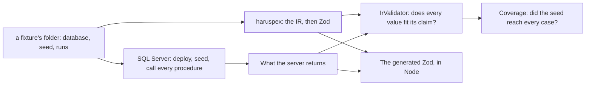

# Observing the engine

The claims haruspex makes are only as good as its model of SQL Server: which result sets arrive when a branch is skipped, what
`FOR JSON` writes for a NULL, when an expression overflows to NULL rather than failing. So every such rule is **observed**:
run on a real SQL Server by a test, which fails if the server ever behaves otherwise. And every claim haruspex makes about
the fixtures is checked against what the server really returns. This chapter is about the harness that does both: what it
checks, how a fixture is laid out and found, how it shows that the data gave every claim a chance to fail, and how it keeps
the runs honest.

## The idea: differential testing

**Differential testing** checks one program against another that should agree with it, and treats any disagreement as a
bug in one of them (McKeeman, 1998). Compilers are tested against each other this way, and databases against a reference
engine. Here the two programs are haruspex, which predicts what a procedure can return, and SQL Server, which returns it.
A value SQL Server returns that the prediction excludes is a soundness bug in haruspex: a claim stronger than the engine
guarantees.

Every test needs an **oracle**, something that says what the right answer is, and finding one is often the hard part of
testing (Barr and others, 2015). Here there is a perfect oracle to hand, which is unusual: the engine whose behaviour
haruspex predicts. The obvious alternative is to take the rules from SQL Server's documentation and check haruspex with snapshot
tests alone. A snapshot records what haruspex says; it can't say whether SQL Server agrees, so a wrong rule passes for ever,
and the documentation leaves much unsaid (what `FOR JSON` writes for a query with no rows, which result set arrives where
after a branch not taken). The first differential run corrected one of haruspex's own rules, about nested objects under
`INCLUDE_NULL_VALUES`. The decision is recorded in [decision 0007](../decisions/0007-every-engine-rule-is-observed.md).

## Two kinds of test

- **Observation tests** pin one rule each, and are named for it:
  `Count_over_more_rows_than_int_holds_is_null_under_the_callers_ansi_warnings_and_arithabort_off`,
  `A_callees_result_sets_arrive_in_the_callers_stream_where_it_is_called`. They are grouped by the part of the inference that
  relies on them (`ExecObservationTests`, `RefinementObservationTests`, `ForJsonObservationTests` and others), and the code
  and READMEs that use a rule name its test. A rule with no observation behind it is a guess.
- **Runs** deploy every fixture, seed it, call every procedure, and check every result against the IR inferred for it.

Why both, rather than runs alone: a run tests a rule only when the fixture's data reaches it, and some rules can't be reached
by any seed a test can afford (an overflow of `COUNT` needs 2,147,483,648 rows). An observation test sets up exactly the
case it pins, however unusual, and its name says the rule in a sentence. Why not observations alone: they check the rules one
at a time, while a run checks what haruspex does with all of them together, on procedures written the way people write them.
A rule observed correctly can still be applied in the wrong place.

## A fixture is one folder, found by listing

A **fixture** is an invented database. Each is one folder under `tests/fixtures`, holding everything about it: the schema
haruspex reads (`database/`), what haruspex must produce from it (`expected/`, one IR and one Zod snapshot per procedure),
the rows the differential tests insert (`seed.sql`), and the calls they make (`runs.json`). Its `README.md` says what it is
for. [`tests/fixtures/README.md`](../../tests/fixtures/README.md) describes each part.

The tests find the fixtures by listing that folder (`Fixture.All`); no test keeps a list of them. The obvious alternative is
a registry: a list of fixture names in each test that needs one. Registries drift. A fixture left out of the emit check's
list never has its generated Zod compiled, and nothing notices, because each list is right by its own lights; the
[decision](../decisions/0021-fixtures-are-found-never-listed.md) records the case that showed it. A registry is a second copy of a fact the file system already holds, and two copies of a
fact disagree sooner or later. With discovery there is one copy: a new folder is snapshotted, compiled, deployed, run and
measured for coverage by every test at once, and a folder missing a part its kind needs fails every test that uses a fixture
rather than being skipped. The cost is that a fixture can't be left out of one test by leaving out its name; a fixture that
differs in kind says so in its files (a project for the CLI has a `haruspex.json` naming its `source`, and no seed).

Three smaller choices follow from the same aim, that a fixture's folder describes it:

- **The schema has a folder of its own.** The seed is SQL too, and haruspex reads every `.sql` file under the folder it is
  given. Keeping the seed beside the test code instead would put a fixture in two places again; keeping it beside the
  schema would make haruspex read it. A `database/` folder is what haruspex reads, and exactly that.
- **Expected outputs live in the fixture, named for what they hold** (`sales.get_order.ir.verified.json`), not for the test
  that checks them. A test can be renamed without moving a reviewed file, and a reader of a fixture sees, beside its SQL, what
  haruspex claims about it.
- **A run gives its arguments as JSON, and takes their types from the procedure.** `"@mode": 1` is sent as a `tinyint`
  because the procedure declares `@mode tinyint`, as an `EXEC` would convert it. The alternative, a type written beside each
  argument, repeats the declaration and can contradict it; here the procedure says it once. A type the reader doesn't know
  how to send fails the run, rather than falling back to a guess.

## How a claim is checked

`IrValidator` reads the IR directly, never through an emitter, so it can't share an emitter's mistakes. For each value the
server returns, it checks the claim at that path: a field with no reason to be null is never null; a key that is always
present is there; a result returns no more rows than its cardinality allows; a string keeps its length, a number its range
and digits, a value its set. Bounds are compared exactly from the decimal text, never through a double.

The alternative is to validate through the generated Zod alone, since that is what users run. But then a bug the emitter
and the validator share (both reading a facet the same wrong way) passes, and a failure can't say whether the IR or its
translation is wrong. So the two are checked apart: `ZodAcceptanceTests` parses every run's output with the Zod generated for
its procedure, so the emitter is held to the same data, and a failure in one but not the other says where the bug is.
`DescribedTypeTests` checks what no value can show: that the SQL type the IR gives each column is the one SQL Server
describes (`sys.dm_exec_describe_first_result_set_for_object`). A wrong precision passes the value checks as long as the data
is short; the type is a claim of its own.

## The seed must reach every case

A claim that a field may be null is only tested by data in which it is null; a claim that it never is, only by data that
could have made it so. So the validator records what it saw at every path, and `The_seed_reaches_every_case_the_ir_allows`
fails unless every nullable field was seen null, every field was seen with a value, and every result that may be absent
was seen absent. Every fixture's seed must also reach each edge of a fact its types alone don't give
(`The_seed_reaches_every_edge_its_types_alone_do_not_give`): each bound, full length and minimum length from a CHECK, an
expression's literals, the engine or a declaration, and each value of each set, since a maximum of 255 is not shown to
hold by values of 7. A type's own range is held at its edges by the observation tests of the built-in types and the
expressions, and for a first rowset by `DescribedTypeTests`. An edge no run can reach is excused in the fixture's
`runs.json`, under `edgesNotReached`, with the reason. Four fixtures (`seedReachesEveryEdge`) are held to every edge, the
types' too. `Every_procedure_is_run_or_excluded_with_a_reason` makes sure no fixture procedure is forgotten; one that
can't be run is listed in its fixture's `notRun`, with the reason.

In the literature this is **coverage**, here measured over the claims rather than over the code: the question is not "did
the test run this line?" but "did the data give this claim a chance to fail?". Line coverage of haruspex would be the obvious
measure, and a poor one here: every line of the validator runs on the first row, whether or not the seed holds the NULL that
would break a claim.

## Keeping the runs honest

Three choices keep a passing run meaningful.

**Runs read a snapshot that can't be written.** Tests run in parallel. A run that wrote, even inside a transaction rolled
back, would hold locks other runs wait on, and a procedure that wrote by mistake would change what later runs see. So every
run that only reads goes through a **database snapshot** of the seeded database, read-only to everyone, as a user who can do
nothing else; a run that writes says so (a `setup` in `runs.json`) and runs alone in a copy of the database, a room of its
own, in a transaction that is rolled back. The alternatives were one gate that made every write wait for every read, which
made the suite nearly serial once most observations wrote, and retrying a run that deadlocks, which hides the cause; the
[differential tests' README](../../tests/Haruspex.DifferentialTests/README.md) weighs them.

**The server's image is pinned by tag and digest** (`SqlServerFixture.Image`). Pinned by tag alone, the image can be replaced
under the same name; unpinned, a new cumulative update changes the engine between two runs of the same commit, and a failure
can't be told from a regression. Pinned, a change of engine is a change in the repository, made on purpose and run against
every rule at once, which is how a new SQL Server version is checked.

**A test that can't run skips, and the skip fails in CI.** Without a SQL Server, or without Node for the Zod checks, a test
skips and says why, so a contributor without Docker can still run the rest. In CI, `HARUSPEX_REQUIRE_SQLSERVER=1` and
`HARUSPEX_REQUIRE_NODE=1` turn each skip into a failure. Always failing would shut out contributors who can't run SQL
Server; always skipping would let CI pass while checking nothing, which a green build would hide.

## What it can't show

Some claims can't be broken by any seed a test can afford: no fixture has 2,147,483,648 rows to overflow `COUNT`, and
under default session options an overflow is an error, not a NULL. Those rules are observed directly, in their own tests,
instead. A rule about concurrency, such as a read-uncommitted scan returning a row twice, can't be observed reliably at all.
Where the source shows that such a rule applies (a `NOLOCK` hint, or a level the procedure sets), haruspex relies on it only
to claim less. The level a caller sets is in no source, and there haruspex assumes the caller doesn't read uncommitted
data, which claims more ([decision 0016](../decisions/0016-visible-read-uncommitted-drops-key-claims.md)). The README lists
that assumption with the others, and the larger gaps known today
([what it guarantees](../../README.md#what-it-guarantees-and-what-it-cant-see)).

And a differential test shows only that the claims held for the data it ran. It is evidence, not proof: the soundness
argument is in the inference's rules, and the harness is what keeps those rules tied to the engine they describe.

## Read more

- William M. McKeeman, "Differential testing for software", *Digital Technical Journal*, 1998.
- Earl T. Barr, Mark Harman, Phil McMinn, Muzammil Shahbaz and Shin Yoo, "The oracle problem in software testing: a
  survey", *IEEE Transactions on Software Engineering*, 2015.
- Manuel Rigger and Zhendong Su, "Finding bugs in database systems via query partitioning", OOPSLA 2020: the same idea
  turned on the database itself, with the engine checked against a rewritten form of each query.
- [`tests/fixtures/README.md`](../../tests/fixtures/README.md): a fixture's folder, `runs.json`, and how to add one.
- [`tests/Haruspex.DifferentialTests/README.md`](../../tests/Haruspex.DifferentialTests/README.md): how a run works, how
  the server is found, why each write has a database of its own, and every rule each observation test pins.
