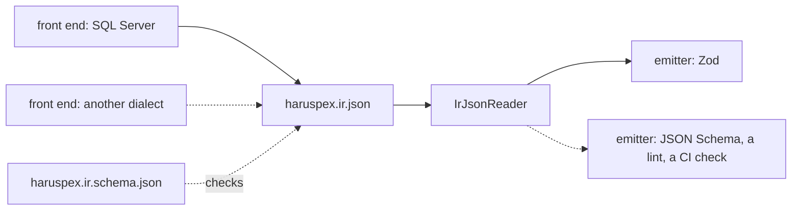

# The IR as a contract

Everything haruspex knows about a procedure ends up in one file, `haruspex.ir.json`. The Zod module is generated from it,
and anything else that wants to know what a procedure returns (another emitter, a lint, a CI check that a change breaks no
caller) reads it too. So the file is a contract: between the front end that writes it and every program that reads it,
and, when a database team publishes it, between that team and the applications that call its procedures. This chapter is
about what makes a file format fit to be a contract, and the choices haruspex made for its own: why there is an
intermediate format at all, why it has a version of its own, why its schema is generated, why reading it back must give
exactly what was written, and what a reader does with a version it doesn't read.

## Why an intermediate representation

Compilers settled this long ago. A compiler for M languages and N machines written directly is M × N programs; with an
*intermediate representation* between them it is M front ends and N back ends, each written once against the IR. LLVM's IR
is the best-known example, and the reason a new language can reach every processor LLVM supports by writing one front
end. The price is that the IR must be able to say everything every front end knows and every back end needs, and nothing
that belongs to only one of them.

The same shape, on a smaller scale, is haruspex's. A front end reads one SQL dialect (SQL Server's, today) and infers what
each procedure returns; an emitter writes one target (Zod, today). The IR between them is small and closed: a node per idea
(a scalar, an array, a tuple, a record, a union, JSON held as text, a reference to a named type, a type the application
already has, and an unknown), each fact with where it came from, and every unknown with its reason. It is not JSON
Schema, which is an open validation language with no notion of a procedure, a result set or an unknown
([decision 0003](../decisions/0003-an-ir-of-its-own.md)).



Two rules keep the IR honest. **Emitters see only the IR**: if an emitter needs a fact, the IR must carry it, so no emitter
reaches back into the inference for something the file doesn't say. And **the IR is a file, not an in-process API**: a
program in any language can read it, so an emitter can be an npm package and a second front end can be written on whatever
parser suits its dialect. The layers are checked by a test ([decision 0006](../decisions/0006-layers-with-one-way-dependencies.md));
the second rule is checked by the tests in this chapter, which generate the Zod from the file rather than from the records
inference built (`ZodThroughTheFileTests`).

## A version of its own

The IR has a version, `IrDocument.CurrentVersion`, written first in every file as `irVersion`, and it is not the tool's.
The two change for different reasons. The tool's version moves when its commands, options or output change for a user;
the IR's moves when a change would break a program that reads the file: a node, property or name added, removed or
renamed, or a claim that now means something else. A release can fix the CLI without touching the format, and a change
to the format may come with no visible change to the tool at all.

While the version is 0.x, every change to the format moves it, and nothing is promised between two versions. That is the
usual meaning of 0.x in semantic versioning, and it is honest: the format is still being found, and a reader that trusted
two versions to agree would be trusting something nobody checked.

## The schema is generated

A file meant for other programs needs a description those programs can check it against, in a language they already
speak. For JSON that is JSON Schema, so the IR's is published as [`schemas/haruspex.ir.schema.json`](../../schemas/haruspex.ir.schema.json).
A program in TypeScript, Python or Go can validate a file with any JSON Schema library before trusting it.

The schema is generated, by `IrJsonSchema`, and never edited by hand
([decision 0023](../decisions/0023-the-ir-schema-is-generated-from-the-model.md)). A hand-kept schema is a second copy of
the format, and second copies drift: the day a null rule is added to the model and not to the schema, every file that
uses it fails validation, or worse, the schema is loosened to stop the failures and starts accepting what the format
doesn't allow. So the parts of the schema that change most often, the closed vocabularies (the null rules, the reasons for
an unknown, the scalar kinds and the rest), are listed from the model's enums through the one table of names the writer
uses, `IrWireNames`. A member added to an enum reaches the schema without anyone remembering to put it there, and
`IrJsonSchemaTests` fails until the committed file is regenerated.

The structure (which objects have which properties, and which are required) is written by hand in the generator, beside
the writer that writes it and the reader that reads it. Deriving it by reflection over the records was considered and
rejected: the file is not a mechanical image of the records. Keys are named for the reader (`output`, not `IrParameter.IsOutput`), a
flag is written only when it says something (`recursive`), and a scalar's facets sit beside its kind rather than in an
object of their own. Each of those choices would have to be restated as an attribute on the model, a second description of
the writer that nothing checks. Three tests hold the hand-written structure to the other two instead. Every file the
writer produces, from every fixture and both public corpora, passes the schema. Every way of breaking a file in the tests
fails the schema and the reader alike. And every property of every IR record is either a key the schema lists, or named
in a table, with the reason, as written another way; a property added to a record fails that test until it is
accounted for.

The schema is strict where the format is closed. Every object refuses a property it doesn't list
(`additionalProperties: false`), every vocabulary is an `enum`, and a flag must agree with its reasons: `nullable: true`
with at least one entry in `nullableBecause`, and `nullable: false` with none. It uses only the core of JSON Schema 2020-12,
so any validator can check it.

## The round trip is a law

`IrJsonReader` is the inverse of `IrJsonWriter`, and the tests state that as a law over every document haruspex writes:

- **read after write gives the document back**: `Read(Write(d))` equals `d`;
- **write after read gives the bytes back**: for a file `f` that the writer wrote, `Write(Read(f))` is `f`, byte for byte.

These are the two laws of a *bidirectional transformation*, which the literature on lenses calls PutGet and GetPut
(Foster, Greenwald, Moore, Pierce and Schmitt, "Combinators for bidirectional tree transformations", 2007), and the
encode and decode property that property-based testing checks for every serialiser (Claessen and Hughes, "QuickCheck", 2000).
Each half catches what the other misses. Equal documents alone would pass a reader that dropped a fact the writer happens
to leave out of every fixture; equal bytes alone would pass a reader and a writer that agreed on the same mistake.
Together they say the file holds exactly the document: nothing lost on the way out, nothing invented on the way in.

The laws are tested on real output rather than on examples written for the purpose: what every fixture infers, every
committed IR snapshot, and both of Microsoft's sample databases (`IrRoundTripTests`), with a document built by hand that
holds every node and every optional property of the format at least once, so that a part no fixture reaches is still
checked (`IrJsonReaderTests`). "Equals" here is the records' value equality ([chapter 5](05-values-as-a-lattice.md)), with
one addition: the file sorts a document's objects, unknowns and overrides, because their order in the records means
nothing, so two documents that differ only in that order are equal (`IrDocument`).

The round trip is also why the emitter is tested through the file. Every committed IR file, read back, must generate exactly
the committed Zod beside it (`ZodThroughTheFileTests`). With the snapshot tests, which check that inference writes the
committed IR, that says the published file alone is enough to generate the published Zod: an emitter written in another
language, from the file and the schema, has the same cases to pass.

## Reading strictly

A reader of a closed format has two ways to treat what it doesn't understand. It can ignore it, as Protocol Buffers ignore
an unknown field and as Postel's law advises ("be liberal in what you accept"). Or it can refuse it. The reader here
refuses: an unknown property, a name outside its vocabulary, a property missing or of the wrong type, a flag that
disagrees with its reasons. Each refusal is an `IrFormatException` that names the place in the file as a JSONPath, such as
`$.types.OrderRow.fields[0].nullableBecause is missing, but nullable is true: every null needs a reason.`, and nothing is
read with a default.

Ignoring is wrong for this format because of what the file holds: claims. A property a newer version adds may weaken a
claim the older properties make. The IR's arrays show it: an array once had no way to say its items could be null, and
`itemsNullable` was added when `json_array` could put a null in one. A reader that ignored `itemsNullable` would read every
array's items as never null, and generate a schema that rejects data the database really returns. For a tool whose first
rule is never to claim more than the engine guarantees ([decision 0002](../decisions/0002-unknown-with-a-reason-never-a-guess.md)),
a reader that silently drops a qualification is the worst kind of reader. The case against Postel's law for protocols in general
is made in RFC 9413 (Thomson and Schinazi, 2023): tolerance lets mistakes spread until they become part of the protocol.

## A version the reader doesn't read

The version is read first, before anything else in the file. A file of any version but the reader's own is refused, with
a message that names the file's version, the version the reader reads and where:

```text
$.irVersion is "0.14", and this reader reads IR 0.15 only. Run haruspex generate again to write the file in this version.
```

The alternative was to migrate: to read an older file by mapping its differences onto the current version. It was rejected
([decision 0024](../decisions/0024-an-ir-reader-refuses-other-versions.md)), for three reasons.

- **An IR file is a build output, not a record.** It is generated from the database project, deterministically. Whoever holds an old file holds, or can get, the source that made it; regenerating gives a file that is right
  for the current version by construction. Migration would spend code, kept forever, to save a command.
- **A version is the meaning of the claims, not only their spelling.** Some changes between versions only rename, which
  a migration could map. Others change what a claim means or which rules made it: a rule observed wrong and corrected, a
  construct that was unknown and is now typed, a reason that was too wide. A migrated file would present an old engine's
  claims with a new version's label, and a reader would trust them as the new version's.
- **Each migration is another reader to test.** The format has had fifteen versions so far. A chain of migrations is a
  reader per version, each needing fixtures of its own, for a format that promises no compatibility while it is 0.x.

A newer version than the reader's is refused for the same reason and more plainly: the reader can't know what it would be
ignoring. One file from every version is kept in [`tests/ir-versions`](../../tests/ir-versions/README.md), and
`IrVersionTests` checks that the current one is read and every older one refused with that message.

Whether this holds after 1.0 is a later decision. A stable format usually promises that a reader of version 1.n reads
every 1.m with m ≤ n, which needs additions to be optional and safe to ignore; the argument above about weakening claims
says that not every addition can be. Until then, the rule is the simple one: a reader reads its own version.

## Names that belong to no dialect

*Planned*: why the IR names the reason a value can be null rather than the SQL construct that causes it, so that a second
front end can write the same format; and how the names were chosen.

## Reading further

- Chris Lattner and Vikram Adve, "LLVM: A compilation framework for lifelong program analysis and transformation" (2004), on
  an IR as the contract between front ends and back ends.
- J. Nathan Foster, Michael B. Greenwald, Jonathan T. Moore, Benjamin C. Pierce and Alan Schmitt, "Combinators for
  bidirectional tree transformations" (2007), for the round-trip laws.
- Martin Thomson and David Schinazi, RFC 9413 (2023), on why a reader that tolerates mistakes keeps them alive.
- Martin Kleppmann, *Designing Data-Intensive Applications* (2017), chapter 4, for how formats evolve: Protocol Buffers,
  Avro and JSON compared, and forward and backward compatibility.
