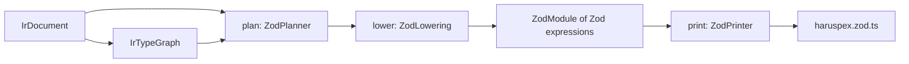

# Emitting code

The IR says what each procedure returns; an emitter says it again in a language an application can use. For Zod that means a
TypeScript module of schemas and types, written so that a developer reading it can't tell a program wrote it; for JSON Schema,
one document of definitions that any language's validator can check a result against. This chapter is about how a program
writes code in another language: why haruspex's emitters work in three stages (plan, lower and print) rather than with string
templates or a syntax tree of the target, why the walks over the IR's types are gathered into one graph that every reader asks,
why the code it writes looks as it does, and what two targets share and what each can't say.

## Writing code is compiling

An emitter is the back end of a small compiler. Its input is already analysed (the IR), and its output is source text in
another language. Compilers have long split that work into steps that each change one thing: they *lower* a program from a
high-level representation to a lower one, choosing for each construct what it becomes in the target, and only at the end
*print* or encode the result. Each step has one kind of decision to make, and the representation between two steps is
something a test can look at.

The Zod emitter does the same, in three stages:



- **Plan** (`ZodPlanner`) decides what the module declares, in what order and under what names, and refuses a document it
  can't write before anything is built: a name TypeScript reserves, a schema imported from two modules, a type that one
  result reads as rows and another as JSON. Its output, `ZodPlan`, is a list of entries, each a named object type or a
  procedure.
- **Lower** (`ZodLowering`, with `TypeLowering` for one type and `Facets` for a scalar's facts) turns each entry into a
  declaration built from a small model of Zod expressions (`ZodExpression`): a call chain on `z`, an object schema, a union, a
  reference to a schema declared elsewhere, JSON text, and a note for the reader. This is where every claim the IR makes
  becomes a Zod check, and every claim Zod can't hold becomes a note.
- **Print** (`ZodPrinter`) writes the model as TypeScript. It is the only stage that knows TypeScript's syntax: how a string
  is quoted and escaped, which keys need quotes, how a comment is kept from ending early, where lines break. It decides
  nothing about what the module says.

## Why not string templates

The obvious way to write code is to build its text while walking the input: return a field's code and its comment as a pair
of strings, append `.nullable()` to the code, find a union's variants again by searching a list. It works for a while, and
it has the faults string templates always have.

**A decision made where text is written can't be looked at.** Whether a field is nullable, which check a bound becomes, which
variant of a union comes first: each is settled in the middle of concatenation, and the only evidence is the final text, which
a test must search with regular expressions. With a model between the stages, a test of the lowering compares records
(`TypeLoweringTests` checks an array's items, length and nullability as an expression, not as a string), and a test of the
printer gives it an expression and reads one line.

**Text can't be compared for meaning.** Two schemas are the same when they check the same things, not when their text happens
to match, and comparing descriptions by their rendered text is a trap the guide's chapter on values describes
([Values as a lattice](05-values-as-a-lattice.md)). The model's records compare by value, so two expressions that say the same
are equal, which is what merging identical shapes into one declaration needs.

**Syntax leaks everywhere.** When every step writes text, every step quotes and escapes, each a little differently. Here
escaping is one function in the printer, so a key, an enum value and an import's module are quoted by the same rules, and a
`*/` in a name from SQL can't end a comment early wherever the name appears.

## Why not a syntax tree of TypeScript

The other well-trodden road is to build the target language's syntax tree and let a library print it: Roslyn's syntax
factory for C#, the TypeScript compiler's factory functions for TypeScript. That gives correct syntax for any program, and
haruspex writes only one idiom of one library. A full tree would make the lowering say `CallExpression(PropertyAccess(
Identifier("z"), "string"), [])` where it means "a string", and the questions the emitter asks of its own output ("is this
check redundant?", "are these two objects the same shape?") would be asked of TypeScript's grammar rather than in Zod's
terms. The TypeScript compiler is also a JavaScript program, which an emitter written in .NET would have to run.

So the model is Zod's vocabulary, small and closed: a dozen kinds of expression, each a record. It is as close to the target
as it can be while still holding decisions rather than characters, and it stops where Zod stops: the printer knows that a
union is written `z.union([…])`, and the lowering only that it is a union.

## The plan: order, sharing and refusing early

A TypeScript module is read top to bottom, and a `const` can't be used before it is declared, so a schema must come after the
schemas it refers to. The plan puts each procedure in the order of its id, and before each the named types its results
reach that no earlier procedure reached, those in an order where every type follows the types it refers to. That is a
*topological order* of the graph of references, and a type two procedures share is declared once, before the first.

A recursive type has no such order: a category's subcategories are categories. Zod 4's answer is a getter,
`get children() { return z.array(CategorySchema) }`, which reads the schema only when it is used, by which time the
module has declared it, and through which TypeScript infers the type without casts. The lowering makes a getter of every
reference back into the type's own cycle, whichever type of the cycle the plan declares first.

The plan also refuses, before anything is built, what the module can't say. The IR's names are identifiers by the format's
own rule, but a name TypeScript reserves (`string`, `class`) can't name a binding, and an imported schema must come from one
module and not take a name the module declares. A type one result reads as rows and another as JSON would need two schemas,
since its scalars arrive differently in each; haruspex never makes one, but an IR is a file anything can write. These are refused
as diagnostics (`ZodCodes`), every one the plan finds, and
the emitter returns them in place of a module ([decision 0037](../decisions/0037-steps-return-outcomes.md)); the CLI reports
them as mistakes in the config file.

## One graph of the types

A type tree invites a walk in every program that reads it: one to collect the imports, one to find JSON text, one to order
the declarations, one to follow references, one to find cycles, one to rename references. Written separately, each is a
`switch` over the kinds of node with its own recursion, and a walk that ends in a default doing nothing skips silently any
kind of node added after it was written.

So the structure is known in two places, both in the IR project:

- **`IrTypeTree`** knows the structure of one type: the children of each node, with the path segment that leads to each,
  every node within a type, and a copy with its references renamed. A node it doesn't know is an error, never a skipped
  branch. A walk asks it for children rather than matching node kinds itself.
- **`IrTypeGraph`** knows the document: which named types each refers to, which are reachable from a type, which lie on a
  cycle, a topological order, and how each type's values arrive (as rows, or as JSON, which is what a type inside JSON text
  always is). It is computed once from an `IrDocument`.

The cycles are the graph's *strongly connected components*: sets of types each of which reaches every other. They are found
with Tarjan's algorithm, as the inference finds functions that call each other ([Summaries and recursion](07-summaries-and-recursion.md)).
The same depth-first search gives the order: a type finishes only after every type it reaches, so the order in which types
finish puts each after the types it refers to, except inside a cycle, where no order can. Starting the search from the results,
in the order the IR file lists the objects, makes the module's order follow the document rather than the alphabet.

A few walks match on node kinds themselves, each for a reason:

- **The IR's writer and reader** write and read each node's own properties, which only a match on its kind can do.
- **Building the IR** (`IrBuilder`) and **converting a declared result back into the inference's shapes** (`IrShapes`) turn
  one structure into another, a different result per kind.
- **Comparing a declaration with what was inferred** (`ResultsComparison`) walks two types side by side, a pair of nodes at
  a time, and **applying an override** (`OverrideApplier`) follows one path down a type, a segment at a time.
- **The lowering** gives each kind its own Zod expression, which is its job.
- **The corpus figures** decide whether a field is JSON text of unknown content by looking through arrays, records and JSON
  text only, as the figures' definition says.
- **The differential tests' validator and coverage check** walk types beside real values, on purpose apart from the code
  whose claims they test.

## The code it writes

The module is read by two kinds of reader: a developer, in an editor or a code review, and the tools a team already runs
over its code, a compiler and a linter. Each choice below is made for one of them.

```sql haruspex-example
CREATE TABLE garden.plant
(
    plant_id  int          NOT NULL PRIMARY KEY,
    name      nvarchar(60) NOT NULL,
    kind      nvarchar(10) NOT NULL CHECK (kind IN (N'herb', N'shrub', N'tree')),
    planted   date         NULL
);
GO
CREATE PROCEDURE garden.list_plants
AS
SELECT p.plant_id, p.name, p.kind, p.planted
FROM garden.plant AS p
ORDER BY p.name;
```

```ts haruspex-zod
// Generated by haruspex from IR 0.21. Do not edit.
// Rowset results follow the default type mapping of the mssql (tedious) driver.
//
// The notes on properties below rest on these facts:
// - A value set from a CHECK constraint holds as the database compares strings, where case, accents and trailing spaces
//   may differ, so it is a note rather than z.enum.
import { z } from 'zod'

export const ListPlantsRowSchema = z.object({
  plant_id: z.int32(),
  name: z.string().max(60),
  /** One of "herb", "shrub", "tree", as the database compares strings. */
  kind: z.string().max(10),
  planted: z.date().nullable(),
})
export type ListPlantsRow = z.infer<typeof ListPlantsRowSchema>

/** garden.list_plants: returns rows. */
export const ListPlantsSchema = z.array(ListPlantsRowSchema)
export type ListPlants = z.infer<typeof ListPlantsSchema>
```

This is part of the example application in `examples/greenhouse`, whose whole module the tests compile, and the guide's
tests check this one is what haruspex writes.

**A note says what is particular to its property, in one sentence, above it.** Where the IR states a fact Zod can't hold
exactly (a length in bytes under an unknown collation, a value set that holds only as the database compares strings, a
decimal the driver may round), the check is weakened or left out, and a note says so. A note is a documentation comment above
the property, not a comment after it: TypeScript carries it through `z.infer` to the inferred type, so an editor shows it
when the developer hovers the field in their own code (checked with TypeScript's language service and zod 4.6.7), and a
formatter keeps it with its property rather than with whatever line it wraps to. Where a check is exact (a `varchar(n)` in a
single-byte collation) there is nothing to explain, and no note.

**A fact many notes rest on is said once.** Why a byte length bounds a string only from above is the same for every
`varchar` in the module; written into each note it buried what was particular to the property under the general rule.
So each note names only its own case, and the header states the general facts the module's notes use, each once, and only
those. One fact is not about any property: what the callers' sessions were declared to set, which the IR records
(`IrSource.Session`). Every claim about an overflow or a loss of precision rests on it, so the header says it, and says nothing
when nothing was declared ([decision 0038](../decisions/0038-the-callers-session-is-declared.md)).

**A check the schema already makes is not repeated.** `z.int32()` checks an `int`'s range, so an `int` with one bound of its
own from a CHECK constraint is `z.int32().gt(0)`, not `z.int().gt(0).max(2147483647)`; with both bounds its own, `z.int()`
and the two bounds say it all. A union leaves out a variant that another variant accepts every value of:
`z.union([z.string().max(60), z.string().max(13)])` is `z.string().max(60)`. Both accept exactly what they did. The test
for "accepts every value of" is deliberately narrow (equal variants, any number under a bare `z.number()`, and strings or
enums under a string with only a maximum length), because a variant it can't compare is kept, which is longer but never
wrong. Object variants are never dropped: a `z.object` strips the keys it doesn't know, so which variant takes a value
changes what comes out.

**An identical shape is declared once.** Two result sets with the same columns, or a callee's rows passed through by its
caller, make named types whose schemas are the same. The first is declared; the second name stays, as an alias of the
first (`export const ProductPageResult1RowSchema = ProductHeaderRowSchema`), so code that imports it keeps working and the
reader is told it is the same shape. Two schemas are the same when their models are equal, which records give by value,
notes included; since a schema names the types it refers to, merging two leaf types can make their users the same too, so
the comparison is repeated until nothing more merges. Two recursive types never merge, since each refers to itself by its
own name, which only claims less. The merge is the emitter's rather than the IR's: the IR keeps each type's identity, which
another emitter or a later run may need apart, and whether two schemas are the same depends on what this target can say.

**Numbers are what JavaScript reads.** JavaScript reads a number literal as the nearest double, so `decimal(19,2)`'s maximum,
99999999999999999.99, means 100000000000000000 in any case, and ESLint's `no-loss-of-precision` rule reports the long form for
that reason. A number a double can't hold is written as the double JavaScript reads, in JavaScript's own shortest form
(`JavaScriptNumbers`); the check is the one it always was, and a bound stays sound because rounding never reverses an order.
The exact bound is not lost: where a literal changes, the property's note keeps it (`decimal(19,2) runs from
-99999999999999999.99 to 99999999999999999.99, which JavaScript reads as the nearest doubles`), so the reader sees what the
database states as well as what is checked. Two alternatives lost. Keeping the exact digits and turning the rule off for the
file would make every team that lints its code configure an exception for haruspex, and would leave a literal that reads as
a claim JavaScript can't check. Writing no bound at all where a double can't hold it would throw a true check away: the
nearest double still bounds every value that arrives.

**The tools agree.** The tests compile every fixture's module with `tsc` under `strict`, and lint it with the recommended rules
of ESLint and typescript-eslint, any warning failing (`EmitCheckTests`); and the example application, which imports a
generated module and uses its schemas and types as a team would, is compiled in CI (`ExampleAppTests`).

## Two targets from one IR

The second emitter, `JsonSchemaEmitter`, writes the same IR as a JSON Schema document (draft 2020-12). It is the test the
design set the IR: if the IR were shaped like Zod, a second target would need things only Zod's emitter computes. It needed
none. Everything it reads is the IR's, and two rules the Zod emitter had kept to itself turned out to be the IR's and moved
there, so both emitters ask one place: the bound one step inside an exclusive one (`IrBound.InsideAt`), and how many items an
array result has as the reader conventions read it (`IrResult.FewestItems`, `IrResult.MostItems`).

What the two share:

- **The three stages.** `JsonSchemaPlanner` decides what the document defines and refuses what it can't write (one name for
  two definitions, `JsonSchemaCodes`); `JsonSchemaLowering` and `TypeLowering` build a model of schemas, records that compare
  by value; `JsonSchemaPrinter` alone knows JSON's syntax and writes keywords in one fixed order.
- **The IR's walks.** Places come from `IrPath` and type identities, so a schema of an unknown says why in the IR's own sentence,
  and a field the config file overrode says so with its reason.
- **Notes and shared facts.** A fact the target can't hold is widened and the schema's description says so, in one sentence; a
  fact many notes rest on is stated once, in the document's own description.
- **The names**, settled once by the config file, so `GetOrder` is the Zod module's export and the JSON Schema's definition.

What differs is what each target is:

| | Zod | JSON Schema |
|---|---|---|
| What a value is | what the mssql driver hands over: in a rowset, a date is a `Date` and a `bigint` a string | JSON, as `FOR JSON` writes it, rowsets included ([decision 0051](../decisions/0051-one-json-schema-document-per-module-every-value-as-json.md)) |
| Order and recursion | declared before use; a getter for a reference back into a cycle | no order; `$ref` |
| A union | the first variant that accepts, which a stripping object can take wrongly, so variants exclude each other's keys | `anyOf`: validation keeps nothing, so no variant can take another's value |
| Identical shapes | merged, the second name an alias | each name a definition, since a definition costs nothing and a reference is how JSON Schema shares |

The first row is a choice, not a limit. For a `FOR JSON` result both describe the same document. For a rowset, the Zod module
describes what the mssql driver hands a TypeScript application, because that is the code it is imported into, and the JSON
Schema describes JSON, because JSON is all a JSON Schema validates. A rowset isn't JSON until something writes it as JSON, and
each language's driver hands it over in its own types, so the JSON Schema takes the one form that belongs to no driver: the one
SQL Server itself writes. The tests hold each to its own: `ZodAcceptanceTests` parses rows as the driver delivers them, and
`JsonSchemaAcceptanceTests` validates the same rows written as `FOR JSON` writes them.

And what each can't say, which its output widens and notes:

| The IR says | Zod | JSON Schema |
|---|---|---|
| a value set that holds up to a collation's fold (`canonical`) | said: the value is mapped to its item first | a note on a plain string: a validator can't fold |
| a decimal's places | `.multipleOf`, which Zod tests with a tolerance shown never to reject a true value | a note: most validators test `multipleOf` in binary floating point, and 0.07 is no multiple of 0.01 there |
| a length in UTF-16 code units or bytes | exact for UTF-16, as JavaScript counts | a bound on code points, which JSON Schema counts, exact only in a single-byte collation |
| a `bigint` past 2^53 | a string in a rowset, a double in JSON | exact in the file, a double in most validators |
| JSON text of known content | parsed and checked | `contentSchema`, which a validator checks only when asked |
| the application's own schema, declared by the config file | imported and used | `{}`: a document can't refer to a TypeScript module |

The same procedure as above, as the JSON Schema describes its rows:

```sql haruspex-example
CREATE TABLE garden.plant
(
    plant_id  int          NOT NULL PRIMARY KEY,
    name      nvarchar(60) NOT NULL,
    kind      nvarchar(10) NOT NULL CHECK (kind IN (N'herb', N'shrub', N'tree')),
    planted   date         NULL
);
GO
CREATE PROCEDURE garden.list_plants
AS
SELECT p.plant_id, p.name, p.kind, p.planted
FROM garden.plant AS p
ORDER BY p.name;
```

```json haruspex-jsonschema ListPlantsRow
{
  "description": "The type at results[0][] in garden.list_plants.",
  "type": "object",
  "properties": {
    "plant_id": {
      "description": "SQL type int.",
      "type": "integer",
      "minimum": -2147483648,
      "maximum": 2147483647
    },
    "name": {
      "description": "SQL type nvarchar(60).",
      "type": "string",
      "maxLength": 60
    },
    "kind": {
      "description": "SQL type nvarchar(10). Facts: values from the check example.sql:5:37. One of \"herb\", \"shrub\", \"tree\", as the database compares strings.",
      "type": "string",
      "maxLength": 10
    },
    "planted": {
      "description": "SQL type date. May be null: nullable-column (garden.plant.planted).",
      "type": ["string", "null"],
      "format": "date",
      "pattern": "^\\d{4}-\\d{2}-\\d{2}$"
    }
  },
  "required": ["plant_id", "name", "kind", "planted"]
}
```

Every check the Zod makes is here, in JSON Schema's words: `int`'s range as `minimum` and `maximum` where Zod has `z.int32()`,
a date as a string of its `format` and `pattern` where the driver hands Zod a `Date`, and the collation's value set as the same
note. What the description adds is the origins the Zod leaves to the IR: the SQL type, the constraint a fact came from, and why
a value may be null.

## Reading further

- Andrew W. Appel, *Modern Compiler Implementation in ML* (Cambridge, 1998): intermediate representations and lowering.
- Philip Wadler, "A prettier printer" (1998), and Derek Oppen, "Prettyprinting" (*ACM TOPLAS*, 1980): printing as a stage of
  its own, separated from what is printed.
- Robert Tarjan, "Depth-first search and linear graph algorithms" (*SIAM Journal on Computing*, 1972): strongly connected
  components in one depth-first search.
- Thomas H. Cormen and others, *Introduction to Algorithms*, the chapter on elementary graph algorithms: topological order from
  the finishing times of a depth-first search.
- *JSON Schema: A Media Type for Describing JSON Documents* and its companion *JSON Schema Validation*, draft 2020-12: the
  keywords, and which of them (`format`, `contentSchema`) are annotations unless a validator is asked to assert them.
