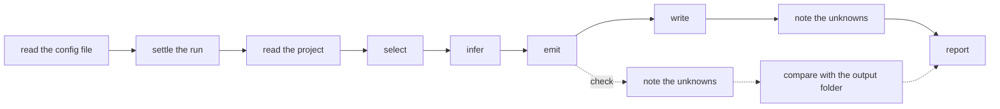

# From input to output (the CLI)

The other chapters are about what haruspex works out. This one is about the run that carries a project from its files to
the two it writes: how `haruspex generate` is put together from steps, how each step says what went wrong without
stopping the program to say it, why a run reports every problem it can rather than the first, and how `haruspex check`
reuses the same steps to say what a change to the database would change. The ideas are old and
have names: *result types* against exceptions, *railway-oriented programming* and its *applicative* side, and the
*error recovery* every compiler does. A running example, a small library's database, goes through all of it.

## A run is a pipeline of steps

`haruspex generate` is eight steps, each a method short enough to read at once, each taking what the one before it gave.
The first six are `ModuleRun`'s, shared with `haruspex check`, and end with the module in memory; the last two are
`Generate`'s. Then a report prints what the run found:



- **Settle** works out what the run is asked: it reads the config file (named, or `haruspex.json` in the working folder
  or the nearest above it), then settles the folder to read, the folder to write and the `--include` patterns, the
  command line over the config file.
- **ReadProject** reads every `.sql` file into the model.
- **Select** picks the procedures to type, and finds and reads the query files `queries` names (`QuerySelection`,
  `QueryFileReader`), reporting what is wrong with both at once.
- **Infer** infers their results, the query files' too, and applies the config file: overrides, declared results, names.
- **Emit** writes what the config file's `emit` names, in memory: the Zod module, a JSON Schema document, or both.
- **Write** puts the IR and each emitted file in place.
- **Noted** lists each unknown in what was written, with its note.
- **Report** prints what was found, in the format and at the detail asked for. It is no step of the pipeline: the command
  gives back a `ModuleReport`, which says what the run found and did, and a report, such as `TextReport`, decides what to
  print of it.

`haruspex check` takes the dotted path after **Emit**: it notes the unknowns, then compares the module with the files in the output
folder, which in CI are the ones committed, instead of writing it ("Checking without writing", below).

Each step can fail because of its input: a config file that isn't JSON, a folder that isn't there, a pattern that
matches nothing, two generated names that clash. What matters is how a step says so.

## Results against exceptions

The obvious way, in C# and most languages since CLU and Ada, is an *exception*: a step that can't go on throws, and
whoever knows what to do catches. Exceptions are the right tool for what nobody can handle where it happens, such as a
disk that fails or a bug. For a user's mistake they are a poor fit, for three reasons:

- **The signature hides them.** Nothing in `HaruspexConfig Read(string path)` says it can fail, or how. Java tried to
  fix this with *checked* exceptions, which a method must declare; most later languages didn't follow, because they
  spread through every signature above them.
- **The first one wins.** A step that throws at its first problem can't report the second, so a user fixes one mistake,
  runs again, and meets the next.
- **The control flow is invisible.** To know what happens after a mistake, a reader looks for the `catch`, which may be
  several calls away.

The alternative is to make failure a value. A function returns either its result or what went wrong, and its type says
so: Haskell's *Either*, OCaml's and F#'s *result*, Rust's *Result* (whose `?` operator passes a failure up without a word
more). In haruspex it is `Outcome<T>` ([decision 0037](../decisions/0037-steps-return-outcomes.md)), a closed hierarchy of
two cases:

- `Succeeded<T>`: the value, and what was found on the way, warnings and notes, never an error.
- `Failed<T>`: what was found, at least one of it an error, and no value.

Each case holds its invariant from its constructor, so no outcome has a value beside an error, or neither. What was
found is a list of `Diagnostic`s, each a stable code, a message and a place
([decision 0036](../decisions/0036-diagnostics-have-stable-codes.md)); the codes have pages in
[docs/diagnostics](../diagnostics/README.md). Exceptions stay for faults, and the CLI turns any that reaches it into exit
code 3.

## The railway

Composing such functions by hand means testing each result before calling the next. Scott Wlaschin's
*railway-oriented programming* (2014) draws the pattern: each step is a switch with two tracks out, success and failure;
on the success track the value goes on to the next step, and once on the failure track a value never comes back. In
haruspex the switch is `Outcome.Then`: on a success it runs the next step on the value and puts what both found
together; on a failure it doesn't run the next step, and carries the failure, with everything found so far, to the end.
The functional literature calls it *monadic bind*. `ModuleRun.Emitted` and `Generate.Run` are the railway written down:

```csharp
public static Outcome<EmittedModule> Emitted(RunRequest request) =>
    Settle(request)
        .Then(ReadProject)
        .Then(Select)
        .Then(Infer)
        .Then(Emit);

var emitted = ModuleRun.Emitted(request);
var run = emitted.Then(Write);
```

At the end, `Generate.Run` turns the outcome into a `ModuleReport`: everything found, in the order it was found, and the exit
code from what failed (the input itself or the write, 1; the command line or the config file, 2). It prints nothing. Keeping
what a run found apart from how it is printed lets one run be printed for a person, as JSON for a tool or as SARIF for a code
scanner, each from the same report.

The running example is a library with two procedures. One reads JSON a column holds, whose shape haruspex can't see;
the other runs SQL it builds as it runs.

```sql haruspex-example
CREATE TABLE lib.book (
    id int NOT NULL PRIMARY KEY,
    title nvarchar(100) NOT NULL,
    extra nvarchar(max) NULL);
GO
CREATE PROCEDURE lib.list_books AS
SELECT b.id, b.title, json_query(b.extra) AS extra FROM lib.book AS b FOR JSON PATH;
GO
CREATE PROCEDURE lib.find_books @where nvarchar(200) AS
DECLARE @sql nvarchar(max) = N'SELECT b.id FROM lib.book AS b WHERE ' + @where;
EXEC sp_executesql @sql;
```

Its first config file has two mistakes, one in each of two steps: a setting with a value it can't have, and a pattern
for procedures the project doesn't have.

```jsonc haruspex-config
{
  "source": "db",
  "out": "generated",
  "objects": "loose",
  "schemas": { "lib": { "include": ["list_*", "find_*", "lend_*"] } }
}
```

```text haruspex-run
haruspex.json:4:14: error HAR3005: objects: must be "strip" or "strict", not "loose".
```

Only the first is reported. Reading the config file failed, so no step after it ran: there is no selection to check a
pattern against until there is a config to select with. That is the failure track at work. Here it costs something: the
pattern `lend_*` is a mistake of its own, not an echo of the first, and the run can't see it yet, because the step that
can needs the config the first mistake took away. Sequencing trades that delay for never reporting a problem that only
follows from another (a later section comes back to it). Corrected, the next run reaches selection and stops there:

```jsonc haruspex-config
{
  "source": "db",
  "out": "generated",
  "objects": "strict",
  "schemas": { "lib": { "include": ["list_*", "find_*", "lend_*"] } }
}
```

```text haruspex-run
haruspex.json:5:57: error HAR4002: schemas.lib.include[2]: 'lend_*' matches no procedure in the schema "lib". Correct it, or remove it.
```

## What a successful run says

With the pattern corrected, the run succeeds:

```jsonc haruspex-config
{
  "source": "db",
  "out": "generated",
  "objects": "strict",
  "schemas": { "lib": { "include": ["list_*", "find_*"] } }
}
```

```text haruspex-run
haruspex: 2 procedures, 2 unknowns. Wrote generated/haruspex.ir.json and generated/haruspex.zod.ts.
First output in generated, so nothing to compare with.
Unknowns by reason (--verbose lists each):
  1  HAR2013  JSON whose shape isn't visible
  1  results only a declaration can give, as the warnings say
What each code means: https://github.com/sharpblue/haruspex/blob/main/docs/diagnostics/README.md
haruspex.json: warning HAR4204: lib.find_books: its result sets are unknown: EXEC sp_executesql @sql runs dynamic SQL, a string built when the procedure runs, so its result sets are not known. (project.sql:11:1) Declare them in haruspex.json under procedures["lib.find_books"].results, as "none" or a JSON Schema, or declare the results of the procedure that runs it.
```

A success can still say things. It says first what it did, then what changed since the last run (this is the first, so it
says so and gives the whole summary), then what needs attention. `lib.find_books` runs dynamic SQL, so
its result sets are unknown and only a declaration can give them: that is a warning, in full, with what to declare. The
`extra` key of `lib.list_books` is unknown too, which the summary counts under its reason's code. Its note, with the reason
and where it is, is one flag away: `--verbose` lists every unknown, grouped by the procedure it is in. A command run many
times a day shouldn't repeat what its reader has seen, so the summary counts, and the detail waits to be asked for. Every
unknown is still reported, but each once: the dynamic SQL is already the warning, so it has no note of its own. Neither
changes the exit code, which is 0.

## Every problem, not the first

A compiler that stopped at its first error would be tiresome, so every compiler since the earliest tries to report all of
them. The textbooks call it *error recovery* (Aho, Lam, Sethi and Ullman, *Compilers*, chapter 4): after an error, the
parser skips to a point it can resume from and carries on. Its danger is the *cascade*, errors that are only echoes of the
first, a missing declaration reported again at every use. Good recovery reports each real error once, and says nothing it
can't stand behind.

A pipeline gets the same from two ways of composing. Steps that need each other's values go in sequence, with `Outcome.Then`,
and a failure ends the line: that is what prevents the cascade, since a step that needs a value it hasn't got is never run.
Steps that don't need each other's values go side by side, and both run whatever the other does. That is
`Outcome.Combine`: both values when both succeed, and otherwise a failure with what each found. Monads can't do this on
their own, since bind needs the first value before it can run the second; it is the *applicative* style (McBride and
Paterson, *Applicative programming with effects*, 2008), which libraries for validation (*Validated* in Scala's Cats,
*Validation* in Haskell) are built on.

In `ModuleRun.Settle`, the `--include` patterns don't depend on the config file, so a config file that doesn't read and a
malformed pattern are both reported. The two folders depend on the config file, and whether anything is selected on the
config file and the patterns, so they follow the config file with `Outcome.Then`, combined with each other. A run with no folder, no output and a malformed pattern hears about
all three, and nothing about a selection never made. With no config file:

```sql haruspex-example
CREATE TABLE lib.book (id int NOT NULL PRIMARY KEY);
```

```text haruspex-run --include a.b.c
haruspex: error HAR6003: give the folder of .sql files, the .sqlproj or the .dacpac to read, or a config file with "source".
haruspex: error HAR6005: give --out, the folder to write to, or a config file with "out".
haruspex: error HAR6006: invalid --include pattern: 'a.b.c' is not a two-part name such as sales.get_order, sales.* or *.list_*.
```

## Writing without half an output

The last step writes the IR and every file emitted from it, and a run must never leave one new beside one old: an application
compiled against a new module and an old IR, or a JSON Schema from one run beside a module from another, would be checked
against a contract that isn't the one in force. No file system replaces several files as one, so `Generate.Write` comes as close
as a rename allows. Every file is written in full to a temporary name in the output folder itself, so that putting each in place
is a rename within one file system: POSIX promises such a rename is atomic, so a reader sees the old file or the new one, never
part of either; Windows makes no such promise for the replacing call .NET uses there, so on Windows the guarantee is only that
each file is written in full before it is put in place. Then each is put in place in turn, the IR first, keeping the old one
aside; if one can't be, those already in place are put back as they were. Two cases can still leave them out of step, and the
CLI's README names both: a process killed between two renames, and a file system that refuses to put one back, when the error
says so and keeps that file's backup. A run that fails earlier writes nothing, and doesn't even create the folder, since the
folder is made in `Generate.Write`, after every other step has succeeded.

## Checking without writing

`haruspex check` runs the same six steps and, where `generate` writes, compares: `Check.Run` is `ModuleRun.Emitted`, then
`ModuleRun.Notes`, then `Check.Compared`. Reuse is why the steps stop at a value, the module in memory, rather than at a file:
a check that read the project differently from `generate` would compare two things that were never alike.

What it compares is the question. The files are text, and a text diff is the obvious answer, but the IR records where each
claim came from, so a comment added above a procedure moves every location after it, and a DACPAC's hash changes with every
build. A check that compared bytes would fail on every change to the database, and say only that a file differs. So `check`
compares *claims*: what a reader of the IR, or of code generated from it, may rely on. `IrComparison.Compare` walks the two
documents side by side, objects by id, fields and parameters by name, result sets by position, following each reference into
the type it names, and reports each difference where it is and as what it is: a field removed, a value that became nullable,
a value set that grew. Locations, the reasons a value may be null and the sources of facts are left out, since they say why
a claim holds, not what it is. Tools that compare programs by their syntax trees rather than their text, such as GumTree,
make the same move for the same reason: a change is better said in the terms of what changed than of where its characters
moved. [Decision 0050](../decisions/0050-check-compares-claims-not-files.md) argues it, with what `check` does when there is
nothing committed to compare with.

The library's catalogue is generated and committed:

```sql haruspex-example
CREATE TABLE lib.book (
    id int NOT NULL PRIMARY KEY,
    title nvarchar(100) NOT NULL,
    status varchar(10) NOT NULL CHECK (status IN ('shelved', 'lent')));
GO
CREATE PROCEDURE lib.list_books AS
SELECT b.id, b.title, b.status FROM lib.book AS b;
```

```jsonc haruspex-config
{ "source": "db", "out": "generated", "schemas": { "lib": { "include": ["list_*"] } } }
```

```text haruspex-run
haruspex: 1 procedure, no unknowns. Wrote generated/haruspex.ir.json and generated/haruspex.zod.ts.
First output in generated, so nothing to compare with.
```

Then a stocktake changes the table: a book may have lost its title, and a book may be lost. A comment is added above it too,
which moves every line below:

```sql haruspex-example
-- The catalogue, as the stocktake left it.
CREATE TABLE lib.book (
    id int NOT NULL PRIMARY KEY,
    title nvarchar(100) NULL,
    status varchar(10) NOT NULL CHECK (status IN ('shelved', 'lent', 'lost')));
GO
CREATE PROCEDURE lib.list_books AS
SELECT b.id, b.title, b.status FROM lib.book AS b;
```

```jsonc haruspex-config
{ "source": "db", "out": "generated", "schemas": { "lib": { "include": ["list_*"] } } }
```

```text haruspex-check
db/project.sql:7:1: error HAR6014: lib.list_books results[0][].title: became nullable
db/project.sql:7:1: error HAR6014: lib.list_books results[0][].status: value set grew: added "lost"
haruspex: 2 changes from the module in generated. If they are meant, run haruspex generate and commit what it writes; if not, change the SQL back.
```

Two changes, each where an application reading `list_books` will meet it, and nothing about the comment. The exit code is 1,
which fails the build. If the change is meant, `generate` writes the new module and the applications that compile against it
see the change in their own build; if not, the SQL goes back. That is consumer-driven contract testing, as Pact does for HTTP
services: the committed module is the contract, and the database's build checks that it still holds.

## Where to read more

- Scott Wlaschin, *Railway oriented programming* (2014), the talk and the article, for the pattern and its pictures.
- Conor McBride and Ross Paterson, *Applicative programming with effects* (Journal of Functional Programming, 2008), for
  why independent steps compose differently from dependent ones.
- Alfred Aho, Monica Lam, Ravi Sethi and Jeffrey Ullman, *Compilers: Principles, Techniques, and Tools*, section 4.1.4, on
  error recovery.
- Jean-Rémy Falleri and others, *Fine-grained and accurate source code differencing* (ASE 2014), which describes GumTree:
  differencing by structure rather than by text.
- Ian Robinson, *Consumer-Driven Contracts: A Service Evolution Pattern* (2006), for the pattern `check` applies to a database.
- OASIS, *Static Analysis Results Interchange Format (SARIF) 2.1.0*, for the levels `error`, `warning` and `note`, and rule
  identifiers such as haruspex's codes.
