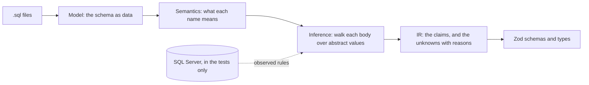

# How haruspex works

A guide to haruspex's internals, read in order, from the problem it solves to the code it writes. It is for two readers at
once: a developer deciding whether to trust haruspex, who wants to see how its claims are made; and someone learning how a
static analyser is built, who wants the ideas as well as this code. Each chapter explains its idea in general terms first,
names it as the literature does, shows how haruspex does it, and says what was considered instead and why it lost.

## Start here

**The idea in a paragraph.** Given a SQL Server database project, haruspex works out, without running anything, what
each stored procedure returns: every column and JSON key, its type, whether it can be null, and facts such as a length or a
set of values. It does this by *abstract interpretation*: it walks each procedure as SQL Server would run it, but over
descriptions of values ("an `int` that is never null") rather than values. Where two paths meet it keeps only what holds on
both, and where a construct is not understood it says *unknown*, with a reason, rather than guess. Every rule it uses about
SQL Server is checked against a real server by a test. The result is an IR, from which it generates Zod.

Then, in about ten minutes:

1. [The shape of the problem](01-the-shape-of-the-problem.md), "What haruspex is for": a procedure and the Zod haruspex
   writes for it, line by line.
2. The same chapter, "Sound by default": why haruspex says *unknown* rather than guess, and what an unknown looks like.
3. [Summaries and recursion](07-summaries-and-recursion.md), "Shapes, ordered" and "Solving recursion: the least fixed
   point": the few ideas about abstract values the rest needs, then the analysis at its most interesting, typing a tree
   that a function builds by calling itself.
4. [The decision log](../decisions/README.md), for any choice that looks odd: each record gives the alternatives and why
   they lost.

## The chapters

| | Chapter | |
|---|---|---|
| 1 | [The shape of the problem](01-the-shape-of-the-problem.md) | What haruspex is for; why it infers from the source rather than asking the server; why it is sound by default, and what *unknown* means. |
| 2 | [The inputs and the model](02-the-inputs-and-the-model.md) | What is read from a folder of scripts in no particular order, and how it becomes a model of the schema in three steps; why an object changed after its definition is recorded rather than applied; why the model hides the parser, with closed hierarchies for what is one of several; where each object is; and the one order the model keeps. |
| 3 | [Binding](03-binding.md) | Name resolution as compilers do it, with symbol tables, scopes and shadowing; SQL Server's rules as haruspex models them (columns, CTEs and recursion, derived tables and `APPLY`, temporary tables resolved when a statement runs, declarations compiled rather than run, names without a schema); the bound tree, bound once for each set of names; and how Inference attaches values to it without resolving a name. |
| 4 | [Abstract interpretation (the typer and the walker)](04-abstract-interpretation.md) | Running a program over abstract values instead of real ones; abstract domains and transfer functions; why *unknown* is the top of every domain, and what makes the analysis sound; a compositional semantics for expressions (the typer) against a flow-sensitive one for statements (the walker), and why the typer holds no state. |
| 5 | [Values as a lattice](05-values-as-a-lattice.md) | What haruspex knows about a value (its shape, why it may be null, its facets): when two such descriptions are equal, and why comparing them as text was a trap; how they are ordered and joined, one lattice per fact, and the laws the joins keep; witnesses; facts dropped by default; and why SQL Server's type rule for `CASE` is not a join. |
| 6 | [Flow, joins and fixed points](06-flow-joins-and-fixed-points.md) | The statement walk as a dataflow analysis: the state it carries, the join where paths meet, what conditions prove as one immutable environment, and one Kleene iteration for every fixed point, with its cap and its widening. |
| 7 | [Summaries and recursion](07-summaries-and-recursion.md) | How views, functions, triggers and called procedures are summarised; strongly connected components and the least fixed point; result sets as positions. |
| 8 | [The SQL Server type system, as data](08-the-sql-server-type-system-as-data.md) | SQL Server's built-in types as one catalogue, with their families, precedence, digits and ranges; the conversion chart, and the table of conversions that keep every value; the built-in functions as entries with stable codes, typed through one table; why data beats code here, and how each row, and every type through every operator, is observed against the server. |
| 9 | [Observing the engine](09-observing-the-engine.md) | Why every rule about SQL Server is observed in a differential test; how a fixture is laid out and found; how the harness checks every claim against real output and shows the seed reached every case; and how the runs are kept honest. |
| 10 | [The IR as a contract](10-the-ir-as-a-contract.md) | Why there is an intermediate format between front end and emitter, why it has a version of its own, why its schema is generated, why reading it back must give exactly what was written, why a reader refuses a version it doesn't read, and why its names belong to no dialect. |
| 11 | [Emitting code](11-emitting-code.md) | Why the Zod emitter plans, lowers to a model of Zod expressions and prints, rather than writing text as it goes or building TypeScript's syntax tree; why every walk over the IR's types asks one graph; and the code it writes: notes above the property with shared facts once in the header, no check said twice, identical shapes declared once, and numbers as JavaScript reads them. |
| 12 | [From input to output (the CLI)](12-from-input-to-output.md) | A run as a pipeline of named steps; results against exceptions, and the railway that composes them; why independent problems are all reported (the applicative side) while a step that needs a missing value isn't run (no cascades), as a compiler's error recovery does; stable codes; and writing two files without half an output. |

Each project's README is its layer's chapter in brief: what the layer is for, its main types, an example, what it
guarantees and what it deliberately doesn't do. They are listed in [docs/architecture.md](../architecture.md).

## Reading further

The ideas here are old and well described. Two books cover nearly all of them:

- Anders Møller and Michael I. Schwartzbach, *Static Program Analysis*, free online at
  <https://cs.au.dk/~amoeller/spa/>. Clear and short: lattices, dataflow analysis, widening, interprocedural analysis.
- Flemming Nielson, Hanne Riis Nielson and Chris Hankin, *Principles of Program Analysis* (Springer, 1999). The standard
  reference, more formal: abstract interpretation and its proofs.

Each chapter names the papers its own idea comes from.

## How the guide is kept true

The guide, the [decision log](../decisions/README.md) and the READMEs point into the code and show what haruspex produces.
Two tests keep those pointers and examples true, so a change that breaks one fails the build like any other test
([decision 0019](../decisions/0019-the-guide-is-held-to-the-code-by-tests.md)).

**Code references** (`CodeReferenceTests`). In every Markdown file but the house style guide, inline code is a reference
to check when it is one of these:

| Written as | Example | Must |
|---|---|---|
| A path from the repository root, starting `src/Haruspex.…`, `tests/`, `docs/` or `schemas/` | `src/Haruspex.SqlServer.Inference/FunctionSummaries.cs` | name a file or folder that exists |
| A C# file's name | `FlowState.cs` | name a file under `src/` or `tests/` |
| A name in PascalCase, with members after dots | `ResultTrack.Then`, `FixedPoint.MostPasses` | name a type of haruspex, then a member of it at each dot |
| A test's name | `Calls_nest_at_most_32_deep` | name a test method |

Types and members are found by reflection over haruspex's assemblies, and for the differential tests from their source. A
name alone may also be a test, a project or layer (`Ir`, `Sources`), or a schema or type a committed Zod snapshot exports, or a name a worked
example's Zod or [the five-minute start](../quick-start.md)'s module holds (a schema or type it exports, or a key of an object it declares), or a SQL name a fixture defines (a schema, or an object with its schema, such as `Sales.Orders`), but never a member: write a member after its type (`Conversions.Converts`), since a type renamed while a property keeps its
old name would otherwise go unnoticed. In a Mermaid diagram, every word in PascalCase with two capitals or more
(`IrBuilder`) is a name, checked the same way. A name that is not
haruspex's (a .NET type, an MSBuild property) is listed in `CodeReferences.Outside`, which says why each is there; a
renamed type of haruspex must never be added to it. Text in capitals (`FOR JSON`, `WITHOUT_ARRAY_WRAPPER`) is SQL and is not
checked, nor is anything with a placeholder or a wildcard. Links to this repository on GitHub, which the packable projects'
READMEs use because they are read on NuGet, are checked on disk too, and so is every path into `docs/` that a C# comment
names.

**Worked examples** (`WorkedExampleTests`). A fenced block whose info string is `sql haruspex-example` holds a whole
database project: tables, functions and procedures, separated by `GO`. Every procedure in it is inferred as the CLI does
with no config file. The blocks after it, up to the next example, show what that gives:

- `ts haruspex-zod`: the Zod module, compared line for line. It may start after the module's `import` line, leaving out the
  header, which names the IR's version.
- `json haruspex-ir`: the IR, compared as JSON; with a third word, only that top-level property
  (`json haruspex-ir unknowns`).
- `json haruspex-jsonschema`: the JSON Schema document, compared as JSON; with a third word, only that definition of its
  `$defs` (`json haruspex-jsonschema GetOrder`).
- `text haruspex-run`: what `haruspex generate` prints, standard error then standard output, run in a folder holding the
  project as `db/project.sql`, with paths shown from that folder. Words after the mark are the run's arguments; with none,
  the run takes its settings from the config file, or types every procedure to `out` when there is none. A
  `jsonc haruspex-config` block before it is the config file, `haruspex.json`, of the runs after it in the same example.
- `text haruspex-check`: what `haruspex check` prints when the example before this one has been generated, as if committed,
  and the project then changed to this one, run the same way and with the same arguments. It can't follow a file's first
  example, which has nothing before it.

An example may instead be written over one of the vendored corpora, named after the mark (`sql haruspex-example AdventureWorks`):
it is read beside the corpus's scripts, so it can use the sample's own tables, and only the procedures it defines are inferred.
The project's README shows haruspex this way, and `ShowcaseTests` holds each such example to a fixture that runs it on SQL Server.

When an example's output changes, the test prints what haruspex now gives. Read it as a claim about SQL Server, as you would
a snapshot, before pasting it in: the example teaches whatever it shows.

## Writing a chapter

Follow [the house style](../style.md). Lead with the idea in general terms, name it as the literature does, and point to
where to read more. Then show how haruspex does it, with a worked example where one teaches, and a Mermaid diagram where a
picture is clearer than prose. Argue rather than assert: for each design, the obvious alternative and why it lost, so that
a sceptical expert finds the argument already had. State the limits as plainly as the strengths. Use invented schemas (a
shop, a catalogue), never a real organisation's.
