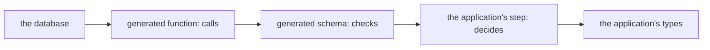

# The application's own types

The generated module says what the database guarantees: which keys a result has, which may be null or absent, what type and
range each value is. It doesn't say what the application means by them. That an absent list is an empty history, that a figure
is litres, that `water_log` is called `history` in the application's code: these are the application's decisions, which no
analysis of the database can make. This page shows where each kind of knowledge belongs, with one example from
[the greenhouse application](../examples/greenhouse/README.md), compiled by its test (`ExampleAppTests`).

## Three layers

Each layer does one thing, and only the last is written by hand:

1. **The generated function makes the call.** It checks the parameters and runs the procedure through the driver
   ([the database module](database-module.md)).
2. **The generated schema checks what came back**, inside the function, so a result that breaks a claim fails there, as a
   `ResultError`, rather than deep in the application.
3. **A thin step, written by hand on the generated type, turns it into the application's type.** Database names and shapes
   stop here: nothing past it sees a column's name, an absent key or a number without its unit.

A result passes through each in turn, and only the application's types go further:



The step takes the generated type as its input, so the compiler checks it against what the schema claims. When the database
changes and the module is regenerated, a step that reads a key the row lost, or a value whose type changed, stops compiling
there. A key the row gained stops it only with an account of every key ([below](#a-mapper-that-accounts-for-every-key)).

All of this happens when the module is regenerated, not when the database changes. Until then, the application reads the
database through the module it has: a column the database gains is dropped by the schema without an error (or, under
`"objects": "strict"`, fails the call), and a result set added after the known ones is ignored
([the database module](database-module.md#calling-a-procedure)). What notices that the module is out of date is
`haruspex check` in CI, which fails when a change to the SQL would change what the committed module claims
([the command line](command-line.md)).

## The example

The greenhouse's procedure `garden.get_plant` returns a plant with its log of watering, as `FOR JSON`. Its generated row has
`id`, `name`, `kind` and `water_log`, a list of `watered_at` and `litres` that is absent when the plant was never watered. The
application wants a `Plant` with its `history`, each watering an amount in litres that can't be mistaken for another number:

```ts examples/greenhouse/src/watering.ts
/** Litres of water: a number the compiler won't accept where another figure is wanted, nor this one in its place. */
export type Litres = number & { readonly unit: 'litres' }

/** One watering, as the application records it. */
export interface Watering {
  /** The greenhouse's own clock time, as the log keeps it: 2026-11-16T08:30:00. */
  readonly at: string
  readonly amount: Litres
}

/** A plant, in the application's words. */
export interface Plant {
  readonly id: number
  readonly name: string
  readonly history: readonly Watering[]
}
```

The step is one function. The type it takes says what it does with each key of the row
([below](#a-mapper-that-accounts-for-every-key)):

```ts examples/greenhouse/src/watering.ts
/** What toPlant does with each key of garden.get_plant's row; once the module is regenerated, a key the procedure gains stops the build here. */
type PlantRow = Exhaustive<GetPlantRow, {
  id: 'used'
  name: 'used'
  kind: 'ignored: the watering history treats every kind alike'
  water_log: { watered_at: 'used'; litres: 'used' }
}>

export function toPlant({ id, name, water_log }: PlantRow): Plant {
  return {
    id,
    name,
    // FOR JSON leaves out the key of a plant never watered; to the application, that is an empty history.
    history: (water_log ?? []).map(({ watered_at, litres }) => ({ at: watered_at, amount: litres as Litres })),
  }
}
```

And the three layers together, the first two generated:

```ts examples/greenhouse/src/watering.ts
export async function plant(pool: sql.ConnectionPool, id: number): Promise<Plant | null> {
  const row = await getPlant(pool, { plant_id: id })
  return row === null ? null : toPlant(row)
}
```

An application that calls the driver itself, with the schemas alone, puts the same step on the generated schema, and parses
with that (`PlantSchema.parse(result.recordset?.[0] ?? null)`, as [the database module](database-module.md#calling-the-driver-yourself)
says for the schema it is built on):

```ts examples/greenhouse/src/watering.ts
/** The same step on the generated schema, for code that calls the driver itself and parses with the schema alone. */
export const PlantSchema = GetPlantSchema.transform((row) => (row === null ? null : toPlant(row)))
```

## What the step is for, and what it isn't

**It is for the decisions the database can't know**: what an absent key or a null means to the application, which numbers are
money or litres or a count, what things are called, which keys this part of the application has no use for. Each is written
once, beside the reason for it, and the rest of the application uses the result.

**It isn't a second claim about the database.** A schema written by hand to say what the row looks like, beside the generated
one, is the claim haruspex makes, made again without the analysis, and it drifts. The step starts from the generated type and
changes it, so what it says about the row is what the schema says.

**Nor is it a mapper by convention**, one that copies each key to a field of the same name. It would carry the database's names
into the application's types, and pass a column the database gains straight through, where nobody decides about it.

## A mapper that accounts for every key

**For an application whose step must decide about every key a row gains.** A step that names the keys it uses compiles unchanged when the procedure gains a column, and the column is dropped without
anyone choosing to drop it. `"mapping"` in `"emit"` ([the configuration](configuration.md#what-is-written-emit)) writes
`haruspex.mapping.ts` beside the module, with one type, `Exhaustive`, that makes the compiler stop there instead. It is types
only, with nothing to run.

`Exhaustive<GetPlantRow, { … }>` takes an account of the row: an entry for every key, `'used'`, or `'ignored: '` with the
reason. A key that holds objects, or a list of them, has an account of its own, as `water_log` has above, to any depth; a
recursive type's account refers to itself. The compiler refuses the account when it leaves out a key the row has, names one it
doesn't, marks a key of objects `'used'` whole, ignores a key without a reason, or gives a key several decisions at once. A
record (an object whose keys are data, such as prices by currency) is accounted for by its values. So once the module is
regenerated, a key the procedure gains, anywhere in the row, is an error at the account, in the one place that must decide
about it.

The type is the row without the keys ignored, so the generated row is passed to the step as it is, and the step can't read a
key it said it ignores: `kind` doesn't exist on `PlantRow`. Whether a key marked `'used'` is read, the compiler can't see. A step
that takes its keys by destructuring, as `toPlant` does, lets typescript-eslint's rule against unused variables find a key
named and never read. Nor does the account notice a key that becomes optional or nullable: its entry stays `'used'`, and it is
the step's body that stops compiling, where it relies on the value, as `toPlant` would if `name` could be null, since
`Plant.name` is a `string`.
Why it works this way, and the alternatives, are in [decision 0066](decisions/0066-a-mapper-accounts-for-every-key-of-a-generated-row.md).
