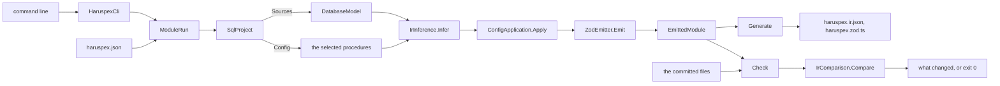

# Haruspex.Cli

The `haruspex` command. It composes the layers: it reads a folder of `.sql` files or a DACPAC with
[Haruspex.SqlServer.Sources](https://github.com/sharpblue/haruspex/blob/main/src/Haruspex.SqlServer.Sources/README.md), infers
with [Haruspex.SqlServer.Inference](https://github.com/sharpblue/haruspex/blob/main/src/Haruspex.SqlServer.Inference/README.md),
applies [`haruspex.json`](https://github.com/sharpblue/haruspex/blob/main/docs/configuration.md) with
[Haruspex.Config](https://github.com/sharpblue/haruspex/blob/main/src/Haruspex.Config/README.md), and writes the IR and the
output of [Haruspex.Emit.Zod](https://github.com/sharpblue/haruspex/blob/main/src/Haruspex.Emit.Zod/README.md).

## How data flows through it

`HaruspexCli` parses the command line, and `ModuleSet` runs the command once for each module it covers. `ModuleRun` runs the steps both commands share, each returning an outcome, up to the
module in memory (`EmittedModule`); `Generate` writes it, and `Check` compares it with what is committed, claim by claim
(`IrComparison`, in the IR's layer). `SqlProject` composes the layers that read and infer.



## Example

```sh
haruspex generate                                    # settings from haruspex.json, found by walking up
haruspex generate path/to/database --include 'sales.*' --out src/db
haruspex generate bin/Release/Sales.dacpac --include 'sales.*' --out src/db   # a DACPAC and the packages it refers to
haruspex generate Sales/Sales.sqlproj --include 'sales.*' --out src/db       # a project file, read as its build reads it
```

```sh
haruspex check                                       # in CI: fail if the committed module would change
haruspex check --all                                 # every haruspex.json below the working directory, each a module
haruspex generate -c plugins/orders/haruspex.json -c plugins/returns/haruspex.json
```

`generate` writes `haruspex.ir.json` and `haruspex.zod.ts` to the output folder. `check` infers the same way, writes nothing,
and compares with the two files committed there. Both take the same arguments: the source argument (a folder, a `.sqlproj` or
a `.dacpac`), `--include` and `--out` override the config file for one run, and `--config` names a config file instead of
searching for one.

**Several modules.** An application whose plugins each have their own interface to the database has a `haruspex.json`
for each, and each is a module of its own: its own selection, names, output and committed contract. `--config` may be
repeated, and `--all` runs every `haruspex.json` below a folder (the working directory, or the one it names), in path
order, leaving out folders whose name starts with a dot, `node_modules`, and a repository or worktree nested below (a
folder holding `.git`), whose modules are another checkout's. Each module runs as a run of its own would, under a line
naming its config file, and the run ends with one line saying which failed; its exit code is the worst of theirs. A
source, `--include` and `--out` are one module's, so they can't be given with several, and two modules may not share an
`out`. With one config file, nothing is added to what a run prints.

A check that fails says what changed, one line for each change, at the procedure it is in:

```text
db/procedures.sql:1:1: error HAR6014: shop.list_orders results[0][].customer: became nullable
db/procedures.sql:1:1: error HAR6014: shop.list_orders results[0][].status: value set grew: added "closed"
haruspex: 2 change(s) from what is committed. If they are meant, run haruspex generate and commit what it writes; if not, change the SQL back.
```

Everything it finds goes to standard error, one line each, in the form compilers write and editors and CI annotate, with
the problem's code, whose page in [docs/diagnostics](https://github.com/sharpblue/haruspex/blob/main/docs/diagnostics/README.md)
says what it means and what to do:

```text
db/procedures/get_order.sql:7:5: error HAR1001: Incorrect syntax near 'FROM'.
haruspex.json:14:9: error HAR4104: procedures["sales.get_order"].paths["lines[].skew"]: the path results[0].lines[].skew does not exist: …
db/procedures/list_orders.sql:12:9: note HAR2013: sales.list_orders results[0][].settings: JSON whose shape is not visible …
```

An error stops the run. A warning, such as a call whose results only a declaration in the config file could give, and a
note, one for each unknown in the output with where it is and why, don't. A run that succeeds prints one line to standard
output: how many procedures it typed, how many unknowns there are, and where it wrote.

## What it guarantees

- **Every unknown is reported**, as a note with its code, its place in the SQL and its reason, except one only a
  declaration can resolve (dynamic SQL, a procedure chosen when it runs, one outside the project), which is a warning
  saying what to declare instead. One fact is said once.
- **Every problem with a run's settings is reported**, not only the first: a config file that doesn't read, a missing
  source folder, a missing output folder and a malformed `--include` are all listed in one run. A check that needs what an
  earlier step failed to give is not run, so one mistake doesn't bring others with it; the price is that a problem only a
  later step can see (a pattern that matches no procedure, say) waits until the run gets that far.
- **No half output.** When the SQL, the command line or the config file has an error, or the module can't be emitted,
  nothing is written, and the output folder isn't even created. When the run succeeds, both files are written in full to
  temporary names in the output folder and then renamed into place, the IR first; if the module can't be put in place,
  the IR is put back as it was (or removed, if there was none), no temporary file is left, and the exit code is 1. Two
  files can't be replaced as one, so a new IR can still be left beside the old module in two cases: a process killed
  between the two renames, which can also leave the hidden temporary files (`.haruspex.ir.json.….tmp`, `….old`) in the
  folder; and a file system that refuses to put the IR back, which the error then says, keeping the old IR beside it.
- **The same input gives the same bytes**, on every platform, so a CI check can compare the output with what is committed.
- **`check` writes nothing, and fails on any change of claim**, said as the change: a field added or removed, a value that
  became nullable, a type that changed, a value set that grew. What only says where a claim came from (a location, a reason,
  a DACPAC's hash) isn't compared, so moving a procedure down its file passes. A module that differs though the IR claims the
  same fails too, quoting the first line that differs (a comment giving a reason that changed, a module another version of
  haruspex wrote, a hand edit), as does nothing committed, a committed IR of
  another version, and a selected procedure whose result sets are unknown and not declared. Unknowns are notes, and pass,
  unless the config file says `"check": { "unknowns": "fail" }`
  ([decision 0050](https://github.com/sharpblue/haruspex/blob/main/docs/decisions/0050-check-compares-claims-not-files.md)).
- **The exit codes are fixed**, so scripts and CI can rely on them (`ExitCodeTests` holds each row). A run over several
  modules exits with the highest of theirs (`ModuleSetTests`):

| Code | Meaning |
|---|---|
| 0 | Success, with or without warnings and notes |
| 1 | The input has errors (SQL that doesn't parse, an object defined twice, a file that isn't a DACPAC), the output couldn't be written, or a check failed: what the module claims would change, or it can't be compared with what is committed |
| 2 | The command line or the config file is wrong: an unknown option, a missing folder, a pattern that matches nothing, an override whose path doesn't exist, generated names that clash, an import the module can't write |
| 3 | A fault in haruspex itself |

## What it deliberately doesn't do

- **No logic of its own.** Each rule lives in the layer it belongs to. The CLI parses arguments, finds files, composes the
  layers and writes the results. `SqlProject` is that composition, kept here because no layer below may know both how a
  model is read and how it is inferred.
- **No database connection.** Everything comes from the source files
  ([decision 0001](https://github.com/sharpblue/haruspex/blob/main/docs/decisions/0001-infer-from-source-never-a-live-database.md)).
- **No watch mode or server.** It runs once and exits, which is what a build step or a CI job needs.

It is part of [haruspex](https://github.com/sharpblue/haruspex), and pre-release: its commands, options and output will
change. How a run goes from input to output, step by step, and why it is built so, is
[the guide's chapter 12](https://github.com/sharpblue/haruspex/blob/main/docs/internals/12-from-input-to-output.md).
