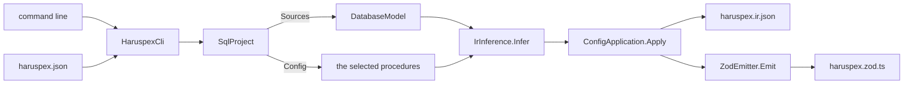

# Haruspex.Cli

The `haruspex` command. It composes the layers: it reads a folder of `.sql` files with
[Haruspex.SqlServer.Sources](https://github.com/sharpblue/haruspex/blob/main/src/Haruspex.SqlServer.Sources/README.md), infers
with [Haruspex.SqlServer.Inference](https://github.com/sharpblue/haruspex/blob/main/src/Haruspex.SqlServer.Inference/README.md),
applies [`haruspex.json`](https://github.com/sharpblue/haruspex/blob/main/docs/configuration.md) with
[Haruspex.Config](https://github.com/sharpblue/haruspex/blob/main/src/Haruspex.Config/README.md), and writes the IR and the
output of [Haruspex.Emit.Zod](https://github.com/sharpblue/haruspex/blob/main/src/Haruspex.Emit.Zod/README.md).

## How data flows through it

`SqlProject` is the composition; `HaruspexCli` parses the command line and writes the files.



## Example

```sh
haruspex generate                                    # settings from haruspex.json, found by walking up
haruspex generate path/to/database --include 'sales.*' --out src/db
```

`generate` writes `haruspex.ir.json` and `haruspex.zod.ts` to the output folder. The folder argument, `--include` and
`--out` override the config file for one run, and `--config` names a config file instead of searching for one.
Diagnostics go to standard error as `file:line:column: error HAR1001: message`, or `warning`, with the problem's code,
which editors and CI annotate.
A warning, such as a call whose results only a declaration in the config file could give, doesn't stop the run. A run
that succeeds prints one line to standard output: how many procedures it typed and how many unknowns there are. The
unknowns themselves are in the IR file's `unknowns`, each with its reason, a sentence saying why, and where it is; they
aren't listed on the console.

## What it guarantees

- **Nothing is written when the input is wrong.** When the SQL, the command line or the config file has an error, nothing
  is written. Both outputs are made in memory before either is written, and then written one after the other, so only a
  failure to write (a full disk, a folder that can't be written to) can leave a new IR file beside a missing or older Zod
  file; the exit code is then 1.
- **The same input gives the same bytes**, on every platform, so a CI check can compare the output with what is committed.
- **The exit codes are fixed**, so scripts and CI can rely on them:

| Code | Meaning |
|---|---|
| 0 | Success |
| 1 | The input has errors (SQL that doesn't parse, an object defined twice), or the output couldn't be written |
| 2 | The command line or the config file is wrong: a missing option, a pattern that matches nothing, an override whose path doesn't exist, generated names that clash |
| 3 | A fault in haruspex itself |

## What it deliberately doesn't do

- **No logic of its own.** Each rule lives in the layer it belongs to. The CLI parses arguments, finds files, composes the
  layers and writes the results. `SqlProject` is that composition, kept here because no layer below may know both how a
  model is read and how it is inferred.
- **No database connection.** Everything comes from the source files
  ([decision 0001](https://github.com/sharpblue/haruspex/blob/main/docs/decisions/0001-infer-from-source-never-a-live-database.md)).
- **No watch mode or server.** It runs once and exits, which is what a build step or a CI job needs.

It is part of [haruspex](https://github.com/sharpblue/haruspex), and pre-release: its commands, options and output will
change. Its chapter of [the guide](https://github.com/sharpblue/haruspex/blob/main/docs/internals/README.md), *From input
to output*, is planned.
