# Haruspex.Cli

The `haruspex` command. It composes the layers: it reads a folder of `.sql` files, a `.sqlproj` or a DACPAC with
[Haruspex.SqlServer.Sources](https://github.com/haruspex-tools/haruspex/blob/main/src/Haruspex.SqlServer.Sources/README.md), infers
with [Haruspex.SqlServer.Inference](https://github.com/haruspex-tools/haruspex/blob/main/src/Haruspex.SqlServer.Inference/README.md),
applies [`haruspex.json`](https://github.com/haruspex-tools/haruspex/blob/main/docs/configuration.md) with
[Haruspex.Config](https://github.com/haruspex-tools/haruspex/blob/main/src/Haruspex.Config/README.md), and writes the IR and the
output of [Haruspex.Emit.Zod](https://github.com/haruspex-tools/haruspex/blob/main/src/Haruspex.Emit.Zod/README.md).

## How data flows through it

`HaruspexCli` parses the command line, and `ModuleSet` runs the command once for each module it covers. `ModuleRun` runs the steps both commands share, each returning an outcome, up to the
module in memory (`EmittedModule`); `Generate` writes it, and `Check` compares it with the files in the output folder, claim by claim
(`IrComparison`, in the IR's layer). `SqlProject` composes the layers that read and infer. Neither command prints: each gives
back a `ModuleReport` of what it found and did, and a report in `Output/` prints it in the format asked for (`TextReport`,
`JsonReport`, `SarifReport`, `GitHubAnnotations`), as `OutputSettings` settles from the terminal. `Init` writes a starter
config file.

```mermaid
flowchart LR
    args["command line"] --> cli["HaruspexCli"]
    cli --> run["ModuleRun"]
    configFile["haruspex.json"] --> run
    run --> project["SqlProject"]
    project -->|Sources| model["DatabaseModel"]
    project -->|Config| selected["the selected procedures"]
    configFile -->|"Config, Sources"| queries["the query files"]
    queries --> infer
    model --> infer["IrInference.Infer"]
    selected --> infer
    infer --> apply["ConfigApplication.Apply"]
    apply --> zod["ZodEmitter.Emit"]
    apply --> jsonSchema["JsonSchemaEmitter.Emit"]
    zod --> emitted["EmittedModule"]
    jsonSchema --> emitted
    emitted --> generate["Generate"]
    generate --> files["haruspex.ir.json, haruspex.zod.ts, haruspex.jsonschema.json, haruspex.files.json"]
    emitted --> check["Check"]
    committed["the files in the output folder"] --> check
    check --> compare["IrComparison.Compare"]
    compare --> changes["what changed, or exit 0"]
```



## Example

No package is published yet, so there is no `haruspex` on the `PATH`: until there is, run it from a clone of the repository
as `dotnet run --project src/Haruspex.Cli -- generate …`, which builds it first. With the command installed:

```sh
haruspex init                                        # find the database below here, write a starter haruspex.json
haruspex generate                                    # settings from haruspex.json, found by walking up
haruspex generate path/to/database --include 'sales.*' --out src/db
haruspex generate bin/Release/Sales.dacpac --include 'sales.*' --out src/db   # a DACPAC and the packages it refers to
haruspex generate Sales/Sales.sqlproj --include 'sales.*' --out src/db       # a project file, read as its build reads it
```

```sh
haruspex check                                       # in CI: fail if the module in the output folder would change
haruspex check --all                                 # every haruspex.json below the working directory, each a module
haruspex generate -c plugins/orders/haruspex.json -c plugins/returns/haruspex.json
```

`init` looks below the working directory for the database's files, a `.sqlproj` first, then a `.dacpac` (in `bin` too, where a
build writes one, leaving out the system databases' packages beside it), then the folder holding every `.sql` file, and writes
a `haruspex.json` that reads it, types every procedure of each schema that has one, and writes to `src/db` (or `generated`
when there is no `src` folder). It never writes over a config file, and when it finds two of a kind it names them and asks
for one: `haruspex init Sales/Sales.sqlproj`.

`generate` writes `haruspex.ir.json` to the output folder, and beside it what the config file's `emit` names: `haruspex.zod.ts`
(the default), `haruspex.jsonschema.json`, `haruspex.mssql.ts`, the database module's functions, and `haruspex.mapping.ts`, the
mapping helper ([the configuration page](../../docs/configuration.md#what-is-written-emit)). It writes `haruspex.files.json`
beside them, the list of the files it wrote (`OutputList`), and removes each file the last run's list names that this run
doesn't write (`StaleFiles`), never one the list doesn't name
([decision 0091](../../docs/decisions/0091-generate-removes-only-the-files-its-list-names.md)).
`check` infers the same way, writes nothing, and compares with the files there, which in CI are the ones committed. Both
take:

| Argument or option | What it is |
|---|---|
| `source` | The folder of `.sql` files, the `.sqlproj` or the `.dacpac` to read. Replaces `source` in the config file. |
| `--config`, `-c` | The config file. By default, `haruspex.json` in the working directory or the nearest folder above it. Give it again for more modules. |
| `--all`, `-a` | Every `haruspex.json` below the folder given, or below the working directory, each a module ("Several modules", below). |
| `--include`, `-i` | Procedures to type, as `schema.name`, where `*` and `?` match within a part; give it again, or give several, for more. Replaces the config file's includes for this run, which then removes no file of the last run's ([decision 0091](../../docs/decisions/0091-generate-removes-only-the-files-its-list-names.md)). |
| `--out`, `-o` | The folder to write to, or for `check` to compare with. Replaces `out` in the config file. |
| `--verbose`, `-v` | Also list every note: each unknown, grouped by the procedure or query file it is in. |
| `--quiet`, `-q` | Print errors only. |
| `--color` | `auto` (the default: colour on a terminal, unless `NO_COLOR` is set), `always` or `never`. |
| `--format` | `text` (the default), `json` for a tool, `sarif` for code scanning, or `github` for annotations in GitHub Actions (the default when `GITHUB_ACTIONS` is `true`). |

Without a config file, the source, `--include` and `--out` are all required. `haruspex --help`, `haruspex generate --help`
and `haruspex check --help` list the same.

**Several modules.** An application whose plugins each have their own interface to the database has a `haruspex.json`
for each, and each is a module of its own: its own selection, names, output and committed contract. `--config` may be
repeated, and `--all` runs every `haruspex.json` below a folder (the working directory, or the one it names), in path
order, leaving out folders whose name starts with a dot, `node_modules`, and a repository or worktree nested below (a
folder holding `.git`), whose modules are another checkout's. Each module runs as a run of its own would, under a line
naming its config file, and the run ends with one line saying which failed; its exit code is the worst of theirs. A
source, `--include`, `--out` and `--baseline` are one module's, so they can't be given with several, and two modules may not
share an `out`. With one config file, nothing is added to what a run prints.

A check that fails says what changed, one line for each change, at the procedure it is in, or, for a value that became
nullable, where its new reason is (here the column's declaration):

```text
db/tables.sql:3:5: error HAR6014: shop.list_orders results[0][].customer: became nullable
db/procedures.sql:1:1: error HAR6014: shop.list_orders results[0][].status: value set grew: added "closed"
haruspex: 2 changes from the module in generated. If they are meant, run haruspex generate and commit what it writes; if not, change back the SQL, or a schema file a column is declared with.
```

In CI, until haruspex is published as a package, a job runs it from a copy of its source pinned to a commit, and one step
checks every module in the repository:

```yaml
- uses: actions/checkout@v7                      # haruspex itself, into .haruspex, which check --all doesn't look in
  with: { repository: haruspex-tools/haruspex, ref: <commit>, path: .haruspex }
- uses: actions/setup-dotnet@v6
  with: { global-json-file: .haruspex/global.json }
- run: dotnet run --project .haruspex/src/Haruspex.Cli -- check --all   # every haruspex.json below; exit code 1 on a change
```

Pin the two actions by commit too, as haruspex's own workflow does.

What each run prints, mode by mode, with the options for colour and the formats for tools and CI (`--format json`, `sarif`,
`github`), is [the command line's page](../../docs/command-line.md). Each error and warning goes to standard error, one line each, in the form compilers write and editors and CI annotate, with
the problem's code, whose page in [docs/diagnostics](https://github.com/haruspex-tools/haruspex/blob/main/docs/diagnostics/README.md)
says what it means and what to do; so does each note, one for each unknown, with `--verbose`:

```text
db/procedures/get_order.sql:7:5: error HAR1001: Incorrect syntax near 'FROM'.
haruspex.json:14:9: error HAR4104: procedures["sales.get_order"].paths["lines[].skew"]: the path results[0].lines[].skew does not exist: …
db/procedures/list_orders.sql:12:9: note HAR2013: sales.list_orders results[0][].settings: JSON whose shape is not visible …
```

An error stops the run. A warning, such as a call whose results only a declaration in the config file could give, and a
note, one for each unknown in the output with where it is and why, don't. A run that succeeds first prints its summary to
standard output: how many procedures it typed (and query files, when there are any), how many unknowns there are, and where it
wrote. `generate` reads the IR it is about to write over, and says what changed since the last run, as `check` compares claims:
each change, then the unknowns that are new or resolved. When nothing changed, that is the one line it prints. A first run, or
an earlier IR of another version or one that doesn't read, says why it can't compare and counts the unknowns by reason instead.
Errors and warnings follow in full. Notes are counted, not listed: `--verbose` lists
each, grouped by the procedure or query file it is in, and `--quiet` prints errors only. Paths below the working directory are
shown from it.

## Why a field is what it is: `explain`

`haruspex explain` (`Explain`) reads the committed IR and nothing else, finds the field by the path a person writes
(`IrFieldPlaces`), and prints its derivation from the IR's `from` and null reasons, each reason with its short text and page
(`IrReasons`), as text or, with `--json`, a document for tools (`ExplainWriter`). Under each reference it prints the line of SQL
when that SQL is at hand and, for a package, unchanged (`ExplainSources`, which reads a package's line through `PackageLines`);
otherwise the reference alone. `check` ends a message about a changed field with the command (`ExplainPointer`). What it prints,
and the JSON's shape, are in [the command line's page](../../docs/command-line.md#explain); why it reads the IR alone is
[decision 0078](https://github.com/haruspex-tools/haruspex/blob/main/docs/decisions/0078-the-ir-says-where-each-field-came-from.md).

## What it guarantees

- **Every unknown is reported**, as a note with its code, its place in the SQL and its reason, except one only a
  declaration can resolve (dynamic SQL, a procedure chosen when it runs, one outside the project, one the caller's default
  schema chooses, one created `WITH ENCRYPTION`), which is a warning
  saying what to declare instead. One fact is said once.
- **Every problem with a run's settings is reported**, not only the first: a config file that doesn't read, a missing
  source folder, no output folder given and a malformed `--include` are all listed in one run. A check that needs what an
  earlier step failed to give is not run, so one mistake doesn't bring others with it; the price is that a problem only a
  later step can see (a pattern that matches no procedure, say) waits until the run gets that far.
- **No half output.** When the SQL, the command line or the config file has an error, or the module can't be emitted,
  nothing is written, and the output folder isn't even created. When the run succeeds, every file (the IR and what `emit`
  names) is written in full to a temporary name in the output folder and then renamed into place, the IR first; if one can't
  be put in place, those before it are put back as they were (or removed, if there were none), no temporary file is left,
  and the exit code is 1. Several files can't be replaced as one, so a new file can still be left beside an old one in two
  cases: a process killed between two renames, which can also leave the hidden temporary files (`.haruspex.ir.json.….tmp`,
  `….old`) in the folder; and a file system that refuses to put one back, which the error then says, keeping the old file
  beside it.
- **It removes only what it wrote.** Once the module is in place, each file the last run's `haruspex.files.json` names that
  this run didn't write is removed, then the list is written anew; a file the list doesn't name is never removed, nor anything
  the list names outside the folder, with a character no name it writes has, or through a symbolic link, nor a folder. A run
  that fails before writing removes nothing, and so does one narrowed by `--include`.
- **The same input gives the same bytes**, on every platform, so a CI check can compare the output with what is committed and checked out.
- **`check` writes nothing, and fails on any change of claim**, said as the change: a field added or removed, a value that
  became nullable, a type that changed, a value set that grew. What only says where a claim came from (a location, a reason,
  a DACPAC's hash) isn't compared, so moving a procedure down its file passes. A module that differs though the IR claims the
  same fails too, quoting the first line that differs (a comment giving a reason that changed, a module another version of
  haruspex wrote, a hand edit), as does an output folder with nothing to compare
  with, an IR there of another version, and a selected procedure whose result sets are unknown and not declared. Unknowns are notes, and pass,
  unless the config file says `"check": { "unknowns": "fail" }`
  ([decision 0050](https://github.com/haruspex-tools/haruspex/blob/main/docs/decisions/0050-check-compares-claims-not-files.md)).
- **`generate` with a baseline writes types that work against both databases** (`CombinedTypes`): the baseline (`Baseline`),
  read once for the run as a source is, with the module's own config file, or from an IR file, is combined with the module's
  own document by `IrCombination`, and every emitter writes the combined one. A change no one function bridges is an error at its
  procedure (HAR6033), which the module leaves out while it is written for the rest, and the run fails with 1; a possible rename
  (HAR6034), a procedure in one database only (HAR6035) and a return shape that changes (HAR6028) are warnings
  ([decision 0073](https://github.com/haruspex-tools/haruspex/blob/main/docs/decisions/0073-generate-with-a-baseline-writes-types-that-hold-against-both-databases.md)).
- **`check` with a baseline also fails on what the application already running would fail on** (`BaselineCheck`): `IrFit`
  judges the module's own database against the baseline, the database that application was built against, and the output
  folder is compared with the combined module, as `generate` with the same baseline writes it. A change it would fail on is an error (HAR6026), one it sets aside
  a warning (HAR6027), and a function whose return shape changes a warning (HAR6028). The comparison with the output folder is
  still made, unless `--fit-only` asks for the fit alone, as a database's pipeline does against an application's committed
  contract
  ([decision 0069](https://github.com/haruspex-tools/haruspex/blob/main/docs/decisions/0069-check-with-a-baseline-judges-the-deploy-window.md)).
- **The exit codes are fixed**, so scripts and CI can rely on them (`ExitCodeTests` holds each row). A run over several
  modules exits with the highest of theirs (`ModuleSetTests`):

| Code | Meaning |
|---|---|
| 0 | Success, with or without warnings and notes |
| 1 | The input has errors (SQL that doesn't parse, an object defined twice, a file that isn't a DACPAC), the output couldn't be written, or a check failed: what the module claims would change, it can't be compared with the files in the output folder, or the application already running, built against the baseline, would fail on a change; or a change between the baseline and the source can't be bridged, though the module is written for the rest; or `init` wrote the config file, but reading the source it names found errors |
| 2 | The command line or the config file is wrong: an unknown option, a missing folder, a pattern that matches nothing, an override whose path doesn't exist, generated names that clash, an import the module can't write; or `init` wrote nothing, finding a config file, no database or more than one |
| 3 | A fault in haruspex itself |

## What it deliberately doesn't do

- **No logic of its own.** Each rule lives in the layer it belongs to. The CLI parses arguments, finds files, composes the
  layers and writes the results. `SqlProject` is that composition, kept here because no layer below may know both how a
  model is read and how it is inferred.
- **No database connection.** Everything comes from the source files
  ([decision 0001](https://github.com/haruspex-tools/haruspex/blob/main/docs/decisions/0001-infer-from-source-never-a-live-database.md)).
- **No watch mode or server.** It runs once and exits, which is what a build step or a CI job needs.

It is part of [haruspex](https://github.com/haruspex-tools/haruspex), and pre-release: its commands, options and output will
change. How a run goes from input to output, step by step, and why it is built so, is
[the guide's chapter 12](https://github.com/haruspex-tools/haruspex/blob/main/docs/internals/12-from-input-to-output.md).
