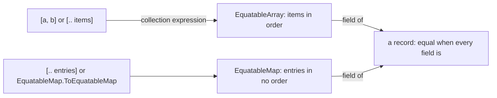

# Haruspex.Collections

Immutable collections that compare by value: `EquatableArray<T>`, a sequence equal to another with equal items in the same
order, and `EquatableMap<TKey, TValue>`, a map equal to another with the same keys holding equal values, in any order. A record's generated equality compares each field with that field's own equality, and for .NET's collections that is
the reference, so a record holding a list is equal only to itself. Holding these instead, a record compares by value, as
[decision 0022](https://github.com/sharpblue/haruspex/blob/main/docs/decisions/0022-values-compare-by-structure.md) requires of
every record of haruspex; the guide's chapter [Values as a lattice](https://github.com/sharpblue/haruspex/blob/main/docs/internals/05-values-as-a-lattice.md)
says why comparing them any other way was a trap. They are a package of their own because every layer holds them, the reusable
[Haruspex.SqlServer.Model](https://github.com/sharpblue/haruspex/blob/main/src/Haruspex.SqlServer.Model/README.md) among them
([decision 0034](https://github.com/sharpblue/haruspex/blob/main/docs/decisions/0034-collections-that-compare-by-value-are-a-layer-of-their-own.md)).

## How data flows through it

A collection expression builds one, and a record holding one compares by what it holds.



## Example

```csharp
EquatableArray<string> first = ["id", "name"];
EquatableArray<string> second = ["id", .. new[] { "name" }];
Console.WriteLine(first == second);   // True: the same items in the same order

var prices = new[] { ("tea", 3), ("cake", 4) }.ToEquatableMap(p => p.Item1, p => p.Item2);
var again = new[] { ("cake", 4), ("tea", 3) }.ToEquatableMap(p => p.Item1, p => p.Item2);
Console.WriteLine(prices == again);    // True: the same entries, added in another order
```

## What it guarantees

- **Equality is the items'**, in order, by each item's own equality; equal sequences hash equal.
- **A map's equality is its entries'**, whatever order they were added in, and so is its hash. Which keys are the same is
  the key type's own equality: a map takes no comparer, so two maps can't disagree about it, and a key that ignores case is
  a type that says so.
- **It never changes** once built: it wraps an immutable array, copied when it is made.
- **An empty sequence is one object per item type**, so the most common list costs nothing.

## What it deliberately doesn't do

- **No mutation**: build a new one.
- **No equality of its own choosing**: an item, key or value that compares by reference makes the collection compare by
  reference.
