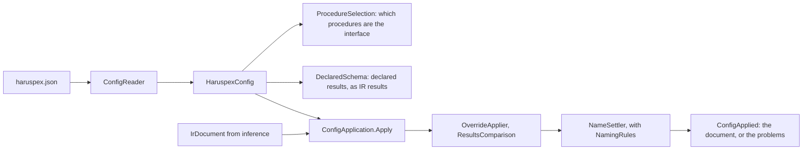

# Haruspex.Config

The config file, `haruspex.json`: reading it, selecting procedures, and applying overrides and naming to the IR that
inference produced. The format is documented for users in [docs/configuration.md](../../docs/configuration.md) and
published as a JSON Schema in [schemas/haruspex.schema.json](../../schemas/haruspex.schema.json).

## How data flows through it

The config file is read once. It decides which procedures inference is asked for, then transforms the document inference
returns: claims a person makes first, names last.



| File | What it does, and why it is so |
|---|---|
| `ConfigJson.cs` | Reads JSON with comments into a tree that remembers each value's line and column. `JsonDocument` forgets positions, and every error must name its line. |
| `ConfigReader.cs` | Finds the file (walking up) and checks every setting; an unknown key is an error, never ignored. The same checks as the JSON Schema, plus what a schema can't say (a pattern, a path or a regular expression that doesn't parse, a reserved word). |
| `NamePattern.cs`, `ObjectPattern.cs`, `ProcedureSelection.cs` | Selection per schema (`schemas["sales"].include`, matching names only), and the CLI's one-off `--include schema.pattern`. A pattern or a schema key that matches nothing is reported. |
| `DeclaredSchema.cs` | A procedure's declared results (`results`): the JSON Schema of each, inline or in a file, translated into IR results. A keyword it doesn't read is a warning and is not checked, so a declared type is never narrower than its schema. |
| `ResultsComparison.cs` | A declaration of results that inference can infer is compared with them: an error where they differ, a warning where they agree. |
| `OverrideApplier.cs` | Path overrides as transformations of the IR. Each claim is listed in the IR's `overrides`; a path that doesn't exist is an error, an override the inference agrees with a warning. |
| `NamingRules.cs` | `replace`, then the schema's `prefix`, then `case`; a schema's `naming` merges over the top level's. |
| `NameSettler.cs` | Settles every name, replacing inference's provisional keys. Clashes between objects are errors; a number is added only between two types of one object. |
| `ConfigApplication.cs` | The order: overrides and declared results first (their paths are in terms of the inferred document), then names. It also warns of a selected procedure whose results only a declaration could give, naming the statement. |

## Example

```csharp
var read = ConfigReader.Read("haruspex.json");
var config = read.Config ?? throw new InvalidOperationException(string.Join("\n", read.Problems));
var applied = ConfigApplication.Apply(document, config, procedures);
foreach (var problem in applied.Problems)
    Console.Error.WriteLine(problem);
```

## What it guarantees

- **Every claim a person makes is visible and checked.** An override is listed in the IR's `overrides` with its reason,
  and the generated code still checks the value at runtime, so a wrong override fails loudly rather than casting. A
  declaration of results inference can infer is compared with what it infers.
- **Nothing the file says is ignored.** An unknown key, a pattern that matches nothing, or an override whose path doesn't
  exist is reported, since each would otherwise drop something silently.
- **A name depends only on its object and the settings**, never on which other objects exist
  ([decision 0011](../../docs/decisions/0011-generated-names-leave-the-schema-out.md)).

**Why naming lives here, not in inference.** Names are generated from config, so they can't be settled before it is
read. Inference keys each type by its identity (the object and the path that own it, also written to the IR as
`identity`), and leaves each procedure's name as its id; this layer replaces both. Inference settling names itself would mean
breaking clashes with numbers, which would make names depend on which other objects exist.

**Why overrides come before naming.** A path override is written in terms of the shape, which doesn't depend on names,
and a `name` override must be known before the types under it are named, since their names build on it.

**Why declared results reach inference.** A declaration is applied to the procedure itself here, like an override. But a
procedure that calls it needs the declared result sets placed among its own, through its branches and loops, which only the
statement walk can do. So the declarations, translated into IR results here, are also handed to inference by the CLI
(`SqlProject.Infer`), which takes them as given facts about procedures, as it takes the model; it never sees this file.

## What it deliberately doesn't do

- **No SQL syntax.** It knows the IR and the model's object names, and not ScriptDom, as the layer table in
  [docs/architecture.md](../../docs/architecture.md) says.
- **No reaching into inference.** Overrides transform the finished document, so they work the same however it was
  produced.
- **No emitters.** The CLI maps `objects` to the Zod emitter's own options.

How haruspex works, layer by layer, is in [the guide](../../docs/internals/README.md); the decisions this layer rests on
are [0008](../../docs/decisions/0008-objects-strip-unknown-keys-by-default.md),
[0010](../../docs/decisions/0010-procedures-are-selected-per-schema.md),
[0011](../../docs/decisions/0011-generated-names-leave-the-schema-out.md) and
[0013](../../docs/decisions/0013-results-that-cannot-be-inferred-are-declared.md).
