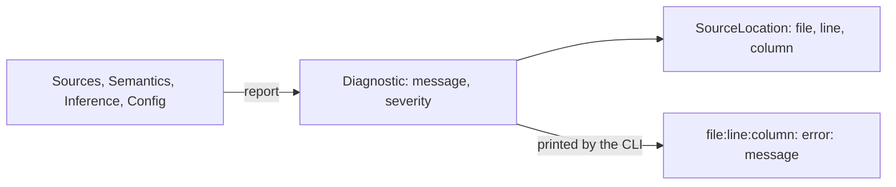

# Haruspex.Diagnostics

Two small types shared by haruspex's layers: `SourceLocation`, a place in the source, and `Diagnostic`, a message about
it. They are a package of their own only because the reusable layers,
[Haruspex.SqlServer.Model](https://github.com/sharpblue/haruspex/blob/main/src/Haruspex.SqlServer.Model/README.md) and
[Haruspex.SqlServer.Sources](https://github.com/sharpblue/haruspex/blob/main/src/Haruspex.SqlServer.Sources/README.md),
have them in their public API.

## How data flows through it

Every layer that reads SQL reports what it can't read as a diagnostic at a location; the CLI prints them.



## Example

```csharp
var at = new SourceLocation("procedures/get_order.sql", 7, 5);
var problem = new Diagnostic("sales.get_order is defined twice.", at);
Console.Error.WriteLine(problem);   // procedures/get_order.sql:7:5: error: sales.get_order is defined twice.
```

## What it guarantees

- **A location prints the same on every platform**: a file relative to the source root, with `/` separators, and a
  1-based line and column, in the `file:line:column` form that editors and CI annotate.
- **A diagnostic is an error or a warning** (`DiagnosticSeverity`). An error stops analysis (SQL that doesn't parse, say);
  a warning is about a gap the results can't show (a table the project doesn't define), after which the results stand.

## What it deliberately doesn't do

- **Nothing but locations and messages.** No SQL, no files, no formatting beyond the one line.
- **No diagnostic codes yet**, since nothing needs them.

It is part of [haruspex](https://github.com/sharpblue/haruspex), and pre-release: its API will change. How haruspex works,
layer by layer, is in [the guide](https://github.com/sharpblue/haruspex/blob/main/docs/internals/README.md).
