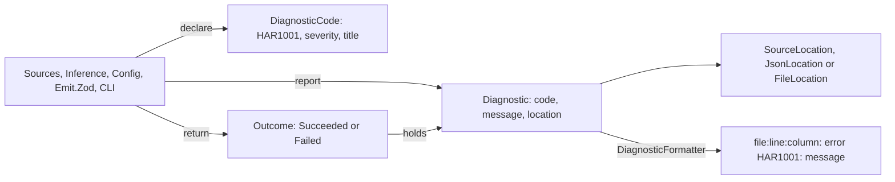

# Haruspex.Diagnostics

What every step of haruspex reports and returns: a `Diagnostic` (a stable code, a message and where), the three kinds of
place a problem can be, one formatter that writes them, and `Outcome<T>`, a step's value with what it found or, after an
error, what it found and no value. It is a package of its own because the reusable layers,
[Haruspex.SqlServer.Model](https://github.com/sharpblue/haruspex/blob/main/src/Haruspex.SqlServer.Model/README.md) and
[Haruspex.SqlServer.Sources](https://github.com/sharpblue/haruspex/blob/main/src/Haruspex.SqlServer.Sources/README.md),
have these types in their public API.

## How data flows through it

Each layer declares the codes of the problems it finds, reports them as diagnostics, and returns them with its value; the
CLI writes them all with the formatter.



## Example

```csharp
var code = new DiagnosticCode(1002, DiagnosticSeverity.Error, "An object is defined more than once");
var problem = new Diagnostic(code, "sales.get_order is defined more than once.", new SourceLocation("procedures/get_order.sql", 7, 5));
Console.Error.WriteLine(DiagnosticFormatter.Format(problem, "db"));
// db/procedures/get_order.sql:7:5: error HAR1002: sales.get_order is defined more than once.

Outcome<int> read = Outcome.Of(42, [problem]);   // a Failed<int>: one of what was found is an error
```

## What it guarantees

- **A code is stable**: `HAR` and four digits, whose number, severity and meaning never change, and which is never given
  out twice ([decision 0036](https://github.com/sharpblue/haruspex/blob/main/docs/decisions/0036-diagnostics-have-stable-codes.md)).
  Each has a page in [docs/diagnostics](https://github.com/sharpblue/haruspex/blob/main/docs/diagnostics/README.md) saying what
  it means, why it is reported and what to do.
- **A diagnostic is an error, a warning or a note**, as its code says: an error stops the step that found it, a warning is
  about something the output rests on that couldn't be checked or input that could be simpler, and a note says what the
  output is (an unknown, with its reason). They are SARIF's three levels.
- **One written form**, `file:line:column: error HAR1001: message`, which editors and CI annotate. A SQL file's path is
  relative to the source root, with `/` separators on every platform, so a diagnostic prints the same everywhere. A path in a
  message follows one rule as well: one haruspex makes, such as a place it looked or a file it writes, is printed with `/`
  (`DiagnosticFormatter.PathAsShown`), and one quoted from a project, a package or a config file is printed as written there,
  such as `..\shelf\shelf.sqlproj`, on every platform.
- **An outcome is one of two cases**, each holding its invariant: `Succeeded<T>` has a value and no error, `Failed<T>` at
  least one error and no value ([decision 0037](https://github.com/sharpblue/haruspex/blob/main/docs/decisions/0037-steps-return-outcomes.md)).

## What it deliberately doesn't do

- **Know any layer.** The codes are declared by the layers that report them; this layer knows what a code is, not which
  codes there are.
- **Throw for a mistake.** A user's mistake is a diagnostic in an outcome; an exception is for a fault.
- **Write anything but the one line.** No SQL, no files read, no colours.

It is part of [haruspex](https://github.com/sharpblue/haruspex), and pre-release: its API will change. How haruspex works,
layer by layer, is in [the guide](https://github.com/sharpblue/haruspex/blob/main/docs/internals/README.md).
