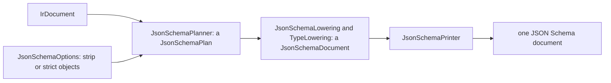

# Haruspex.Emit.JsonSchema

Writes a [haruspex IR](https://github.com/sharpblue/haruspex/blob/main/src/Haruspex.Ir/README.md) document as one
[JSON Schema](https://json-schema.org) document, draft 2020-12: a definition in `$defs` for each procedure's results and for
each named object type. It reads only the IR and knows nothing about SQL, as the Zod emitter doesn't: the two are equal
backends of one IR, which is what shows the IR isn't shaped like either target. Any language with a JSON Schema validator can
check what a procedure returns with it.

## How data flows through it

The same three stages as the Zod emitter's, each with one job. The plan decides what the document defines and in what order,
and refuses an IR it can't write. The lowering turns each IR type into a small model of schemas, records that compare by value.
The printer writes that model as JSON, and is the only part that knows JSON's syntax. The guide's chapter
[Emitting code](https://github.com/sharpblue/haruspex/blob/main/docs/internals/11-emitting-code.md) says why three stages, and
what the two emitters share.



## Example

```csharp
var document = IrJsonReader.Read(File.ReadAllText("haruspex.ir.json"));
var emitted = JsonSchemaEmitter.Emit(document, new JsonSchemaOptions { Objects = JsonSchemaObjects.Strip });
if (emitted is Succeeded<string> { Value: var schema })
    File.WriteAllText("haruspex.jsonschema.json", schema);
```

From the command line, `"emit": ["zod", "json-schema"]` in `haruspex.json` writes it beside the Zod module
([the configuration page](https://github.com/sharpblue/haruspex/blob/main/docs/configuration.md#what-is-written-emit)).

A procedure's schema is the definition under its generated name, the name the Zod module exports it by, and its `title` is
its name in the database. It is its one result set's schema; for several, an array of exactly as many (`prefixItems`); and when
the config file names its sets, an object with a property for each set, required, even for one
([decision 0070](https://github.com/sharpblue/haruspex/blob/main/docs/decisions/0070-a-procedure-s-result-sets-are-named-all-or-none.md)). Here a basket, its lines nested by `FOR JSON`, and its status in a binary collation, where SQL Server
ignores only trailing spaces:

```sql haruspex-example
CREATE TABLE shop.basket (
    basket_id int NOT NULL PRIMARY KEY,
    status varchar(8) COLLATE Latin1_General_100_BIN2 NOT NULL CONSTRAINT ck_basket_status CHECK (status IN ('open', 'paid')),
    note nvarchar(200) NULL
);
GO
CREATE TABLE shop.basket_line (
    basket_id int NOT NULL REFERENCES shop.basket (basket_id),
    line_no smallint NOT NULL,
    price decimal(7,2) NOT NULL CONSTRAINT ck_line_price CHECK (price > 0),
    PRIMARY KEY (basket_id, line_no)
);
GO
CREATE PROCEDURE shop.get_basket @basket_id int
AS
SELECT b.basket_id AS id, b.status, b.note,
       (SELECT l.line_no AS line, l.price FROM shop.basket_line AS l
        WHERE l.basket_id = b.basket_id ORDER BY l.line_no FOR JSON PATH) AS lines
FROM shop.basket AS b
WHERE b.basket_id = @basket_id
FOR JSON PATH, WITHOUT_ARRAY_WRAPPER;
```

```json haruspex-jsonschema GetBasket
{
  "title": "shop.get_basket",
  "description": "Returns JSON, null when no rows match. Null when absent: no-rows (example.sql:16:1).",
  "anyOf": [
    {
      "$ref": "#/$defs/GetBasketRow"
    },
    {
      "type": "null"
    }
  ]
}
```

The result is one object, or null when no basket matches. A note left out when null is not `required`, and a value set that
holds up to trailing spaces is a `pattern`:

```json haruspex-jsonschema GetBasketRow
{
  "description": "The type at results[0] in shop.get_basket.",
  "type": "object",
  "properties": {
    "id": {
      "description": "SQL type int.",
      "type": "integer",
      "minimum": -2147483648,
      "maximum": 2147483647
    },
    "status": {
      "description": "SQL type varchar(8). Facts: values from the check shop.ck_basket_status.",
      "type": "string",
      "pattern": "^(?:open|paid) *$",
      "maxLength": 8
    },
    "note": {
      "description": "SQL type nvarchar(200). Left out when null: nullable-column (shop.basket.note).",
      "type": "string",
      "maxLength": 200
    },
    "lines": {
      "description": "Left out when null: empty-subquery (example.sql:17:8).",
      "type": "array",
      "items": {
        "$ref": "#/$defs/GetBasketLine"
      },
      "minItems": 1
    }
  },
  "required": [
    "id",
    "status"
  ]
}
```

A line's price is more than 0 with two places, so at least 0.01, and its places are a note rather than `multipleOf`:

```json haruspex-jsonschema GetBasketLine
{
  "description": "The type at results[0].lines[] in shop.get_basket.",
  "type": "object",
  "properties": {
    "line": {
      "description": "SQL type smallint.",
      "type": "integer",
      "minimum": -32768,
      "maximum": 32767
    },
    "price": {
      "description": "SQL type decimal(7,2). Facts: min from the check shop.ck_line_price. At most 2 decimal places, which multipleOf would check inexactly.",
      "type": "number",
      "minimum": 0.01,
      "maximum": 99999.99
    }
  },
  "required": [
    "line",
    "price"
  ]
}
```

## A document split into modules

`JsonSchemaEmitter.Emit(document, options, modules)` writes a document per module of an `IrModules`: a module's procedures, and
the named types its procedures alone reach, each defined as in the one document. A named type the procedures of two or more
modules reach is defined in the shared document, under `IrModules.Shared`, which a module refers to by a `$ref` relative to its
own name, `shared.jsonschema.json#/$defs/PartNode` (`JsonSchemaOptions.SharedDocument`). Shapes aren't shared in JSON Schema, so
the shared document holds only types that are one type, such as a recursive function's node. A consumer adds each document under
its file name, so that a relative reference resolves
([decision 0075](https://github.com/sharpblue/haruspex/blob/main/docs/decisions/0075-what-several-modules-share-is-written-once-in-a-shared-file.md)).

A document describes results, not parameters, but it defines every named type of the IR, a table type's row among them (the
rows a client sends in a table-valued parameter): strict whatever the `objects` setting, with every column required, since a row
sent has every column and a key it doesn't list is a misspelt column. Its values are described as a client sends them, by the
parameters' rules, not as `FOR JSON` writes them (`SentScalars`): a date or time is a string of exactly the form its type holds
(no finer fraction, which the server would round without an error), and a `bigint` a number or the string of its digits.

## What it guarantees

**It claims everything the IR states, and nothing more**
([decision 0005](https://github.com/sharpblue/haruspex/blob/main/docs/decisions/0005-claim-everything-the-engine-guarantees.md)).
Each fact becomes the most precise keyword JSON Schema has:

| The IR says | JSON Schema |
|---|---|
| a key always there, or left out when null (presence) | in `required`, or not |
| a value may be null, with its reasons | `null` added to its `type` or `enum`, or `anyOf` with `{ "type": "null" }`; the reasons in its `description` |
| an exact value set | `enum` |
| a value set padded with spaces | `pattern`, the items followed by any spaces |
| a length, a minimum length | `maxLength`, `minLength`, in code points (below) |
| an integer format, a decimal of no places | `integer`, with the type's range as `minimum` and `maximum` |
| bounds | `minimum` and `maximum`, as exact decimal text; an exclusive one as the inclusive one a step inside |
| a date, a date and time with an offset, a GUID | `format` `date`, `date-time`, `uuid`, each with a `pattern` |
| a time, a date and time without an offset | a `pattern`, since no RFC 3339 format fits |
| an array, its items' nullability and length | `items`, `minItems`, `maxItems` |
| a tuple (`json_array`) | `prefixItems`, `"items": false` and `minItems` |
| a record (`json_objectagg`) | `additionalProperties` of its values' schema |
| a union | `anyOf`, each variant once; an object variant refuses the keys only the others have |
| a named type, recursion | a definition in `$defs`, and `$ref` |
| JSON text of known content | `contentMediaType` `application/json` and `contentSchema` |
| a JSON result that may be absent | nullable, as the mssql driver hands it over ([decision 0048](https://github.com/sharpblue/haruspex/blob/main/docs/decisions/0048-an-absent-json-result-reads-as-null.md)) |
| how many rows a result returns | `minItems` and `maxItems` on its array |
| an unknown | `{}`, which accepts anything, with the IR's sentence for why |
| the SQL type, where each fact came from, why a value may be null | `description` |

Every value is described as JSON, as SQL Server's `FOR JSON` writes it, a rowset's rows as an array of objects as
`FOR JSON PATH, INCLUDE_NULL_VALUES` writes them (every column a key, null where it is null, and JSON text, a `json` column
included, the string it holds)
([decision 0051](https://github.com/sharpblue/haruspex/blob/main/docs/decisions/0051-one-json-schema-document-per-module-every-value-as-json.md)).
So a `bigint` is a JSON integer in a rowset as in a JSON result, and a date a string, whatever a driver makes of them.

**For rowsets, the two emitters describe different things, on purpose.** The Zod module describes what the mssql driver hands a
TypeScript application: a `Date` for a date, a string for a `bigint`. The JSON Schema describes JSON. A rowset isn't JSON until
something writes it as JSON, and every driver hands it over in its own language's types (a Python driver gives a date object
and an exact decimal), so a schema of one driver's values would fit no other. `FOR JSON`'s form is SQL Server's own, the same
whatever reads it, and already what a JSON result is; a service that writes rows as JSON writes them in that form, or validates
what its driver gives against the Zod's rules in its own language. For `FOR JSON` results the two describe the same document.

**What it can't say, it widens and says so.** A fact JSON Schema can't hold exactly is left wider, and a note in the
`description` says what was left out, never silently; a fact many notes rest on is stated once, in the document's own
`description`:

- **Lengths in code points.** JSON Schema counts a string's length in code points, SQL Server in UTF-16 code units or bytes.
  A maximum of `n` is still at most `n` code points, but a fixed `nchar(10)` is only 5 to 10 code points, and a `varchar` in
  UTF-8 counts bytes, of which a character takes up to four. Only a single-byte collation's lengths are exact.
- **A collation's value sets.** A set that holds as the database compares strings (`collation`), or up to a fold
  (`canonical`), is not a set of exact strings, and JSON Schema can't apply a fold, so it is a plain string with the set in
  its note. The Zod module maps such a value to its item before checking it; a JSON Schema validator can't.
- **Decimal places.** `decimal(7,2)` has at most two places, but `multipleOf: 0.01` would be tested in binary floating point
  by most validators, which find 0.07 no multiple of 0.01, so it is left out and a note says how many places there are. A
  decimal of no places is `integer`, exact everywhere
  ([decision 0052](https://github.com/sharpblue/haruspex/blob/main/docs/decisions/0052-a-decimal-s-places-are-a-note-not-multiple-of.md)).
- **Precision past a double.** The bounds are exact in the file, but a validator that reads numbers as doubles reads a
  `bigint` exactly only up to 2^53, and a wide decimal's bounds as the nearest doubles. An inclusive bound is never crossed by
  rounding; an exclusive one of no known scale is written inclusive, and says so.
- **JSON text.** `contentSchema` is an annotation: a validator checks what the string parses to only when asked to.
- **Imports.** A value the config file declares to be the application's own Zod schema is `{}` here, since the document can't
  refer to a TypeScript module, and its note names the schema.

Objects allow other keys by default, so a database deployed ahead of its consumers can add a column without failing them
([decision 0008](https://github.com/sharpblue/haruspex/blob/main/docs/decisions/0008-objects-strip-unknown-keys-by-default.md));
`JsonSchemaObjects.Strict` gives `"additionalProperties": false`. The output is deterministic, with stable ordering and LF
line endings, so a CI check can compare it byte for byte. Every document the fixtures give is checked against the draft 2020-12 meta-schema
(`JsonSchemaMetaSchemaTests`), and every row the differential tests get from SQL Server is validated against it, with Ajv and
its formats asserted (`JsonSchemaAcceptanceTests`).

## What it deliberately doesn't do

- **No config file.** It takes `JsonSchemaOptions`. The CLI reads `haruspex.json` and maps its settings across.
- **No naming.** Names come from the IR, where the config's naming rules have already been applied, so a procedure has the
  same name in the JSON Schema as in the Zod. One name for two definitions is refused with a diagnostic (`JsonSchemaCodes`).
- **No shared definitions.** Each named type is written in full under its own name, even where the Zod module declares a
  shape several types share once: every definition in `$defs` can be referred to, so there is no unexported name to declare a
  shared one under, and each says where it comes from
  ([decision 0071](https://github.com/sharpblue/haruspex/blob/main/docs/decisions/0071-a-shared-shape-is-named-by-declaration-or-by-its-structure.md)).
- **No renaming of keys.** The document describes the wire format, the keys as SQL Server writes them.
- **No SQL.** It can't look at a procedure, only at what the IR says about it.

It is part of [haruspex](https://github.com/sharpblue/haruspex), and pre-release: its API and its output will change. Its
chapter of [the guide](https://github.com/sharpblue/haruspex/blob/main/docs/internals/README.md) is
[Emitting code](https://github.com/sharpblue/haruspex/blob/main/docs/internals/11-emitting-code.md).
