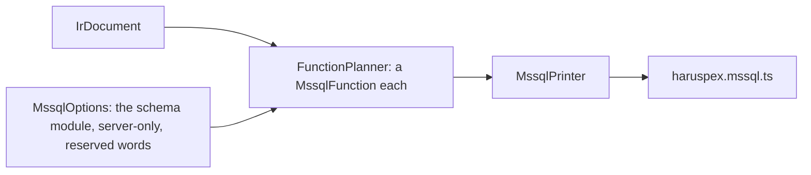

# Haruspex.Emit.Mssql

Writes the database module's functions from a [haruspex IR](https://github.com/sharpblue/haruspex/blob/main/src/Haruspex.Ir/README.md)
document: one TypeScript function for each procedure and query file, which runs it through the
[mssql](https://www.npmjs.com/package/mssql) driver, the driver most Node applications reach SQL Server with. A function checks its parameters with the procedure's
parameters schema, binds each with the driver's type, executes, and checks each result set and the `OUTPUT` parameters with
their schemas:

```ts
const order = await getOrder(pool, { order_id: 42 })
```

The functions are a file of their own (`haruspex.mssql.ts`), which imports the schemas and types from the schema module beside
it (`haruspex.zod.ts`): so an application's browser code can import the types and schemas, and the functions stay on the
server, where the connection and its credentials are. `MssqlOptions.ServerOnly` adds `import 'server-only'`, which makes a Next.js build
fail where browser code imports the functions.

## How data flows through it



The plan decides each function's name, how each parameter is bound (`DriverTypes`) and how each result set is read; the printer
is the only stage that knows TypeScript and the driver's API. Two stages, not the Zod emitter's three, because there is no
model of expressions to lower: a function's code is the same for every procedure but for its names, bindings and reads.

## Example

```csharp
var document = IrJsonReader.Read(File.ReadAllText("haruspex.ir.json"));
if (MssqlEmitter.Emit(document, new MssqlOptions { SchemaModule = "./haruspex.zod.js" }) is Succeeded<string> { Value: var module })
    File.WriteAllText("haruspex.mssql.ts", module);
```

## A module split into files

`MssqlEmitter.Emit(document, options, modules, schemaModule)` writes a functions file per module of an `IrModules`: the file this
emitter writes for the module's procedures and query files alone, importing the schemas of its own module's schema file, whose
specifier `schemaModule` gives (`./sales.zod.js`). Each file is self-contained, with its own error classes and helpers, as the
files of several config files are ([decision 0074](https://github.com/sharpblue/haruspex/blob/main/docs/decisions/0074-a-config-may-split-its-output-into-modules.md)).

## What it guarantees

- **A function takes a connection; it never owns one.** Its first argument is anything with `request()`, an mssql
  `ConnectionPool`, a `Transaction`, or a test double (`Queryable`). Pooling, retries and transactions stay the application's.
- **Parameters are checked before the connection is touched**, and a failure is thrown as a `ParameterError` naming the
  procedure and each parameter. A parameter left out is not bound, so its default applies: bound as `undefined`, the driver
  would send NULL, which overrides it (observed). An `OUTPUT` parameter without a default is always bound, since SQL Server
  refuses a call that leaves it out.
- **Each value is sent with the driver's type for the declared one** (`DriverTypes`): `nvarchar(40)` as `sql.NVarChar(40)`, a
  decimal with its precision and scale, and a date or time as text, which SQL Server converts exactly in any session
  ([decision 0055](https://github.com/sharpblue/haruspex/blob/main/docs/decisions/0055-dates-and-times-are-sent-as-iso-8601-strings.md)).
- **A table-valued parameter is sent as an `sql.Table` of its type** (`TableValue`, built by the module's `table` helper): the
  type named by its schema and name apart, so that no name needs quoting, and every column declared in the type's order, each
  with the driver's type of a scalar parameter of its type, since the server matches the columns by place. A `bigint` is sent as
  the string of its digits, which the server converts exactly. Left out, it is not bound, and the procedure reads no rows. A
  column whose type gives no driver type is refused (HAR5204)
  ([decision 0076](https://github.com/sharpblue/haruspex/blob/main/docs/decisions/0076-a-table-valued-parameter-is-an-array-of-strict-rows-of-its-type.md)).
- **The database's error is the driver's own**, a `RequestError` with its number, state, class, procedure and line, passed
  through unchanged. **A result that breaks its schema** is a `ResultError` naming the procedure, the part (the results, or the
  `OUTPUT` parameters) and each issue's path, as JavaScript reads it (`[0].label`); of several result sets, the set comes
  first, counted from 1 (`result set 2, [0].label`), or named by its name when the config file names the sets (`lines[0].label`). Each error has a stable `name` and `kind`, so code that handles errors from several
  modules tells them apart without importing any
  ([decision 0056](https://github.com/sharpblue/haruspex/blob/main/docs/decisions/0056-a-function-throws-three-kinds-of-failure.md)).
- **The shape follows what the procedure hands back**
  ([decision 0060](https://github.com/sharpblue/haruspex/blob/main/docs/decisions/0060-a-call-returns-its-one-result-itself.md)):
  its one result set itself, when it has no `OUTPUT` parameter and no return code worth handing back (the IR's `returnsCode`);
  otherwise an object of `result`, or `result1`, `result2` and so on for several, or each set under its name when the config
  file names them (always an object then, even for one set:
  [decision 0070](https://github.com/sharpblue/haruspex/blob/main/docs/decisions/0070-a-procedure-s-result-sets-are-named-all-or-none.md)),
  `output` for the `OUTPUT` parameters, and `returnValue` when the code may be other than 0; and nothing, when there is nothing
  to hand back. A `FOR JSON` result is read as
  decision 0048 fixes, whether the pool parses JSON or not.
- **It reads the result sets its procedure lists, and ignores any after them**, so a database deployed ahead of the
  application with a trailing set more doesn't break it; `MssqlOptions.RefusesExtraResultSets`, which `"objects": "strict"`
  sets, refuses them. A set every call returns that doesn't arrive is a `ResultError` either way, since read as `[]` it would
  pass
  ([decision 0063](https://github.com/sharpblue/haruspex/blob/main/docs/decisions/0063-a-function-ignores-result-sets-after-those-it-knows.md)).
- **A query file's function runs its text through `sp_executesql`**: the text as the IR holds it, and each parameter declared
  by its name and its type's `sql`, so the query runs with the types it was inferred with, and each value is bound beside them
  by name, converted by the server to its declared type. A parameter with no type to declare, or named `@stmt` or `@params`
  (`sp_executesql`'s own), is refused (HAR5202). Its failures name its path where a procedure's would name the procedure, and
  it has no return code to hand back, since the server refuses `RETURN` with a value in such a batch (error 178, observed).
- **It checks through Standard Schema**, the interface Zod, Valibot and ArkType implement, never through Zod's own methods, so
  the functions are the same whichever validator wrote the schemas, by the names `SchemaModuleNames` gives.
- **It is self-contained.** Its errors and helpers are written into it, so a module needs no package of haruspex's at run time,
  and several modules in one application share nothing.

A function's shape is what its callers are written against, so the emitter also says what it is apart from the module:
`MssqlEmitter.ReturnShape` gives a procedure's `MssqlReturnShape` (its one result itself, an object of named fields, or
nothing), and `MssqlReturnShape.KeepsCallersOf` whether code written against one still reads another. `haruspex check
--baseline` uses it to warn when a change to the database changes the shape (HAR6028). The names come from the plan
(`MssqlFunction.Returned`), which the printer writes too, so the two can't disagree.

## Why a result is what it is

A function's comment says why a result set may be missing, or why its procedure's result sets can't be listed, with the codes
and the `haruspex explain` command; under `MssqlOptions.Comments` of `IrComments.All`, how many rows each returns too. The fields' reasons are
the Zod module's comments
([decision 0079](https://github.com/sharpblue/haruspex/blob/main/docs/decisions/0079-a-surprise-is-explained-where-it-is-written.md)).

## Testing with a double

A double that stands in for the connection gives `request()`, whose object has `input()`, `output()` and `execute()`. The
functions call `execute()` for a procedure and a query file alike, and read three fields of what it resolves to: `recordsets`,
every result set in order; `output`, the `OUTPUT` parameters by name (`{}` when there are none); and `returnValue`, the
return code (0). A double that gives only `recordset`, the first set, fails every call:

```ts
const result = { recordsets: [[{ order_id: 42 }]], output: {}, returnValue: 0 }
const db = { request: () => ({ input() {}, output() {}, execute: async () => result }) } as unknown as Queryable
```

[The database module's page](https://github.com/sharpblue/haruspex/blob/main/docs/database-module.md#testing-with-a-double)
has a whole example, typed as the driver's `IProcedureResult` so that the compiler asks for each field, which a test runs
against a generated function.

## What it deliberately doesn't do

- **No naming.** A function's name is its procedure's settled name with a lower-case first word (`GetOrder` is `getOrder`); a
  name that is reserved, or one the module already binds, is refused (`MssqlCodes`). A parameter's key is its declared name
  without its `@`.
- **No connection, no retries, no caching, no transactions.** The application wraps the functions rather than being replaced by
  them.
- **No SQL.** It binds from what the IR says of each type, its kind, format and facets, never from its spelling.

It is part of [haruspex](https://github.com/sharpblue/haruspex), and pre-release: its API and its output will change. Its chapter
of [the guide](https://github.com/sharpblue/haruspex/blob/main/docs/internals/README.md) is
[Emitting code](https://github.com/sharpblue/haruspex/blob/main/docs/internals/11-emitting-code.md).
