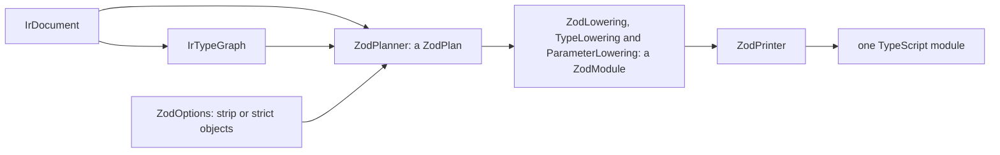

# Haruspex.Emit.Zod

Writes a [haruspex IR](https://github.com/sharpblue/haruspex/blob/main/src/Haruspex.Ir/README.md) document as one TypeScript
module of [Zod 4](https://zod.dev) schemas: a schema and an inferred type for every named object type, every procedure's
results and every procedure's parameters.
It reads only the IR and knows nothing about SQL, which is what keeps it one emitter among several rather than the shape of
the IR.

## How data flows through it

Three stages, each with one job. The plan decides what the module declares, in what order and under what names, asking the
IR's type graph about references and cycles. The lowering turns each IR type into a small model of Zod expressions, records
that compare by value. The printer writes that model as TypeScript, and is the only part that knows TypeScript's syntax.
Why three stages, rather than text written as the IR is walked, is argued in the guide's chapter
[Emitting code](https://github.com/sharpblue/haruspex/blob/main/docs/internals/11-emitting-code.md).



## Example

```csharp
var document = IrJsonReader.Read(File.ReadAllText("haruspex.ir.json"));
var emitted = ZodEmitter.Emit(document, new ZodOptions { Objects = ZodObjects.Strip });
if (emitted is Succeeded<string> { Value: var module })
    File.WriteAllText("haruspex.zod.ts", module);
```

What a module looks like is shown, procedure by procedure, in
[the guide's first chapter](https://github.com/sharpblue/haruspex/blob/main/docs/internals/01-the-shape-of-the-problem.md).

## What it guarantees

**It claims everything the IR states, and nothing more**
([decision 0005](https://github.com/sharpblue/haruspex/blob/main/docs/decisions/0005-claim-everything-the-engine-guarantees.md)).
Each fact the IR carries becomes a Zod check: lengths, integer and decimal ranges, decimal steps (`.multipleOf`), exact
value sets as `z.enum` or `z.literal`, and whether a field may be null or absent. A fact the target can't hold exactly is
left out, and a note above the property says why, in one sentence; a fact many notes rest on is stated once, in the
module's header. For example, a `bigint` from a rowset arrives from the driver as a string, so its range can't be checked
as a number. A value set that is true only under the database's collation is a note, not an enum, because the value that
arrives may differ in case or trailing spaces. When the IR records the options the callers' sessions were declared to set
(`source.session`: `ansiWarnings`, `arithAbort`, `concatNullYieldsNull`, `numericRoundAbort`), the header says them too, since
the schemas are true only for callers that set them; with none declared, it says nothing, as nothing was assumed.

What a value looks like depends on how it arrives, and the module follows what actually arrives:

- **In JSON** (`FOR JSON` and the JSON functions), SQL Server writes dates, times and GUIDs as strings in fixed formats, so
  they are validated strings (`z.iso.date()`, `z.iso.datetime(…)`, `z.guid()`). They are deliberately not converted to
  `Date`: a `date` has no time zone, and `new Date('2026-11-09')` is UTC midnight, the previous day west of Greenwich.
- **In a rowset**, the types follow the default mapping of the [mssql](https://www.npmjs.com/package/mssql) (tedious)
  driver: dates and times as `Date`, `bigint` as a string.
- **A procedure's `FOR JSON` result** is the document, as the mssql driver hands it over with its `parseJSON` option: `null`
  when no rows matched, an array as much as an object, and an array that arrives has at least one item
  ([decision 0048](https://github.com/sharpblue/haruspex/blob/main/docs/decisions/0048-an-absent-json-result-reads-as-null.md)).
- **JSON that arrives as text** (a `FOR JSON` result that wasn't embedded) stays a `string`, since that is what arrives,
  and the check parses it and validates its content against the inner schema.
- **Recursive types** (a tree built by a function that calls itself) use Zod 4's getter form, so the inferred type needs
  no casts.
- **Nothing is said twice, and every exported name is its own.** A shape several named types share is declared once, and
  each type is exported under its own name as that schema: under a name the config file gave one of them, or else as a
  constant the module doesn't export, named from a hash of its structure (`const shape3f2a9c = z.object(…)`), so no exported
  name depends on which procedure came first
  ([decision 0071](https://github.com/sharpblue/haruspex/blob/main/docs/decisions/0071-a-shared-shape-is-named-by-declaration-or-by-its-structure.md)).
  A check the schema already makes is not repeated:
  `z.int32()` rather than an `int`'s own bounds, and a union without a variant another one already accepts.
- **It passes a linter.** A number a double can't hold is written as the double JavaScript reads it as, which is the check
  it always was, and the tests lint every fixture's module with ESLint's recommended rules and typescript-eslint's strict and stylistic sets, so
  every helper states its return type.

**A procedure's results** are one schema under its name (`GetOrderSchema`, and its type `GetOrder`): its one result set's
schema, a `z.tuple` of several, or, when the config file names its sets, a `z.object` with a property for each set, even for
one ([decision 0070](https://github.com/sharpblue/haruspex/blob/main/docs/decisions/0070-a-procedure-s-result-sets-are-named-all-or-none.md)).
The types inside are named after the sets: `GetOrderLinesRow` for a set named `lines`.

**A procedure's parameters** are a strict schema of what may be sent (`GetOrderParamsSchema`, and its type `GetOrderParams`),
declared before its results' schema, whatever the `objects` setting: a key it doesn't know is an error
([decision 0009](https://github.com/sharpblue/haruspex/blob/main/docs/decisions/0009-parameters-are-strict.md)). Each value is
checked against its declared type's facts, because SQL Server cuts a longer string short and rounds a decimal of more places
without an error
([decision 0054](https://github.com/sharpblue/haruspex/blob/main/docs/decisions/0054-a-parameter-is-checked-against-its-declared-type.md)):
a length in UTF-16 code units, an integer's and a decimal's range, a decimal's places. A date or time is an ISO 8601 string
of exactly the form its type holds, never a `Date`
([decision 0055](https://github.com/sharpblue/haruspex/blob/main/docs/decisions/0055-dates-and-times-are-sent-as-iso-8601-strings.md)):
a `Date` a rowset result handed over is sent back as its `toISOString()` without the `Z`, cut to the digits its type holds,
since a type without an offset would drop the `Z` without an error. A `bigint` is a safe integer, a JavaScript `bigint`, or the
string of digits a rowset hands over.
Every parameter accepts `null`, since a procedure can't declare one `NOT NULL`; one with a default, or an `OUTPUT` one, may be
left out. A table-valued parameter is `z.unknown()` for now, and a `json` one a string.

Objects strip unknown keys by default (`z.object`), so a database deployed ahead of its consumers can add a field without
breaking them
([decision 0008](https://github.com/sharpblue/haruspex/blob/main/docs/decisions/0008-objects-strip-unknown-keys-by-default.md)).
`ZodObjects.Strict` makes them `z.strictObject`. The output is deterministic, with stable ordering and LF line endings, so
a CI check can compare it byte for byte.

## Why a field is what it is

A field that would surprise its reader (its nullability, presence or type differs from what its source column declares, or
it is unknown) has a comment above its property saying why: each reason's short text and code, the way out when there is one,
and the `haruspex explain` command, in the lines `IrFieldText` gives every emitter. `ZodOptions.Comments` asks for those
(`IrComments.Surprises`, the default), for every field (`IrComments.All`) or for none. A shape several types share is compared and declared without
them, so comments never stop it being shared; each type exported as the shape says its own fields' reasons above its export
([decision 0079](https://github.com/sharpblue/haruspex/blob/main/docs/decisions/0079-a-surprise-is-explained-where-it-is-written.md)).

## A module split into files

`ZodEmitter.Emit(document, options, modules)` writes the module split into a file per module of an `IrModules`, the
document's objects grouped as the config file's `split` says, with what two or more modules share in one more file, under
`IrModules.Shared`, which each module imports by `ZodOptions.SharedModule` (`./shared.zod.js`). The whole module is planned and
lowered once, as for one file (`ZodLowering.Placed`), so every name and every shared shape is what one file would have; then
`ZodSplit` puts each declaration in the file of the module that alone reaches it, or else in the shared one. A module refers
only to its own declarations and the shared file's, and the shared file only to its own, so no module imports another. A shape
named by its structure is exported from the shared file marked `@internal`, with no type, since it is no public name; each file
defines the helpers it calls and imports only the application's names it uses, so each passes the linter alone
([decision 0075](https://github.com/sharpblue/haruspex/blob/main/docs/decisions/0075-what-several-modules-share-is-written-once-in-a-shared-file.md)).

## The mapping helper

`MappingModule` holds `haruspex.mapping.ts`, which `"mapping"` in `"emit"` writes beside the module: TypeScript types, the same
for every module, with which an application's mapper accounts for every key of a row the module declares, at any depth, so
once the module is regenerated, a key the row gains is a compile error in the mapper
([decision 0066](https://github.com/sharpblue/haruspex/blob/main/docs/decisions/0066-a-mapper-accounts-for-every-key-of-a-generated-row.md)).
It lives here because what it accounts for is this module's types: a `Date`, which a rowset's date arrives as, is a value
rather than an object with keys.

## What it deliberately doesn't do

- **No config file.** It takes `ZodOptions`. The CLI reads `haruspex.json` and maps its settings across, so the emitter
  works the same wherever it is composed.
- **No naming.** Names come from the IR, where the config's naming rules have already been applied. An IR name that isn't
  a TypeScript identifier is refused with a diagnostic (`ZodCodes`), not something the emitter quietly rewrites.
- **No SQL.** It can't look at a procedure, only at what the IR says about it. Every claim it makes is one the inference
  layer already proved.

It is part of [haruspex](https://github.com/sharpblue/haruspex), and pre-release: its API and its output will change. Its
chapter of [the guide](https://github.com/sharpblue/haruspex/blob/main/docs/internals/README.md) is
[Emitting code](https://github.com/sharpblue/haruspex/blob/main/docs/internals/11-emitting-code.md).
