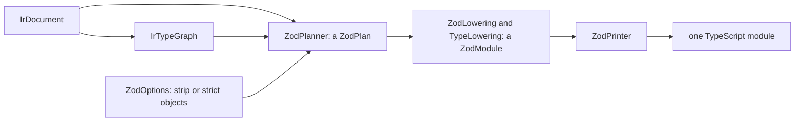

# Haruspex.Emit.Zod

Writes a [haruspex IR](https://github.com/sharpblue/haruspex/blob/main/src/Haruspex.Ir/README.md) document as one TypeScript
module of [Zod 4](https://zod.dev) schemas: a schema and an inferred type for every named object type and every procedure.
It reads only the IR and knows nothing about SQL, which is what keeps it one emitter among several rather than the shape of
the IR.

## How data flows through it

Three stages, each with one job. The plan decides what the module declares, in what order and under what names, asking the
IR's type graph about references and cycles. The lowering turns each IR type into a small model of Zod expressions, records
that compare by value. The printer writes that model as TypeScript, and is the only part that knows TypeScript's syntax.
Why three stages, rather than text written as the IR is walked, is argued in the guide's chapter
[Emitting code](https://github.com/sharpblue/haruspex/blob/main/docs/internals/11-emitting-code.md).



## Example

```csharp
var document = IrJsonReader.Read(File.ReadAllText("haruspex.ir.json"));
var module = ZodEmitter.Emit(document, new ZodOptions { Objects = ZodObjects.Strip });
File.WriteAllText("haruspex.zod.ts", module);
```

What a module looks like is shown, procedure by procedure, in
[the guide's first chapter](https://github.com/sharpblue/haruspex/blob/main/docs/internals/01-the-shape-of-the-problem.md).

## What it guarantees

**It claims everything the IR states, and nothing more**
([decision 0005](https://github.com/sharpblue/haruspex/blob/main/docs/decisions/0005-claim-everything-the-engine-guarantees.md)).
Each fact the IR carries becomes a Zod check: lengths, integer and decimal ranges, decimal steps (`.multipleOf`), exact
value sets as `z.enum` or `z.literal`, and whether a field may be null or absent. A fact the target can't hold exactly is
left out, and a comment beside the field says why. For example, a `bigint` from a rowset arrives from the driver as a
string, so its range can't be checked as a number. A value set that is true only under the database's collation is a
comment, not an enum, because the value that arrives may differ in case or trailing spaces.

What a value looks like depends on how it arrives, and the module follows what actually arrives:

- **In JSON** (`FOR JSON` and the JSON functions), SQL Server writes dates, times and GUIDs as strings in fixed formats, so
  they are validated strings (`z.iso.date()`, `z.iso.datetime(…)`, `z.guid()`). They are deliberately not converted to
  `Date`: a `date` has no time zone, and `new Date('2026-11-09')` is UTC midnight, the previous day west of Greenwich.
- **In a rowset**, the types follow the default mapping of the [mssql](https://www.npmjs.com/package/mssql) (tedious)
  driver: dates and times as `Date`, `bigint` as a string.
- **JSON that arrives as text** (a `FOR JSON` result that wasn't embedded) stays a `string`, since that is what arrives,
  and the check parses it and validates its content against the inner schema.
- **Recursive types** (a tree built by a function that calls itself) use Zod 4's getter form, so the inferred type needs
  no casts.

Objects strip unknown keys by default (`z.object`), so a database deployed ahead of its consumers can add a field without
breaking them
([decision 0008](https://github.com/sharpblue/haruspex/blob/main/docs/decisions/0008-objects-strip-unknown-keys-by-default.md)).
`ZodObjects.Strict` makes them `z.strictObject`. The output is deterministic, with stable ordering and LF line endings, so
a CI check can compare it byte for byte.

## What it deliberately doesn't do

- **No config file.** It takes `ZodOptions`. The CLI reads `haruspex.json` and maps its settings across, so the emitter
  works the same wherever it is composed.
- **No naming.** Names come from the IR, where the config's naming rules have already been applied. An IR name that isn't
  a TypeScript identifier is an error (`ZodEmitException`), not something the emitter quietly rewrites.
- **No SQL.** It can't look at a procedure, only at what the IR says about it. Every claim it makes is one the inference
  layer already proved.

It is part of [haruspex](https://github.com/sharpblue/haruspex), and pre-release: its API and its output will change. Its
chapter of [the guide](https://github.com/sharpblue/haruspex/blob/main/docs/internals/README.md) is
[Emitting code](https://github.com/sharpblue/haruspex/blob/main/docs/internals/11-emitting-code.md).
