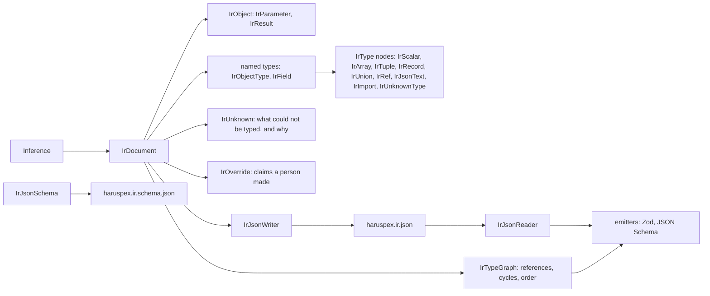

# Haruspex.Ir: the IR format, version 0.25

This is the specification of haruspex's intermediate representation (the IR) in its file form, `haruspex.ir.json`, at
version 0.25, whose documents that say less are labelled 0.24 or 0.23 ("Changelog", below): what a document holds, what each part
claims, and what a program that writes or reads one must do. *Must*,
*must not* and *may* have their usual meanings. The format's JSON Schema, generated from the model, is
[`schemas/haruspex.ir.schema.json`](../../schemas/haruspex.ir.schema.json); the reasons behind the format are in the
guide's chapter [The IR as a contract](../../docs/internals/10-the-ir-as-a-contract.md). What SQL Server's constructs give in
the IR's terms is the SQL Server front end's, in [its README](../Haruspex.SqlServer.Inference/README.md#what-each-construct-gives-in-the-ir).

The IR is the product: front ends write it, emitters read it, and it is a file, so each side can be written in whatever
language suits it. This project holds the model (`IrDocument` and the records it holds, one to a file), its writer, its
reader, the generator of its schema, and the walks every reader needs: `IrTypeTree` for the structure of one type and
`IrTypeGraph` for what a document's types refer to, which of them lie on a cycle, and an order that puts each after the
types it refers to. `IrComparison` says what changed between two documents, claim by claim, for `haruspex check`;
`IrFit` whether one document's values fit within another's, for `haruspex check --baseline`; and `IrCombination` combines two
documents into one whose types hold against both databases, for `haruspex generate --baseline`. `IrReasons` says what each of the
IR's codes means, in words, `IrSurprises` which fields differ from what their columns declare, `IrFieldText` the lines that
explain one in generated code, and `IrFieldPlaces` the path a person names a field by, for `haruspex explain`
([decision 0079](../../docs/decisions/0079-a-surprise-is-explained-where-it-is-written.md)).

## How data flows through it

Inference builds an `IrDocument`; the config layer transforms it (overrides, names); `IrJsonWriter` writes it;
`IrJsonReader` reads a file back into the same document; emitters read it. Nothing in it is SQL Server's: the SQL type of a
value is kept as text, for people and for emitters that want it.



## Example

```csharp
var document = IrInference.Infer(model, [new ObjectName("sales", "get_order")]);
File.WriteAllText("haruspex.ir.json", IrJsonWriter.Write(document));

// Elsewhere, perhaps in another program: the same document, or an IrFormatException that names the path at fault.
var read = IrJsonReader.Read(File.ReadAllText("haruspex.ir.json"));
```

"A document", below, shows one annotated; the guide's [first chapter](../../docs/internals/01-the-shape-of-the-problem.md)
shows one whole, with an unknown.

## What it guarantees

- **Every claim holds for every execution.** A field with no `nullableBecause` is never null; a value set holds every value
  the code can produce; a result without `mayBeAbsent` always arrives. The differential tests check each against SQL
  Server's real output.
- **Nothing is left out silently.** Whatever could not be typed is an `unknown` node in place and an entry in `unknowns`,
  with a reason from a closed list, a sentence and a location.
- **The format is closed.** An emitter that handles the nodes listed here handles every document of this version.
- **The same input gives the same bytes**, on every machine ("Writing a document", below).
- **Reading a file gives back the document written**, and writing it again the same bytes. `IrJsonReader` refuses, naming
  the path, a file of another version, an unknown property or name, and everything else a reader must refuse
  ("Conformance", below); it supplies no defaults ([decision 0024](../../docs/decisions/0024-an-ir-reader-refuses-other-versions.md)).
- **The schema is the model's.** `schemas/haruspex.ir.schema.json` is generated by `IrJsonSchema`, its vocabularies from
  the enums, and every file haruspex writes passes it ([decision 0023](../../docs/decisions/0023-the-ir-schema-is-generated-from-the-model.md)).
- **Types compare by value.** Two type nodes, fields or results describing the same thing are equal, lists included
  (`EquatableArray`), and two documents are equal when their files say the same, so code that asks whether two are the
  same asks the records, never their JSON.
- **Every closed vocabulary is an enum**, and its names in the JSON are in one table, `IrWireNames`, which the writer uses
  and the reader reads backwards.
- **A comparison reports every change of claim, and only those.** `IrComparison.Compare` lists each difference in what two
  documents claim as an `IrChange`, where it is (`results[0][].note`) and how it changed (`became nullable`), and nothing for
  what only says where a claim came from: a location, a reason, the source of a fact, a package's hash. Equality of documents
  is stricter: two documents with no changes between them may still differ there.
- **A fit is a comparison with a direction.** `IrFit.Of` asks what an application built against one document does when it
  meets a database described by another, and reports each difference that matters as an `IrFitFinding`: the change, worded
  as `IrComparison` words it, and whether the application refuses it or ignores it. Results are judged as the database
  gives them to the application, parameters as the application sends them to the database, so a narrower string fits in a
  result and is refused in a parameter
  ([decision 0068](../../docs/decisions/0068-a-baseline-fits-when-the-running-application-accepts-every-value.md)).
- **A combined document holds against both databases.** `IrCombination.Of` combines a baseline's document with a candidate's:
  results widen, so every value either database returns is accepted, and parameters narrow, so every call is one both
  procedures take. What no one call bridges is reported as an `IrCombinationFinding` and its object left out. The result is held
  to `IrFit` against each database, and refused there for nothing
  ([decision 0073](../../docs/decisions/0073-generate-with-a-baseline-writes-types-that-hold-against-both-databases.md)).

## What it deliberately doesn't do

- **No SQL, and no dialect's vocabulary.** It depends on nothing. Its names say what a value is and why it may be null,
  never which construct of which dialect made it ([decision 0025](../../docs/decisions/0025-null-reasons-in-neutral-terms.md)),
  so a second front end writes the same format. The two places a dialect's own words appear are data the format carries
  without reading: a scalar's `sql` type and the names of the session's options (`source.session`).
- **No target language.** It knows no language's keywords or module system: which names TypeScript reserves, and how an
  import is written, are the Zod emitter's (`TypeScriptNames`).
- **No JSON Schema.** It maps to JSON Schema without loss, but isn't it ([decision 0003](../../docs/decisions/0003-an-ir-of-its-own.md)).
- **No migration.** A file of another version is refused, not converted: it is regenerated from its source.

## Why not JSON Schema

JSON Schema is an open validation language (`oneOf`, `allOf`, `if`/`then`, `$ref` anywhere), so every
emitter would have to handle all of it, and it has no notion of procedures, result sets, provenance or
unknowns. The IR is small and closed instead: an emitter that handles the IR's records (`IrDocument` and the records it
holds, one to a file in this folder) handles every document. It maps to JSON Schema without loss.

## Conformance

A **document** is a JSON text, UTF-8 without a byte order mark, whose root is an object as this page describes. Three kinds
of program handle one.

**A writer** (a front end, or a tool that transforms documents):
- must write `irVersion` as the oldest version that says all the document says: `"0.25"` when a field has `from` or `sides`, or
  a source has `files`,
  else `"0.24"` for a document combining two databases (one whose `source` names a `baseline`), else `"0.23"`; and a document
  that this page and the schema allow;
- must write `text` on an object exactly when its kind is `query`;
- must write a flag and its reasons together: `nullable`, `itemsNullable`, `valuesNullable` and `mayBeAbsent` are `true`
  exactly when the matching list of reasons (`nullableBecause`, …) is there, with at least one reason;
- must write every `ref` as the name of a type in `types`, and every `values.fold` as the name of a fold in `folds`;
- must write a number in a facet (a bound, a value set's item) as plain decimal text, with no exponent;
- must claim only what holds for every execution, and must write anything it can't prove as an `unknown` node with an
  entry in `unknowns`;
- may leave out any property this page marks optional, which then means what this page says its absence means.

**A reader**:
- must read `irVersion` first and must refuse a document of any version but 0.25, 0.24 and 0.23, older or newer, without
  reading further; must refuse a document labelled 0.24 whose `source` names no `baseline`, and one labelled 0.23 that names
  one; must refuse, in a document whose `source` names no `baseline`, a key whose presence is `optional`, a reason whose rule
  is `not-in-both` and a field's `sides`; and must refuse a field's `from` or `sides`, and a source's `files`, in a document
  labelled 0.23 or 0.24;
- must refuse a property this page doesn't list, a property given twice in one object, a name outside its vocabulary, a
  missing required property, an object of kind `query` without `text` or of another kind with it, a value of the wrong JSON
  type, a count that is negative or past 2,147,483,647, a number in a
  facet that is not plain decimal text, a union of fewer than two variants, a flag that disagrees with its reasons, a
  `ref` that names no type, a value set's `fold` that names no fold, and a `fold` on a set whose match isn't `canonical` or none
  on one whose match is;
- must not supply a default for a required property;
- should read numbers in facets as exact decimals, not as binary floating point;
- must follow the reader conventions for results that are absent or missing ("Results", below);
- must stop at a recursive type when it expands references ("Recursive types", below).

**An emitter** is a reader that writes code. It must not claim more than the document does: a value with reasons to be
null is nullable in what it writes, a `collation` value set is not an exact set, and an `unknown` is a value of any shape.

**Rules a reader need not check.** Three rules bind writers only, because a reader can't check them cheaply or doesn't
need to: once names are settled, every `name` and every key of `types` is an identifier ("Paths", below); a union's variants
are all different; and `recursive` is set exactly on the types that can reach themselves (a reader that needs to know may
find the cycles itself, "Recursive types"). `IrJsonReader` doesn't check them; an emitter must refuse a name it can't bind.

`IrJsonReader` and `IrJsonWriter` are this project's reader and writer, and follow every rule here that binds them. The schema
checks what a reader must refuse except three things JSON Schema can't express: a number's form, a key given twice in one
object, and a `ref` that names no type.

## A document

```jsonc
{
  "irVersion": "0.25",                // versioned separately from the tool; a reader checks it first; the oldest that says it all
  "source": { "dialect": "tsql",      // the package is left out for a folder of scripts or a project file, the references for a folder
    "package": "sales.dacpac", "sha256": "3f1c…",
    "references": [{ "package": "ledger.dacpac", "sha256": "9a0e…", "database": "$(Ledger)" }],
    "session": { "ansiWarnings": true } },  // the session is left out when the callers' options aren't declared
  "objects": [{                       // sorted by id
    "id": "sales.get_order",          // the name in the database: the object's identity
    "name": "GetOrder",               // the name for generated code, from the config file's naming rules
    "kind": "procedure",
    "at": "procedures/get_order.sql:1:1",
    "returnsCode": false,             // whether a call may end with a return code other than 0
    "parameters": [{ "name": "@order_id", "type": { … }, "hasDefault": false, "output": false }],
    "results": [{                     // null when they cannot be listed
      "encoding": "json", "type": { "ref": "GetOrderRow" },
      "mayBeAbsent": true, "absentBecause": [{ "rule": "no-rows", "at": "procedures/get_order.sql:7:5" }],
      "cardinality": "atMostOne"      // how many rows: "one", "atMostOne" or "many"
    }]
  }],
  "types": {                          // named object types, sorted by name
    "GetOrderRow": { "kind": "object",
      "identity": { "procedure": "sales.get_order", "path": "results[0]" },   // what it is, whatever it is named
      "fields": [
      { "name": "shippedAt", "type": { "kind": "datetime", "format": "offset", "sql": "datetimeoffset(0)" },
        "presence": "omittedWhenNull", "nullable": true,
        "nullableBecause": [{ "rule": "nullable-column", "at": "sales.order.shipped_at" }],
        "from": [{ "column": "sales.order.shipped_at", "sql": "datetimeoffset(0)", "at": "tables/order.sql:6:5" }] },  // where it is read from
      { "name": "status", "type": { "kind": "string", "sql": "varchar(10)",
          "maxLength": { "value": 10, "unit": "bytes", "encoding": "single-byte", "from": { "type": "varchar(10)" } },
          "values": { "match": "canonical", "items": ["closed", "open"], "from": [{ "check": "sales.ck_order_status" }],
            "fold": "SQL_Latin1_General_CP1_CI_AS.codepage" } },
        "presence": "always", "nullable": false },
      { "name": "total", "type": { "kind": "number", "format": "decimal", "sql": "decimal(19,2)",
          "digits": { "precision": 19, "scale": 2, "from": { "type": "decimal(19,2)" } },
          "min": { "value": 0, "inclusive": false, "from": { "check": "sales.ck_order_total" } },
          "max": { "value": 99999999999999999.99, "inclusive": true, "from": { "type": "decimal(19,2)" } } },
        "presence": "always", "nullable": false }
    ] }
  },
  "unknowns": [                       // everything that could not be typed, and why
    { "object": "sales.order_report", "path": "results[0][].customer_name",
      "reason": "unsupported-expression", "detail": "The expression upper(c.name) is not modelled yet.",
      "at": "procedures/order_report.sql:6:8" }
  ],
  "overrides": [                      // claims the config file made rather than inference
    { "object": "sales.get_order", "path": "results[0].customer.email", "setting": "not-null",
      "why": "checkout requires an email" }
  ],
  "folds": {                          // how a collation compares strings, for the canonical value sets; sorted by name
    "SQL_Latin1_General_CP1_CI_AS.codepage": { "ignored": "",
      "classes": { " ": " ", "-": "-", ".": ".", "0": "0", "A": "Aa", "B": "Bb", …, "_": "_" } }
  }
}
```

Every property shown is required unless this page says it may be left out. An object's `results` is `null`, not `[]`, when
its result sets can't be listed: an empty list claims it returns none.

An object's `kind` is `procedure` or (0.22) `query`. A **query** is a file of the application holding one batch of SQL, which is
run with its parameters rather than called by a name: its `id` is the file's path, relative to the folder of the config file it
belongs to, with `/` between folders (`queries/get_order_card.sql`); `text` holds what it runs, the file's text with LF line
endings, and only a query has `text`. Its `parameters` are the variables its text uses without declaring, in the order of their
first use, each `hasDefault` and `output` false; each one's type is what a call declares it as, by its `sql`, and is the
`undecided-parameter` unknown where the file's uses don't decide it. A query's results are written as a procedure's are, and
its types' identity names it as `{ "query": "queries/get_order_card.sql", "path": … }`.

A result's `name` (0.23) is the key the object's function returns the set under, `order` or `lines`, as the config file names it
([decision 0070](../../docs/decisions/0070-a-procedure-s-result-sets-are-named-all-or-none.md)). An object's sets are named all or
none: a writer must give every set a `name` or leave it out of every one; each name must be an identifier (an ASCII letter, `_` or
`$`, then letters, digits, `_` or `$`), none may be `output` or `returnValue` (the keys the function returns its `OUTPUT`
parameters and return code under), and no two sets of an object may have the same one. A reader refuses a document that breaks
any of these. A name a target's language can't hold as a key, such as `__proto__` in JavaScript, is that target's emitter's to
refuse.

`returnsCode` (0.22) says whether a call of the object may end with a return code other than 0: `true` when its body has a
`RETURN` whose value isn't the constant 0 or NULL, or when the body can't be read; `false` when every call that succeeds ends with
0, so the code tells a caller nothing, as for a body with no such `RETURN`, and for every query (SQL Server refuses `RETURN` with a
value in a batch run through `sp_executesql`). `at` is a source location, `path:line:column`
relative to the source root, or for a null reason the column it applies to (`schema.table.column`).

`source.package` and `source.sha256` (0.19) name the package the source was read from, such as a DACPAC, by its file name
without a folder, and the SHA-256 of its bytes as 64 lower-case hexadecimal digits; both are left out, together, for a source
that is not a package. `source.references` (0.19) lists the packages it refers to (for a project file, the packages it and the
projects it reads refer to), sorted by `package` and then `database`, the
same database first: each with its `sha256` when one was found and read, left out when none was (then nothing the package
holds is known, and an object it may define is an unknown like any other the source lacks), and a `database` when it is
another database, named as the reference names it (`master`, or a SQLCMD variable such as `$(Ledger)`, whose value is only
known when it is deployed). It is left out when there are none, and must not be written empty. A package's hash makes the
claims reproducible: the same packages give the same document. A claim about a table of another database rests on that
database's package being what is deployed there, which it may not be, since another database is deployed on its own schedule:
regenerate the document when a referenced package's hash changes.

`folds` (0.20) holds, by name, each fold a `canonical` value set names (`values.fold`), and no others; it is `{}` when none
does. A fold says how a column's collation compares strings: `ignored`, the characters it ignores, and `classes`, the characters
it holds equal to each class, by the class's name, each as a string of UTF-16 code units in ordinal order. The **canonical form**
of a string, under a fold, is made in this order: drop each code unit in `ignored`; put a class's name in place of each code unit
of that class; keep every other code unit; then drop trailing spaces (U+0020). The order matters: a value ending with a space and
an ignored character is padded, as the database compares it. Two strings a column can hold are equal under its collation exactly
when their canonical forms are equal. A front end gives a fold only where it has shown that, for every string the column can hold
([decision 0043](../../docs/decisions/0043-a-value-set-is-canonical-by-a-fold-observed-from-the-server.md)).

`source.baseline` (0.24) is there exactly when the document combines two databases: the types `haruspex generate` writes
with a baseline, which hold against the database before a change is deployed (the baseline) and after it (the source). It is
the baseline's own source, written as a source is but without a `baseline` of its own: its `dialect`, and its `package`,
`sha256` and `references` when it was read from a package. Every claim in a combined document holds for both databases. A
reason only the baseline gives, and an unknown only the baseline has, place it (`at`) in the baseline's source, not the
document's ([decision 0072](../../docs/decisions/0072-a-document-written-with-a-baseline-is-the-combined-one-and-says-so.md)).

`source.session` (0.17) holds the options the callers' sessions are declared to set, by the dialect's name for each as the
config file writes it, `true` for on and `false` for off: for `tsql`, `ansiWarnings`, `arithAbort`, `concatNullYieldsNull`
and (0.18) `numericRoundAbort`. Every claim in the document assumes them. It is left out when none is declared, and must not be
written empty: then every claim holds whatever the callers set, as in every version before 0.17. A reader doesn't interpret
the names; an emitter should say what was assumed where its output is read, as the Zod emitter's header does
([decision 0038](../../docs/decisions/0038-the-callers-session-is-declared.md)).

## Type nodes

A type node is one of these, and nothing else:

| Node | Written as | Means |
|---|---|---|
| scalar | `{ "kind", "format"?, "sql"?, facets… }` | a value of a logical kind (below), refined by `format`, with the source's own type in `sql` (left out only when it has none: in declared results, and in a JSON literal's scalars), and its facets ("Facets", below) |
| reference | `{ "ref" }` | the named object type `ref` in `types`, which must exist |
| array | `{ "kind": "array", "items", "itemsNullable"?, "itemsNullableBecause"?, "minItems"?, "maxItems"? }` | any number of items of one type. Items are never null unless `itemsNullable` is `true`, with its reasons; `itemsNullable` may be left out when false. `minItems` and `maxItems`, when there, bound how many there are |
| tuple | `{ "kind": "tuple", "items": [{ "type", "nullable", "nullableBecause"? }, …] }` | exactly these positions, in order, each with its own type and nullability |
| record | `{ "kind": "record", "values", "valuesNullable", "valuesNullableBecause"? }` | an object whose keys are data: any string keys (possibly repeated in the text, which `JSON.parse` reads as the last), each to a value of `values` |
| union | `{ "kind": "union", "variants": […] }` | a value of one of the variants: at least two, all different |
| JSON text | `{ "kind": "json-text", "content"? }` | a string holding JSON, which the consumer parses. With `content`, a non-null string parses to a value of that type (the JSON was built here). Without it, only "JSON" is claimed |
| import | `{ "kind": "import", "name", "from" }` | a value the config file declares to be of the application's own schema: `name`, exported by the module `from`. `from` is a path relative to the folder the IR file is in, when it starts `./` or `../`, and otherwise a name the target resolves itself (a package, a path alias). Emitters import and use it as it is, so the value is still checked, by that schema, which receives the value as it arrives: the string, where it replaces JSON text |
| unknown | `{ "kind": "unknown", "reason" }` | a value of any shape: nothing is claimed. The document's `unknowns` says why, and where |

A named object type, in `types`, is `{ "kind": "object", "recursive"?, "nameDeclared"?, "identity"?, "fields": […] }`; each field is
`{ "name", "type", "presence", "nullable", "nullableBecause"?, "from"?, "sides"? }`. `presence` is `always` (the key is there, null or not),
`omittedWhenNull` (the key is left out when the value is null), or (0.24) `optional` (the key may be left out whatever its
value, and when it is there, its value is null only with a reason). Only a combined document has `optional`: one of its
databases doesn't return the key, or one leaves it out when null where the other sends the null. `recursive` may be left out
when false. `nameDeclared` (0.23) is `true` when the config file gave the type its name rather than
the naming rules, and may be left out when false: an emitter that declares a shape several types share once declares it under such a
name ([decision 0071](../../docs/decisions/0071-a-shared-shape-is-named-by-declaration-or-by-its-structure.md)). `identity` is left
out only in a document built by hand.

**Where a field came from** (0.25). `from` lists the table columns the field's value is read from, in the order the SQL first
reads them, each `{ "column", "sql"?, "at" }`: the column as `schema.table.column` (as a `nullable-column` reason names it), its
type as a scalar's `sql` is written (left out for a column the IR doesn't type as a scalar), and where it is declared. A column
only tested (a `WHEN`, a condition), only ordering or partitioning a window, or read in a subquery, is not one of them, and
`from` is left out when there are none: a literal, a count of rows, a parameter. With the field's null reasons, each a rule and
where it applied, it is the field's derivation, which `haruspex explain` shows without the SQL
([decision 0078](../../docs/decisions/0078-the-ir-says-where-each-field-came-from.md)). In a combined document, `sides` gives the
field as each database gave it before they were combined, `{ "baseline"?, "candidate"? }`, each
`{ "presence", "nullable", "nullableBecause"?, "sql"?, "from"? }`, a side left out where that database doesn't return the key;
`sides` is left out where both databases give the field exactly as it is, which it would only repeat.
A source's `files` (0.25) gives the SHA-256 of each script file the document's locations point into, by its path as a location
writes it, of its text with LF line endings in UTF-8, so that a reader can tell the file in front of it is the one a location
was written from, as `sha256` tells a package. None of these is a claim: a comparison reports no change in them.

**Logical kinds.** `string`, `number`, `boolean`, `date` (no time, no zone), `time` (no date, no zone), `datetime`, and
`uuid` (8-4-4-4-12 hex digits, not necessarily an RFC 9562 UUID). `format` refines a `number` as `uint8`, `int16`,
`int32`, `int64`, `decimal` or `float`, and a `datetime` as `local` (no offset) or `offset`. Dates, times and identifiers
are kinds, not strings, because in JSON they arrive as strings in a known format and in a rowset as a driver's native
values, so an emitter can validate them only if it knows which each one is. What each kind's JSON value looks like is the
front end's to say, from what its engine writes ([SQL Server's](../Haruspex.SqlServer.Inference/README.md#scalars-in-json)).

## Null reasons

A value can be null, a key absent or a result missing only for a reason, and the reason says why, never which construct
of which dialect made it ([decision 0025](../../docs/decisions/0025-null-reasons-in-neutral-terms.md)). Each reason is
`{ "rule", "at" }`, `at` pointing at the construct or the column. A reader must refuse a `rule` not in this list.

| `rule` | The value can be null because |
|---|---|
| `nullable-column` | the stored column it reads may hold null |
| `unmatched-row` | it comes from the optional side of an outer join that had no row to match |
| `unmatched-lateral-row` | it comes from the right side of an outer lateral join whose query returned no row for the left's row |
| `empty-subquery` | it is a subquery's value, null when the subquery returns no row |
| `all-fields-null` | it is a nested object that is left out when every one of its fields is null |
| `empty-aggregate` | it is an aggregate over a whole query, null over no rows |
| `function-result` | it is a function's result, typed from its declared return type only |
| `parameter` | it is a parameter, which a caller may pass as null |
| `null-input` | it is a call of a function that returns null, without running, when given a null argument |
| `no-rows` | (of a result) the query returns no row at all when nothing matches |
| `not-run` | (of a result) the statement that returns it may not run, so the result set is missing, not empty |
| `variable` | it is a variable, null until a value never null is assigned on every path |
| `count-overflow` | it is a count, which overflows its type over enough rows, and the caller's session may make that null |
| `arithmetic-overflow` | it is arithmetic or a conversion that can overflow or divide by zero, and the caller's session may make that null |
| `precision-loss` | it is a decimal that may be rounded to fewer places, and the caller's session may make that null |
| `failed-conversion` | it is a conversion that gives null rather than an error when the value doesn't convert |
| `subtotal-row` | it is a grouped column, and the query adds subtotal rows, which total over it and hold null in it |
| `missing-for-action` | it is a column a statement taking several actions reports, which some of the actions don't set |
| `no-branch-matched` | it is a choice with no branch for when none of its conditions holds |
| `null-literal` | it is, or may be, the null literal |
| `out-of-range` | it is given an index, a code, a position, a count or a length that may be outside the range it reads, and gives null for it |
| `read-twice` | it is read a second time after it was tested, and may have changed between the reads |
| `null-when-equal` | it is made null when it equals a given value |
| `json-null-or-absent` | it is read from JSON at a path, where the JSON may hold null, nothing, or the wrong kind of value |
| `empty-frame` | it is a window function over a frame that may hold no row |
| `window-edge` | it reads a row before or after the current one, which may be past the edge of its partition |
| `domain-error` | it is a math function that may be given a value outside its domain, and the caller's session may make that null |
| `too-few-values` | it is a sample statistic, null over fewer than two values |
| `unknown` | its type is unknown, so nothing is proved about it |
| `declared` | the config file declares it may be null, or absent (in declared results); `at` is the procedure declared |
| `not-in-both` | (0.24, of a result in a combined document) only one of the two databases returns it, so against the other it is missing; `at` is the object |

## Unknowns and overrides

An unknown is `{ "object", "path", "reason", "detail", "at" }`: the object it belongs to, where in it ("Paths", below), a
reason, a sentence for people, and the source location. The same reason is the `reason` of the `unknown` node in place. A
reader must refuse a `reason` not in this list.

| `reason` | What could not be typed |
|---|---|
| `unsupported-statement` | a statement not modelled yet, which may return results of its own |
| `external-code` | results produced by code outside the project |
| `redefined` | an object defined more than once by statements whose order decides which applies |
| `unsupported-query` | a query form not modelled yet |
| `unsupported-expression` | an expression or function not modelled yet |
| `unsupported-source` | a table source or join not modelled yet |
| `unsupported-sql-type` | a SQL type not modelled yet |
| `unresolved-table` | a table not defined in the project |
| `unresolved-column` | a column that cannot be found, or is ambiguous, in the tables in scope |
| `unnamed-column` | a result column without a name |
| `duplicate-column` | two result columns that claim the same key |
| `unresolved-recursion` | functions that call themselves and reached no fixed point, or never return a value |
| `json-shape-unknown` | JSON whose shape is in the data, not the project |
| `caller-temp-table` | a temporary table the caller may have created, whose shape depends on who calls |
| `varying-results` | result sets that depend on the path in a way a list can't express |
| `dynamic-sql` | SQL built as a string when the procedure runs |
| `procedure-variable` | a call of a procedure chosen when the call runs |
| `system-procedure` | a call of one of the engine's own procedures |
| `missing-procedure` | a call of a procedure that is not in the project |
| `ambiguous-procedure` | a call whose procedure depends on the caller's default schema |
| `trigger-results` | a statement firing a trigger of the project that may return result sets of its own |
| `hidden-column` | a result set with a column the server marks hidden, which some drivers list and others don't |
| `encrypted-definition` | (0.19) a module created `WITH ENCRYPTION` whose definition the source doesn't hold, such as a DACPAC extracted from a database |
| `sqlcmd-variable` | (0.21) a literal or a name holding a SQLCMD variable, `$(Region)`, which a deployment replaces with its value, so nothing drawn from the written text holds |
| `undecided-parameter` | (0.22) a query's parameter whose uses don't decide its type: none does, or two decide differently; a declaration in the file decides it instead |

An override is `{ "object", "path", "setting", "via"?, "why"? }`: a claim the config file made rather than inference, kept so
that what the database proves and what a person asserts stay apart. `setting` is `not-null` (declared never null), `type`
(declared an imported schema), `exact-values` (a `collation` value set declared exact) or `results` (the results declared,
not inferred; with `via`, a caller's results include a declared callee's, named by `via`). `why` is the reason the config
file gives, when it needs one. An emitter needs neither: the types already carry the result.

## Paths

Unknowns, type identities and the config file's overrides write a place the same way (`IrPath.cs`): keys as `.key`, or
`["a key"]` (its text a JSON string) when the key is not an identifier; a tuple's position as `[0]`, a record's values as
`{}`, an array's items as `[]` and what JSON text parses to as `<json>`; a union's variants share their path. Inside a
recursive type the path starts at the type, named by its function, `<bom.components>.part.label`, because the type is
shared: the unknown is listed under every object whose results reach it.

An identifier is an ASCII letter, `_` or `$` followed by letters, digits, `_` or `$` (`IrIdentifiers.cs`): the format's own
rule, the ASCII part of what most languages accept. Once names are settled (Haruspex.Config settles them after inference),
every `name` and every key of `types` is an identifier; a front end's own document, before that, holds each object's id as
its name. A target may reserve some identifiers for itself, and its emitter must refuse those as names it binds.

## Names and identity

The IR keeps SQL names as the canonical identity: each object's `id`, and each object type's `identity`, the object
(`procedure`, `query` (0.22), or `function` for a recursive function's types) and the path that own it. A query's identity is
its file's path, since a file has no name in the database. Generated names (`name`, and
the keys of `types`) come from the config file's naming rules and overrides, applied by Haruspex.Config after
inference; an emitter uses them as they are and never reads the config file. Two types can share an identity: the
variants of a union share a path.

## Recursive types

An object type may refer to itself, directly or through other types: a scalar function that calls itself builds a
tree of any depth (a bill of materials, a category's subcategories). Such a type is written once in `types` and marked
`"recursive": true`; its fields refer to it by `{ "ref" }` like any other.

**A reader detects a cycle** by the flag, or by itself: follow `ref`s (through arrays, tuples, records, unions and
JSON text's `content`) keeping the names it is expanding, and stop at a name already on that list. A reader that
inlines references must do one or the other, or it never ends. The flag is set exactly on the types that can reach
themselves. This project's `IrTypeGraph` finds them as the strongly connected components of the graph of references, and
the SQL Server front end sets the flag from it.

The type does not say how deep a tree goes. SQL Server stops at 32 nested calls of a function with error 217
(observed), which fails the query rather than returning a value, so no output is deeper than that, but the IR does not
express the bound.

## Facets: what a scalar's values are guaranteed to be

A scalar may carry facets, each a guarantee about its **non-null** values, and each with `from`: where it came
from, `{ "type": "<type or alias type>" }` or `{ "check": "<schema.constraint>" }` (the constraint's location
when it has no name), or `{ "engine": "<what>" }` for a closed set the engine itself writes or a range it fixes (`ASCII`'s
0 to 255), or `{ "expression":
"<location>" }` for the literals an expression gives, for the origins graph. A facet that is not proved is left out:
absence claims nothing. None says anything about null, which is the field's `nullable`: a CHECK constraint passes when
its condition is UNKNOWN, as it is for null, so a constraint never makes a value non-null and a value set never excludes
null.

| Facet | Meaning |
|---|---|
| `maxLength` / `length` | at most, or exactly (padded), `value` of `unit`: `utf16` (UTF-16 code units) or `bytes` (of the stored encoding). With `bytes`, `encoding` is `single-byte` (a byte is a code unit: exact), `utf-8` or `double-byte` (a character takes several, so a maximum is an upper bound on UTF-16 length and a fixed length is only a maximum), or left out when unknown. A scalar has one or the other, never both |
| `minLength` | at least `value` UTF-16 code units |
| `digits` | an exact decimal of at most `precision` digits, `scale` of them after the point |
| `min` / `max` | a bound, `inclusive` or not. `value` is a JSON number written as plain decimal text (`99999999999999999.99`, `-9223372036854775808`), so a reader that parses decimals loses nothing |
| `values` | the value is one of `items` (strings, or numbers as plain decimal text). `match` is `exact`, or `collation`: equal under the database's string comparison, which may ignore case, accents and trailing spaces, so `"Open "` can be a value of a set holding `"open"`. A `collation` set is true but not exact, and an emitter must not treat it as an enum. `padded`: one of the items followed by any number of spaces (U+0020). `canonical` (0.20): the value's canonical form under the fold `fold` names (see `folds`) is an item's, so an emitter may map a value to the item whose canonical form it has and then treat the set as exact; its items are in ordinal order, and where two share a canonical form, a value maps to the first. `fold` is there exactly when `match` is `canonical` |

Every count (a length, `digits`, `minItems`, `maxItems`) is a whole number from 0 to 2,147,483,647.

Facets travel with a value only while it passes through unchanged: a column reference, under aliases, through
joins, nesting and the JSON constructors. Through any expression they are dropped, which leaves the type wider and still
true. A parameter's facets are its declared type's: what SQL Server keeps of a value a caller sends, which it converts to
that type, cutting a string short or rounding a decimal without an error. So they hold inside the body, and they are also the
rule a client checks a value against before sending it
([decision 0054](../../docs/decisions/0054-a-parameter-is-checked-against-its-declared-type.md)). Where SQL Server's front end finds them, and
which constraints it trusts, is in [its README](../Haruspex.SqlServer.Inference/README.md#facets-from-types-and-constraints).

## Results

- **Encoding.** A result is a `rowset`, whose type is an array of row objects, or `json`, a JSON document the caller parses.
- **A result can be absent.** A JSON result may arrive with no value at all: `mayBeAbsent: true` with the reason `no-rows`
  (SQL Server's top-level `FOR JSON` over no rows returns no row, observed). A rowset with no rows is an empty result set,
  always present. **Reader convention:** a reader that finds no value for a JSON result that may be absent yields `null`,
  whatever the result's type, which is what the mssql driver hands an application for it
  ([decision 0048](../../docs/decisions/0048-an-absent-json-result-reads-as-null.md)). Emitters rely on it: a JSON result
  that may be absent is nullable, an array as much as an object.
- **A result can be missing.** A result whose statement may not run is not there at all, not empty, and a result after it
  arrives in its place (observed). Results are listed by position: `results[k]` is everything a successful path can return
  k-th, a `union` of the whole results when paths differ (a rowset is then a union of arrays: every row of one result set
  comes from one statement). A position some path does not reach has `not-run` in `absentBecause`, at each statement that
  can return it there, and so does every position after it: the result sets a client receives are always the first ones
  listed. **Reader convention:** a reader pads the missing ones as absent, `[]` for a rowset and `null` for a JSON result.
  In a combined document, a trailing result set only one of the two databases returns has `not-in-both`, and is missing
  against the other in the same way.
- **The IR describes calls that succeed.** A path that ends in an error the caller sees describes no call that returns, and
  is left out.
- **A result says how many rows it returns** (`cardinality`): `one`, `atMostOne` or `many`, counting a rowset's rows, or a
  JSON result's objects (its array's items, or its one object without the array). It is how many the query returns when it
  runs; whether the result set may be missing is `absentBecause`. `many` claims nothing. A generated client can return one
  row, or a row or null, rather than a list. Emitters bound an array result by it. A rowset that may be absent reads as
  `[]`, so it is only bounded above. A JSON array never reads as `[]`: `FOR JSON` over no rows returns no row, which reads
  as `null`, so an array that arrives has between one item and as many as `cardinality` allows.
- **One object without a proof of one row.** A JSON result written as one object (SQL Server's `WITHOUT_ARRAY_WRAPPER`) is
  claimed as one object even where `cardinality` is `many`. The claim can't be silently wrong: several rows produce
  `{...},{...}`, which is not valid JSON, so parsing fails loudly before any schema is applied.
- **A result in words.** `IrResultText.Describe` says what a result is and what it reads as when absent, and why (`no-rows`,
  `not-run`, `not-in-both`, or `declared`, the config file's declaration): "JSON, null when no rows match". `IrSourceText`
  says what a combined document means for the code written from it, for an emitter's header. Every emitter's summary of a
  procedure uses it, so they say the same of the same result.

## Decisions

- **Presence is separate from nullability.** Each construct decides presence on its own: `FOR JSON` leaves
  a null key out unless `INCLUDE_NULL_VALUES` keeps it, while a rowset always has every column. An emitter
  needs both to tell an absent key (`.optional()` in Zod) from a null value (`.nullable()`).
- **Nullable is derived from its reasons.** A field is nullable exactly when `nullableBecause` is not empty,
  so the flag and its explanation cannot disagree, and non-null is only ever claimed with nothing against it.
- **Logical types, with the SQL type kept.** `format` refines a kind in neutral terms (`int32`, `int64`, `decimal`; `local`
  or `offset` for a `datetime`), because an emitter needs to know that a 64-bit integer does not fit a JavaScript number,
  not that it was a `bigint`. `sql` is kept for people and for emitters that want it.
- **Live JSON versus JSON text.** JSON that nests as JSON is a type node of its shape; a string holding JSON, which the
  consumer must parse, is `json-text`, with `content` when its shape is known. The difference matters because an engine
  escapes JSON as text once it passes through a column or a variable, and a consumer must know whether to parse.
- **Types live in a named table.** Names are decided once, from the config file, before any emitter runs, so every
  emitter agrees on them. Identical shapes are not merged yet.
- **Unknowns are listed at the top level** with the object, a path, a reason code and the source location,
  so a CI check can count and report them. The type node in place carries the reason code too.
- **Names are neutral.** A null reason names why, not the construct; the construct is where `at` points
  ([decision 0025](../../docs/decisions/0025-null-reasons-in-neutral-terms.md)).

## Writing a document

`IrJsonWriter` writes a document the same, byte for byte, on every machine: keys in the order this page shows them,
`objects` sorted by `id`, `types` by name, `unknowns` by object, path, location and reason, `overrides` by object, path,
setting and `via`; two spaces of indentation, LF line endings, no byte order mark, a final newline; no timestamps and no
absolute paths. Characters are escaped only where JSON requires it. A CI check that compares the file sees a change only
when the claims change. Another writer need not write the same bytes, but must write a document a reader reads as the same.

## Changelog

The format's versions, newest first. While the version is 0.x, every change a reader would notice moves it, and a reader
reads only its own version, or one whose every document means the same in it ([decision 0024](../../docs/decisions/0024-an-ir-reader-refuses-other-versions.md)). One file
from each version is kept in [`tests/ir-versions`](../../tests/ir-versions/README.md).

**0.25** (19 Nov 2026, where a field came from). A field's `from`, the table columns its value is read from; in a combined
document, its `sides`, the field as each database gave it, where they differ; and a source's `files`, the hash of each script
file its locations point into
([decision 0078](../../docs/decisions/0078-the-ir-says-where-each-field-came-from.md)). A document is labelled 0.25 when a field
has either, which a document inferred from SQL almost always does; one that says neither is labelled 0.24 or 0.23 as before, and
this reader reads all three.

**0.24** (18 Nov 2026, combined documents). A document combining two databases, which `haruspex generate` writes with a
baseline: `source.baseline`, the baseline's source; the presence `optional`; and the null rule `not-in-both`
([decision 0072](../../docs/decisions/0072-a-document-written-with-a-baseline-is-the-combined-one-and-says-so.md)). Only a combined
document has any of the three, and only it is labelled 0.24: every 0.23 document is a 0.24 document of one database that means
the same, so a document of one database is still written as 0.23, and this reader reads both
([decision 0024](../../docs/decisions/0024-an-ir-reader-refuses-other-versions.md), eighth amendment).

**0.23** (18 Nov 2026, named result sets). A result set's `name`, the key its function returns it under, given for all of an
object's sets or none ([decision 0070](../../docs/decisions/0070-a-procedure-s-result-sets-are-named-all-or-none.md)); and a
type's `nameDeclared`, whether the config file gave it its name, under which an emitter declares a shape several types share
([decision 0071](../../docs/decisions/0071-a-shared-shape-is-named-by-declaration-or-by-its-structure.md)). A 0.22 file doesn't say
which names were declared, so this reader reads 0.23 only.

**0.22** (16 Nov 2026, query files). The object kind `query`, a file of the application holding one batch, identified by its path,
with `text`, what it runs; the type owner `query`; and the unknown reason `undecided-parameter`, for a query's parameter whose uses
don't decide its type ([decision 0059](../../docs/decisions/0059-a-query-file-s-parameters-are-typed-from-their-uses.md)); and every
object's `returnsCode`, whether a call may end with a return code other than 0, which decides the shape of its function
([decision 0060](../../docs/decisions/0060-a-call-returns-its-one-result-itself.md)). A 0.21 file doesn't say that, so this reader
reads 0.22 only.

**0.21** (15 Nov 2026, SQLCMD variables in bodies). The unknown reason `sqlcmd-variable`: a literal holding a SQLCMD variable,
such as `'$(Region)'`, or a key holding one, which a deployment replaces with the variable's value before SQL Server sees the
text ([decision 0046](../../docs/decisions/0046-a-sqlcmd-variable-in-a-body-is-unknown.md)). A 0.20 document claimed the written
text's length, value and type there, from every kind of source, and nothing in it says whether its source had such a literal,
so this reader reads 0.21 only. Within 0.21, the reader convention for an absent JSON array changed from `[]` to `null`,
as the mssql driver hands it over ([decision 0048](../../docs/decisions/0048-an-absent-json-result-reads-as-null.md)). No
document changed, nor what one means: the convention is what a reader makes of a result that isn't there. So the version
didn't move. Also within 0.21, `out-of-range` was widened from a choice by an index out of range to any argument
outside the range a construct reads, as a string function's code, position, count or length; its name and its sense, null
because of an argument the construct can't use, are as they were, so a 0.21 document stays valid and a reader needs no change.
So, within 0.21, is the fact source `engine` on a `min` and `max`: a range the engine fixes, such as `ASCII`'s 0 to 255, where it
was a closed set's only; the schema already allowed it. And within 0.21, a parameter's type carries its declared type's facts
(`maxLength`, `length`, `digits`, `min`, `max`), where a 0.21 document had left them out
([decision 0054](../../docs/decisions/0054-a-parameter-is-checked-against-its-declared-type.md)), and a table-valued parameter has
`hasDefault`, since a caller may leave it out. The schema already allowed both, and a document without them claims less, never
something false, so a reader needs no change and the version didn't move.

**0.20** (14 Nov 2026, canonical value sets). The value match `canonical`, its set's `fold`, and the document's `folds`: a set of
strings a `char` or `varchar` column's CHECK gives, under a collation whose comparison is proven, is exact once a value is
mapped by its canonical form. Such a set was `collation` in 0.19, so a 0.19 file claims less than a 0.20 file of the same source,
and this reader reads 0.20 only ([decision 0024](../../docs/decisions/0024-an-ir-reader-refuses-other-versions.md)).

**0.19** (14 Nov 2026, DACPACs). `source.package` and `source.sha256`, the package a source was read from, and
`source.references`, the packages it refers to, found or not; all are left out for a folder of scripts. The unknown reason
`encrypted-definition`: a module created `WITH ENCRYPTION` that a DACPAC extracted from a database holds only a placeholder
for. Nothing inferred from a folder changed, so this reader also reads 0.18, whose every document is a 0.19 document that
names no package; a 0.18 reader would refuse a reason it doesn't know, which is why the version changed.

**0.18** (14 Nov 2026, precision lost under `NUMERIC_ROUNDABORT`). The null rule `precision-loss`: a decimal that may be
rounded to fewer places than it has, which is NULL for a caller whose session has `NUMERIC_ROUNDABORT` on and
`ANSI_WARNINGS` and `ARITHABORT` off, and under `TRY_CAST` whenever `NUMERIC_ROUNDABORT` is on; and the session option
`numericRoundAbort`, which a declaration of it off removes the rule with. A rule of its own rather than `arithmetic-overflow`,
because what removes it differs: `numericRoundAbort` declared off removes it and leaves an overflow NULL, and `ansiWarnings`
declared on removes an overflow but not a rounding under `TRY_CAST`. **With nothing declared the output changes**, on purpose:
every value 0.17 claimed never null where precision may be lost is now nullable, which closes the gap
[decision 0038](../../docs/decisions/0038-the-callers-session-is-declared.md) recorded. With `ansiWarnings` or `arithAbort`
declared on, only a rounding under `TRY_CAST` gains it. A 0.17 reader would meet a null rule it does not know, which is why
the version changed. This reader no longer reads 0.16 or 0.17: a file of either
claims never null, with nothing declared, a decimal 0.18 says may lose precision, so read as 0.18 it would carry an older
engine's claim under the newer label ([decision 0024](../../docs/decisions/0024-an-ir-reader-refuses-other-versions.md)).

**0.17** (14 Nov 2026, the callers' session). `source.session`: the options the callers' sessions are declared to set, left
out when none is. With `ANSI_WARNINGS` or `ARITHABORT` declared on, `arithmetic-overflow`, `count-overflow` and
`domain-error` are not given; with `CONCAT_NULL_YIELDS_NULL` declared off, string `+` is null only when both sides may be.
A document that declares nothing is what 0.16 wrote, byte for byte but for `irVersion`, so the reader reads 0.16 too
([decision 0038](../../docs/decisions/0038-the-callers-session-is-declared.md)). A 0.16 reader would meet `session` and
refuse it, which is why the version changed: read without it, a document that declares a session would claim, to a
reader that can't tell, more than holds for every caller.

**0.16** (12 Nov 2026). Null reasons are named for the reason, not the SQL construct
([decision 0025](../../docs/decisions/0025-null-reasons-in-neutral-terms.md)); seven names change:

| 0.15 | 0.16 |
|---|---|
| `outer-join` | `unmatched-row` |
| `outer-apply` | `unmatched-lateral-row` |
| `grouping-set` | `subtotal-row` |
| `merge-action` | `missing-for-action` |
| `no-else` | `no-branch-matched` |
| `nullif` | `null-when-equal` |
| `json-value` | `json-null-or-absent` |

Nothing else in a document changes: every claim means what it meant in 0.15. The reader refuses a `ref` that names no type,
and a negative count, which no writer of 0.15 wrote. A 0.15 reader would meet names it does not know, which is why the version
changed. Changes within 0.16, before any release: its first commit (`8a7c00d`) wrote three of these names otherwise, `grouping-set`
as `rolled-up`, `outer-apply` as `unmatched-row` like `outer-join`, and `nullif` as a past-tense form of `null-when-equal`.
A file that commit wrote is refused if it holds either of the other two, and may give a lateral join's reason as
`unmatched-row`; generate it again.

**0.15** (11 Nov 2026, decimal arithmetic and the numeric functions). The null rules `domain-error` and `too-few-values`.
Decimal arithmetic past 38 digits, `%`, `AVG`, the statistics and the numeric functions were unknown
(`unsupported-expression`) before; a `bit` beside a decimal was typed as `decimal(1,0)` and is now the decimal's own type, as
the server converts it; a division by a literal of at least 1 lost `arithmetic-overflow`. A 0.14 reader would meet null rules
it does not know, which is why the version changed. Combining types by data type precedence and JSON built in the project
and traced to where it is read came later in 0.15, adding no record, rule or reason, so the version stayed.

**0.14** (10 Nov 2026, built-in and window functions). The null rules `empty-frame` and `window-edge`. These functions,
float, money and date arithmetic, and `GENERATE_SERIES` were unknown (`unsupported-expression`, `unsupported-source`) before;
a negated `tinyint` was typed `tinyint` and is now `smallint`, as the server types it. A 0.13 reader would meet null rules it
does not know, which is why the version changed.

**0.13** (10 Nov 2026, set operations, the other joins and `OPENJSON`). The null rule `json-value`. Set operations, `CROSS
JOIN`, `FULL OUTER JOIN` and `OPENJSON` were unknown (`unsupported-query`, `unsupported-source`) before; `outer-join` now also
names a side of a `FULL OUTER JOIN`. A 0.12 reader would meet a null rule it does not know, which is why the version changed.

**0.12** (10 Nov 2026, `CASE` and `COALESCE` over JSON). The null rules `no-else`, `null-literal`, `out-of-range`, `nullif`
and `read-twice`; the fact source `expression`. These expressions were unknown (`unsupported-expression`) before, and a
`COALESCE` read twice gave its argument's reasons instead of `read-twice`. A 0.11 reader would meet null rules and a fact
source it does not know, which is why the version changed.

**0.11** (10 Nov 2026, expressions and table-valued functions). The null rules `arithmetic-overflow` and
`failed-conversion`. Expressions and table-valued functions were unknown (`unsupported-expression`, `unsupported-source`)
before; a key read uncommitted no longer bounds a result. A 0.10 reader would meet a null rule it does not know, which is why
the version changed.

**0.10** (10 Nov 2026, `APPLY` and views). The null rule `outer-apply`. `APPLY`, `VALUES` and views were unknown
(`unsupported-source`, `unresolved-table`) before; a result may now be `atMostOne` through an `APPLY` or a keyed view. A 0.9
reader would meet a null rule it does not know, which is why the version changed.

**0.9** (10 Nov 2026, writes). The unknown reasons `trigger-results` and `hidden-column`; the null rule `merge-action`; the
fact source `engine`. Writes to permanent tables, `OUTPUT`, `WITH` before a write and cursors were `unsupported-statement`
before. A 0.8 reader that does not know `engine` would read a `values` facet's `from` it cannot place, which is why the
version changed.

**0.8** (10 Nov 2026, refinement). A result's `cardinality`; the null rules `count-overflow` and `grouping-set` (a grouped
column of a query grouped by `ROLLUP`, `CUBE` or `GROUPING SETS`, NULL in its super-aggregate rows; such a query's grouped
columns were wrongly claimed non-null before). Refinement tightens nullability and adds `minItems`/`maxItems` to `FOR JSON`
subqueries' arrays, which 0.7 readers read as before, but a 0.7 reader would not know a result is one row, and a document
always writes `cardinality`, which is why the version changed.

**0.7** (10 Nov 2026, calls). The unknown reasons `dynamic-sql`, `procedure-variable`, `system-procedure`,
`missing-procedure` and `ambiguous-procedure`; the null rule `declared`; the override setting `results` and an override's
`via`; a scalar's `sql` may be left out (in declared results). A 0.6 reader that ignores unknown keys would read a caller's
declared results as inferred, which is why the version changed.

**0.6** (10 Nov 2026, statement flow). The result reason `not-run`, under which a result set may be missing altogether
(only trailing ones, padded by readers as absent); a rowset result that is a `union` of arrays of rows; the null rule
`variable`; the unknown reasons `caller-temp-table` and `varying-results`; and results described for calls that succeed,
so a path that throws no longer makes them unknown. A 0.5 reader would take a missing result set for a wrong count, which
is why the version changed.

**0.5** (9 Nov 2026, the config file). An object type's `identity`; the `import` node; the document's `overrides`; names
settled from the config file (the schema left out unless its block gives a `prefix`), with no number added to break a
clash between objects, which is an error instead; a path inside a recursive type starts with the function's name
(`<bom.components>`), not the type's; and `$` counts as an identifier character in paths (`.a$b`, not `["a$b"]`). A 0.4
reader that ignores unknown keys would miss the `import` node and the overrides, which is why the version changed.

**0.4** (9 Nov 2026). An object type's `recursive` flag, and references that form cycles; JSON text's `content`; the null
rules `function-result`, `parameter` and `null-input`; the unknown reason `unresolved-recursion`. A 0.3 reader that
expands references would loop on a recursive type, which is why the version changed.

**0.3** (9 Nov 2026). The array's `itemsNullable`, `itemsNullableBecause`, `minItems` and `maxItems`; the `tuple`, `record`
and `union` nodes; the null rule `empty-aggregate`. An array `FOR JSON` builds is written as in 0.2. A 0.2 reader that
ignores unknown keys would read an array's possibly-null items as never null, which is why the version changed.

**0.2** (9 Nov 2026). Scalars gained facets (`maxLength`, `length`, `minLength`, `digits`, `min`, `max`, `values`), each
with its `from`. A reader of 0.1 that ignores unknown keys reads 0.2 documents unchanged, but the version changed because the
facets are claims a 0.2 reader may rely on.

**0.1** (9 Nov 2026). The first version. Changes within it, before any release: with `INCLUDE_NULL_VALUES`, a nested object
is always present and never null, as observed, where it was claimed only as possibly absent; the `time` kind was added, and
SQL `time` is typed with it instead of being unknown; results gained `mayBeAbsent` and `absentBecause`; the reasons
`no-rows`, `external-code` and `redefined` were added; a result's root object is named `<Procedure>Row` in every case.

**Planned:** origins (column lineage) beyond each facet's `from` and each null reason's `at`, documentation, and a source
hash.
