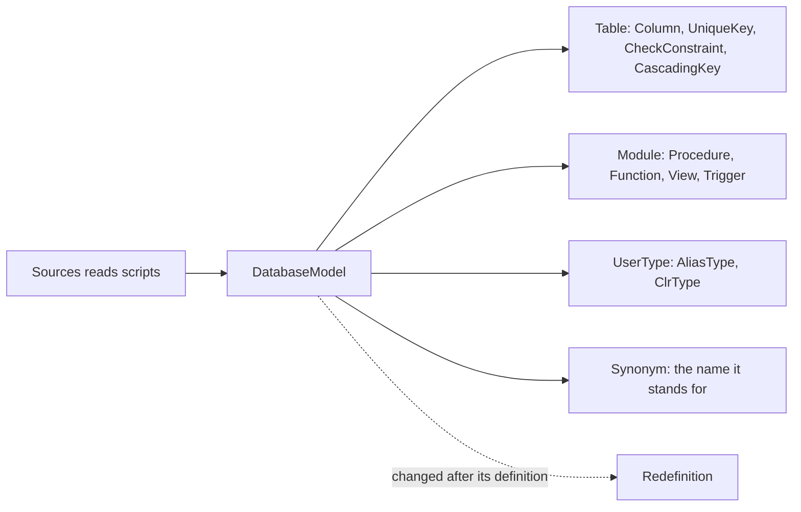

# Haruspex.SqlServer.Model

A SQL Server database's schema as plain .NET data, for tools that need to read a schema without a database and without
DacFx: linters, diff tools, documentation generators, code generators.
[Haruspex.SqlServer.Sources](https://github.com/sharpblue/haruspex/blob/main/src/Haruspex.SqlServer.Sources/README.md)
fills it from a folder of `.sql` scripts.

It holds tables with their columns, declared types, collations, NULL or NOT NULL, identity, primary keys, unique keys and
CHECK constraints; alias and CLR types (`CREATE TYPE`); stored procedures, functions of each kind, views and DML triggers,
with their parameters, return types and options as data and their bodies as
[ScriptDom](https://www.nuget.org/packages/Microsoft.SqlServer.TransactSql.ScriptDom) statements and expressions; synonyms
with the name each stands for; and foreign keys whose actions change the referencing table (`CascadingKey`). A column
records whether it is `HIDDEN`, and a table whether it is a graph table, since both change what `SELECT *` returns. Every
object knows where it was read (`SourceSpan`).

## How data flows through it

A `DatabaseModel` is built once and only read after that. Everything in it is a declaration as written.



[Haruspex.SqlServer.Syntax](https://github.com/sharpblue/haruspex/blob/main/src/Haruspex.SqlServer.Syntax/README.md)
reads a table definition as written (`SyntaxReader.Table`), so a body's own tables (`CREATE TABLE #t`,
`DECLARE @t TABLE`) are read the same way as the schema's.

## Example

```csharp
var model = SqlScriptFolder.Read("path/to/database").Model;
foreach (var table in model.Tables)
    Console.WriteLine($"{table.Name}: {string.Join(", ", table.Columns.Select(c => $"{c.Name} {c.Type}"))}");
```

## What it guarantees

- **One of several is a closed set of kinds.** A function is a `ScalarFunction`, an `InlineFunction` or a `TableFunction`, a
  body a `SqlBody`, a `ClrBody` or a `NoBody`, a user type an `AliasType` or a `ClrType`: a reader matches on the kind and gets
  exactly its fields, and no other assembly can add one
  ([decision 0031](https://github.com/sharpblue/haruspex/blob/main/docs/decisions/0031-the-model-is-closed-hierarchies-of-records.md)).
- **ScriptDom only in code.** ScriptDom's types appear only as bodies and expressions; names, types, parameters and options
  are the model's own values.
- **One order.** Every collection of schema objects is in source order: by file, in ordinal order of the relative paths,
  then by where each object starts. The same folder gives the same model however its files are listed.
- **Names are two-part** (`schema.name`, `ObjectName`) and compared case-insensitively, as SQL Server compares them in
  almost every database.
- **Declarations are kept as written**, so a tool reading the model sees what the source says, not an interpretation.
- **An object changed after its definition says so.** When the source changes an object (`ALTER TABLE`, `DROP PROCEDURE`,
  `ALTER FUNCTION`) and doesn't say which runs last, the model records a `Redefinition` rather than applying one. A CHECK
  constraint that a later `ALTER TABLE … NOCHECK CONSTRAINT` may disable records where (`CheckConstraint.DisabledAt`).

## What it deliberately doesn't do

- **No building, comparing or deploying.** The model is read-only. It never builds a DACPAC, never writes one, and never
  talks to a server.
- **No knowledge of where the schema came from.** A file path appears only in source locations, so errors can point at a
  line. Reading `.sql` files, and later a DACPAC's `model.xml`, belongs to Sources.
- **No interpretation.** Whether a column can be null follows from its declaration, its key, its identity and its alias
  type together; what a CHECK constraint says about values (a set, a range) is a reading of its expression; what a
  reference in a body points to depends on scopes and the caller's default schema. Those are
  [Haruspex.SqlServer.Semantics](https://github.com/sharpblue/haruspex/blob/main/src/Haruspex.SqlServer.Semantics/README.md)'s
  questions, not the model's.

It is part of [haruspex](https://github.com/sharpblue/haruspex), and pre-release: its API will change. Its chapter of the guide is
[*The inputs and the model*](https://github.com/sharpblue/haruspex/blob/main/docs/internals/02-the-inputs-and-the-model.md).
