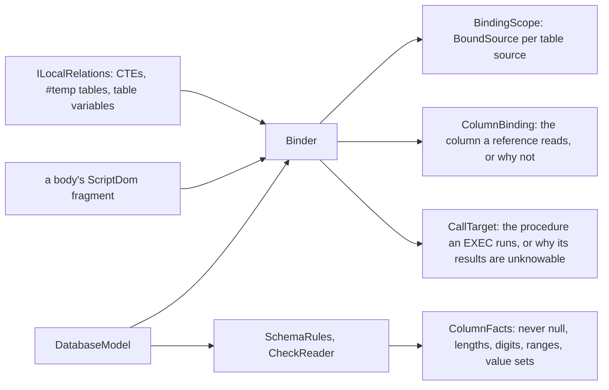

# Haruspex.SqlServer.Semantics

What a SQL Server schema and the references in a body *mean*, over a
[Haruspex.SqlServer.Model](https://github.com/sharpblue/haruspex/blob/main/src/Haruspex.SqlServer.Model/README.md). The model
holds declarations as written; this layer holds the rules SQL Server applies to them, so that every tool that reads a schema
(lint, diff, inference) reads it the same way. It needs neither DacFx nor a database.

## How data flows through it

It does two things, side by side:



- **Binding.** `Binder` binds the references in one procedure or function body to the objects they mean: the table sources
  of a `FROM` clause, with their aliases, scopes and joins (inner, outer and `APPLY`, with which side may be missing), each
  column reference to the column it reads, and each `EXEC` to the procedure it runs or the reason its results can't be
  known (dynamic SQL, `EXEC @name`, a procedure outside the project). Relations a body defines for itself, such as CTEs,
  derived tables, `VALUES` lists, `#temp` tables and table variables, bind by name through `ILocalRelations`, as views do
  through their definitions.
- **Schema rules.** `SchemaRules` and `CheckReader` turn declarations into facts about values: whether a column is never
  null (declared `NOT NULL`, in the primary key, or `IDENTITY`), which keys every row satisfies, what an alias type stands
  for, and what a type and its CHECK constraints guarantee about a column's non-null values (lengths, digits, ranges,
  minimum lengths and closed value sets).

## Example

```csharp
var model = SqlScriptFolder.Read("path/to/database").Model;
var orders = model.FindTable(new ObjectName("sales", "orders"))!;
foreach (var column in orders.Columns)
{
    var facts = SchemaRules.ColumnFacts(model, orders, column);
    var nullable = !SchemaRules.IsNeverNull(model, orders, column);
    Console.WriteLine($"{column.Name}: {facts.Type?.SourceName}{(nullable ? " null" : "")}");
}
```

## What it guarantees

- **A reference it can't bind for certain is unbound, never guessed.** An ambiguous column, a table outside the project or
  a name only dynamic SQL could create becomes a binding that says why, and the layers above treat it as unknown.
- **A fact is never narrower than the truth.** A CHECK constraint is read only in the forms `CheckReader` understands, and
  anything else is ignored, which leaves a type wider than it could be, never narrower. A constraint that a later
  `ALTER TABLE … NOCHECK` may disable, and a key whose index may be disabled, prove nothing.
- **Numbers are compared exactly**, as `ExactDecimal`, never as doubles, because the bounds of `decimal(38, s)` don't survive
  a double.

## What it deliberately doesn't do

- **No result shapes.** What a query returns, its nullability and its JSON structure are
  [Haruspex.SqlServer.Inference](https://github.com/sharpblue/haruspex/blob/main/src/Haruspex.SqlServer.Inference/README.md)'s
  work. This layer says what a reference points to and what the schema guarantees, and stops there.
- **No values.** What a CTE's or temporary table's columns hold is inference's concern; binding needs only their names.
- **No IR.** It never sees the intermediate representation, so other tools can use it without taking haruspex's output
  format with it.
- **No files.** It reads a model already built; Sources builds one from a folder of scripts.

The layers and what each may know are in
[docs/architecture.md](https://github.com/sharpblue/haruspex/blob/main/docs/architecture.md). It is part of
[haruspex](https://github.com/sharpblue/haruspex), and pre-release: its API will change. Its chapter of
[the guide](https://github.com/sharpblue/haruspex/blob/main/docs/internals/README.md), *Binding*, is planned.
