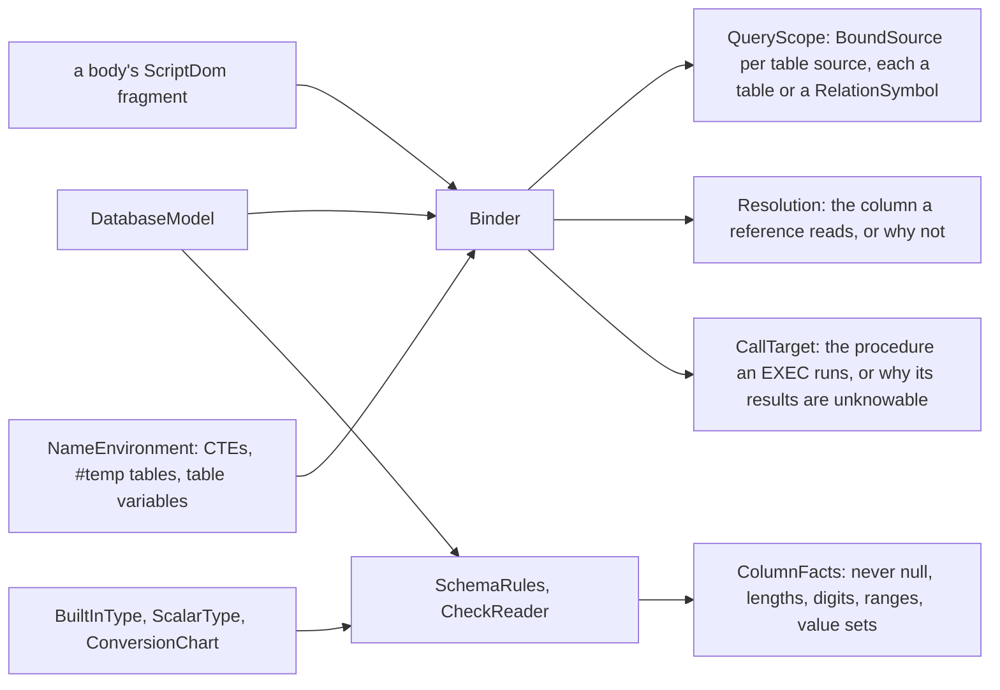

# Haruspex.SqlServer.Semantics

What a SQL Server schema and the references in a body *mean*, over a
[Haruspex.SqlServer.Model](https://github.com/sharpblue/haruspex/blob/main/src/Haruspex.SqlServer.Model/README.md). The model
holds declarations as written; this layer holds the rules SQL Server applies to them, so that every tool that reads a schema
(lint, diff, inference) reads it the same way. It needs neither DacFx nor a database.

## How data flows through it

It does three things, side by side:



- **Binding.** `Binder` binds the references in one procedure or function body to the objects they mean: the table sources
  of a `FROM` clause, with their aliases, scopes and joins (inner, outer and `APPLY`, with which side may be missing), each
  column reference to the column it reads, and each `EXEC` to the procedure it runs or the reason its results can't be
  known (dynamic SQL, `EXEC @name`, a procedure outside the project). A source that is not a table of the schema reads a
  `RelationSymbol`: a CTE, a derived table (bound with its query, so the whole is a tree, `BoundQuery`), a `VALUES` list, a
  view, a table-valued function's call, a `#temp` table, a table variable, each with its columns' names. The names a body
  defines (`NameEnvironment`) are an argument, and each query is bound once for each set of them (`Bindings`).
  `Binder.Resolve` is the one rule a column reference is resolved by, and gives a `Resolution`; a column or star qualified by
  its table's schema and name (`shop.orders.order_id`) names the source exposed under that name (`ExposedName`), as the
  guide's [binding chapter](https://github.com/sharpblue/haruspex/blob/main/docs/internals/03-binding.md#a-full-name) says; a variable reference
  resolves to a parameter, a variable the body declares or neither (`VariableResolution`), from what the whole body declares
  (`BodyDeclarations`). A name written without a schema means what `SchemaNames.Resolve` decides (one object, several or none), for every kind of
  name.
- **Schema rules.** `SchemaRules` and `CheckReader` turn declarations into facts about values: whether a column is never
  null (declared `NOT NULL`, in the primary key, or `IDENTITY`), which keys every row satisfies, what an alias type stands
  for, and what a type and its CHECK constraints guarantee about a column's non-null values (lengths, digits, ranges,
  minimum lengths and closed value sets).
- **SQL Server's type system, as data.** `BuiltInType` is the catalogue of every built-in type, with its family, its place
  in data type precedence, its digits, range and defaults; `ScalarType` is a type with its arguments (`decimal(19,2)`); and
  `ConversionChart` says which conversions the server allows, implicitly or only explicitly. Each row is observed against a
  real server; [the guide's chapter](https://github.com/sharpblue/haruspex/blob/main/docs/internals/08-the-sql-server-type-system-as-data.md)
  says why it is data and how. Bounds on numbers are one lattice, `Bounds`, which the schema rules and inference both use. The built-in functions haruspex reads are a catalogue
  too, `BuiltInFunctions`, each with a stable code (`window.count`).

## Example

```csharp
var model = SqlScriptFolder.Read("path/to/database").Model;
var orders = model.FindTable(new ObjectName("sales", "orders"))!;
foreach (var column in orders.Columns)
{
    var facts = SchemaRules.ColumnFacts(model, orders, column);
    var nullable = !SchemaRules.IsNeverNull(model, orders, column);
    Console.WriteLine($"{column.Name}: {facts.Type?.SourceName}{(nullable ? " null" : "")}");
}
```

## What it guarantees

- **A reference it can't bind for certain is unbound, never guessed.** An ambiguous column, a table outside the project or
  a name only dynamic SQL could create becomes a binding that says why, and the layers above treat it as unknown. When the
  source left part of the database unread (a referenced package that wasn't found), a name that binds to nothing says where
  it may be defined (`SchemaGaps.MayBeIn`). A three-part name binds a table of another database only through a reference the
  source holds for it by that very name, and hands the table on with what is true of it there (`OtherDatabases`); a view,
  function or procedure there stays unbound, with that reason.
- **A full name binds only where SQL Server binds it.** `shop.orders.order_id` names a source without an alias exposed under
  that name: an alias hides it; a one-part name in FROM is exposed under the schema it resolves to, and leaves the column
  unknown when that is the caller's to decide; a temporary table under any schema, a CTE under none; two sources under one
  name are refused by SQL Server (1013), so the column is ambiguous; a table of another database the project holds has no
  full name, so the name passes it by, outward; a source in a database that may or may not be the current one, and a
  four-part name, leave it unknown. `OUTPUT` can't name its target this way (4104), so such a column is
  unknown. Each rule is observed in `BindingObservationTests`, at every compatibility level from 100 to 170.
- **A fact is never narrower than the truth.** A CHECK constraint is read only in the forms `CheckReader` understands, and
  anything else is ignored, which leaves a type wider than it could be, never narrower. A constraint that a later
  `ALTER TABLE … NOCHECK` may disable, and a key whose index may be disabled, prove nothing.
- **Numbers are compared exactly**, as `ExactDecimal`, never as doubles, because the bounds of `decimal(38, s)` don't survive
  a double.
- **A set of strings says how its values compare, and is exact only where the server's comparison is proven.** Under a
  collation, `'Paid '` passes `IN ('paid')`, so a set is `Collation`. It is `Canonical` only for a `char` or `varchar` column in
  a code page whose collation has a fold observed from the server (`Collations/CollationFold`, its data in `Collations/*.json`).
  A value then maps to the one string whose fold it shares
  ([decision 0043](../../docs/decisions/0043-a-value-set-is-canonical-by-a-fold-observed-from-the-server.md)). A column without
  `COLLATE` takes the database's default only when it is a table of the schema (`SchemaRules.EffectiveCollation`): a temporary
  table's columns take `tempdb`'s, which the model doesn't know.

## What it deliberately doesn't do

- **No result shapes.** What a query returns, its nullability and its JSON structure are
  [Haruspex.SqlServer.Inference](https://github.com/sharpblue/haruspex/blob/main/src/Haruspex.SqlServer.Inference/README.md)'s
  work. This layer says what a reference points to and what the schema guarantees, and stops there.
- **No values.** What a CTE's or temporary table's columns hold is inference's concern; binding needs only their names.
- **No IR.** It never sees the intermediate representation, so other tools can use it without taking haruspex's output
  format with it.
- **No files.** It reads a model already built; Sources builds one from a folder of scripts.

The layers and what each may know are in
[docs/architecture.md](https://github.com/sharpblue/haruspex/blob/main/docs/architecture.md). It is part of
[haruspex](https://github.com/sharpblue/haruspex), and pre-release: its API will change. Its chapter of
[the guide](https://github.com/sharpblue/haruspex/blob/main/docs/internals/README.md) is
[*Binding*](https://github.com/sharpblue/haruspex/blob/main/docs/internals/03-binding.md).
