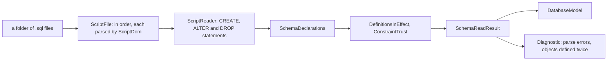
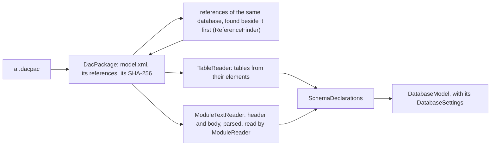
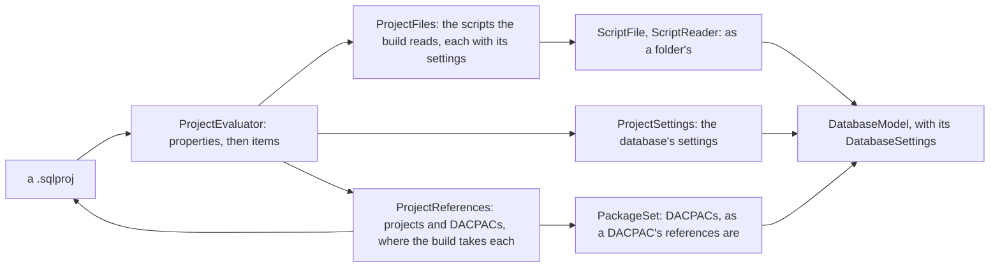

# Haruspex.SqlServer.Sources

Reads a SQL Server database project into a
[Haruspex.SqlServer.Model](https://github.com/sharpblue/haruspex/blob/main/src/Haruspex.SqlServer.Model/README.md): a folder of
`.sql` scripts, such as an SSDT or `Microsoft.Build.Sql` project's; that project's file, `.sqlproj`, with the projects and DACPACs
it refers to; or a DACPAC with the DACPACs it refers to. It parses with [ScriptDom](https://www.nuget.org/packages/Microsoft.SqlServer.TransactSql.ScriptDom), Microsoft's own
T-SQL parser (MIT), reads `model.xml` with .NET's own zip and XML readers, and needs neither DacFx nor a database.

## How data flows through it



`SqlScriptFolder.Read` is three steps: which scripts there are and in which order, each parsed (`ScriptFile`); what each
declares, applying only its own order to the procedures, functions and views it names (`ScriptReader`, `ScriptDefinitions`);
and the passes that settle what is in effect once every script is read
(`DefinitionsInEffect`, `ConstraintTrust`).

Files are read in order of their relative path, so the result doesn't depend on the file system. Each file is UTF-8 unless
a byte order mark says otherwise (SSMS writes UTF-16), and is parsed with the SQL Server 2025 grammar. A script written for
sqlcmd is read as the server would receive it: each `:setvar` defines a variable and each `$(name)` is replaced by its value
first (`SqlcmdVariables`). A `$(name)` the script doesn't set is left as written, and inference reads a literal holding one as
unknown, since a deployment sets it ([decision 0046](https://github.com/sharpblue/haruspex/blob/main/docs/decisions/0046-a-sqlcmd-variable-in-a-body-is-unknown.md)). `SqlScriptFolder.Read` can also be given which of a folder's scripts to read, such as the ones a
project file builds.

A DACPAC is read by `DacpacReader` into the same `SchemaDeclarations`, so the passes and the model are one for both:



A project file is read by `SqlProjectReader` into the same scripts a folder gives, each with the settings it starts with:



`ProjectReading` holds one read: each database from its root project, the projects of its database and the DACPACs they refer to;
another database, a project or a DACPAC, into a model of its own, one level down. Where each reference is looked for
(`ProjectReferences`, `PackageCache`) is what its build was observed to use: a DACPAC's `Include`, a NuGet package's
`tools/<name>.dacpac` in the folder the restore gave its version, then the config file's `references` folders by file name
(decision 0045).

MSBuild is evaluated as far as decision 0044 says; what isn't is carried as a doubt to whatever it touches, and reported only
where that is something read (`Doubt`). The guide's chapter 2 says how, and `ProjectEquivalenceTests` proves a project reads
as the package its build makes.

Tables are elements of `model.xml`, read as data (`TableReader`); each module keeps its text, header and body, which is parsed
and read by the same `ModuleReader` a folder's script is (`ModuleTextReader`). Every package of the same database reachable
through references is read once into the one model; another database's package is read into a model of its own
(`PackageSet`, which a project's read shares). A location
names the package and the object, with a line in the object's own text (`sales.dacpac/[sales].[get_order]:3:5`). The guide's
chapter 2 says why each is so, and `DacpacEquivalenceTests` proves a package of each fixture reads as its folder does.

## Query files

A query file of the application is read apart from the project, by `QueryFileReader`, into a `QueryFile` that is read against
the project's model rather than added to it. It is one batch, as `sp_executesql` runs it: one that `GO` splits, or that holds no
statement, is refused (HAR1014), and so is one that uses a variable before its `DECLARE` (HAR1016) or `RETURN`s a value (HAR1017), each of which the server refuses. Its text is kept with LF line endings, parsed so, and parsed with `QUOTED_IDENTIFIER` on, as
every client library sets it; no SQLCMD variable is replaced, since the application sends the text as it is. A line comment
`-- @param @name type` declares a parameter's type, read as a `DECLARE` of it reads, and one that can't be taken is refused
with why (HAR1015): it doesn't read, it names a parameter twice, or it names a variable the file declares itself or doesn't use
([decision 0059](https://github.com/sharpblue/haruspex/blob/main/docs/decisions/0059-a-query-file-s-parameters-are-typed-from-their-uses.md)).
A line comment `-- @sets order, lines` names the file's result sets, in order; one that names none, leaves a name out between
commas or comes a second time is refused (HAR1018). Whether each name can name a set, and whether there is one for every set,
is the config layer's to check, as it checks a procedure's `sets`
([decision 0070](https://github.com/sharpblue/haruspex/blob/main/docs/decisions/0070-a-procedure-s-result-sets-are-named-all-or-none.md)).

## Example

```csharp
var read = SqlScriptFolder.Read("path/to/database");
foreach (var diagnostic in read.Diagnostics)
    Console.Error.WriteLine(diagnostic);          // file:line:column: error HAR1001: message
var orders = read.Model.FindTable(new ObjectName("sales", "orders"));

var package = DacpacReader.Read("bin/Release/Sales.dacpac", ["../Shared/bin/Release"]);
Console.WriteLine($"{package.Package?.Name} {package.Package?.Sha256}, {package.Model.Settings?.Collation}");

var project = SqlProjectReader.Read("Sales/Sales.sqlproj", ["../Shared/bin/Release"]);
Console.WriteLine($"{project.Projects.Count} projects, {project.References.Count} packages, {project.Model.Settings?.Collation}");

var query = QueryFileReader.Read("app/sql/get_order.sql", "sql/get_order.sql");   // an Outcome<QueryFile>
```

## What it guarantees

- **Everything the model needs is read.** Tables come with their CHECK constraints (a check that a later
  `ALTER TABLE … NOCHECK CONSTRAINT` may disable says so), their primary key, unique constraints and unfiltered unique
  indexes (a key whose index a later `ALTER INDEX … DISABLE` may disable says so), and alias, CLR and table types from
  `CREATE TYPE`, a table type with its columns, keys (whether each ignores duplicates), CHECK constraints, and which columns
  have a default. In a DACPAC a table type's parts are entries of its own element, and its column says `IsNullable` only when it
  is nullable, the reverse of a table's column. An edge table that declares no columns of its own (`CREATE TABLE shop.follows AS EDGE`) is a graph table
  with none listed, as its package reads it. A `CREATE TABLE` whose columns its script doesn't list, a FileTable's or one made
  from a query (`WITH (…) AS SELECT`), is passed over with a note (HAR1013), so a name in it is unresolved, never guessed.
  DML triggers are read from `CREATE`, `CREATE OR ALTER` and `ALTER TRIGGER`, every definition kept, since
  which applies depends on the order the scripts run. Foreign keys with an `ON DELETE` or `ON UPDATE` action are read from
  `CREATE TABLE` and `ALTER TABLE … ADD`, as their actions fire the referencing table's triggers. A primary key or unique
  constraint `ALTER TABLE … ADD CONSTRAINT` adds, as AdventureWorks adds every key, is one of the table's keys
  (`AddedKey`), when the statement is a batch's and names the table with its schema: SQL Server enforces it as one the table
  declares, and an unqualified name may mean another table. A CHECK it adds is not read, which only claims less. A procedure, function or view is the
  definition that stands once its script has run, read in batch order (`ScriptDefinitions`): a stub created and then altered is
  its `ALTER`, one dropped and created again its last `CREATE` (decision 0080); one that two scripts define or change records the
  second as a `Redefinition`. A synonym keeps the name it stands for, read in batch order too: one dropped and created again is
  its last `CREATE`, and one two scripts create, or one created again after a drop that may not run, is HAR1002 (decision 0112); one that a `CREATE SYNONYM` under `IF`, in a block
  or a body, or in a deployment script may move to another target is HAR1002 too. Every
  object keeps where it was read (`SourceSpan`).
- **Settings a definition keeps are kept.** A procedure, function or view records whether `SET ANSI_NULLS OFF` came before
  it in its file, since SQL Server keeps the setting it was created with. Each batch is parsed with the `QUOTED_IDENTIFIER` the
  server has where it starts, as every `SET` before it leaves it (`ScriptParser`, decision 0112), so `"x"` after `SET
  QUOTED_IDENTIFIER OFF` is a string.
- **Problems have a place.** Parse errors and objects defined twice are reported as diagnostics, with their file, line and
  column.
- **Two names in one namespace never differ only in case.** Every layer above matches names ignoring case, which agrees with
  SQL Server for every project that deploys unless one namespace has two such names (`[Code]` and `[code]`), possible only under a
  case-sensitive collation. Once a model is read, `CaseVariants` looks for them in a table's and a table type's columns, a
  schema's objects, and each body's variables, temporary tables and declared tables' columns, a query file's included; each
  pair is an error naming both and where each is (HAR1022, or HAR1002 for two objects of one kind)
  ([decision 0119](https://github.com/sharpblue/haruspex/blob/main/docs/decisions/0119-names-that-differ-only-in-case-are-an-error.md)).
- **Every statement that weakens a claim is read, wherever it is.** A `NOCHECK`, a bulk load without `CHECK_CONSTRAINTS`, a key
  disabled or dropped, and a table altered, dropped or created again, under `IF`, in a block or in a body, in a folder's
  script, in a package's module text, and in a project's or a package's pre- and post-deployment scripts
  (`WeakeningStatements`, `DeploymentScripts`). A procedure, function or view a deployment script creates, alters or drops is
  `redefined`.
- **A DACPAC reads as its project's folder does.** For every fixture that builds as a project (all but the three
  `DacpacEquivalenceTests` lists, each with the build error that keeps it out), and for WideWorldImporters, the
  output from the package is byte for byte the folder's once locations are rewritten (`DacpacEquivalenceTests`). Every element
  of `model.xml` is read, passed over for a stated reason, or counted in one note (HAR1004). A module created with
  `ANSI_NULLS` or `QUOTED_IDENTIFIER` off is parsed and read as it runs. A CLR module, and an encrypted one an extracted
  package holds no text for, is read from its element with a `ClrBody` or an `EncryptedBody`, never from a placeholder. A
  referenced package not found is one warning (HAR1003) naming every place looked.
- **A project reads as the package its build makes.** For two projects of its own in both formats (one database over three
  projects; every kind of item a build reads or leaves out), for WideWorldImporters' own legacy project, and for every
  fixture as a project that sets nothing, the model has exactly the package's objects and settings, and the output is byte
  for byte the package's once locations are rewritten (`ProjectEquivalenceTests`). Each script starts with the
  `ANSI_NULLS` and `QUOTED_IDENTIFIER` its build gives it, from its item or its own project. So do projects that refer to
  other databases and DACPACs, under `Microsoft.Build.Sql` 2.3.0 and 1.0.0 and as a legacy project: each other database has the
  objects and settings its package gives it.

## What it deliberately doesn't do

- **No building or deploying.** It never builds, writes or publishes a DACPAC, and never connects to a server.
- **Another database is read, not bound.** A reference to another database (by name or SQLCMD variable) or to
  `master.dacpac`, from a DACPAC or a project, is read into a model of its own (`DatabaseModel.Databases`), one level deep: its
  references to a third are recorded, not read. What a three-part name in a body means is Semantics' question. A `$(Variable)`
  in a module's text is read as written, a bracketed name such as `[$(Ledger)]`. A database on another server isn't read.
- **No DacFx.** DacFx's licence asks anyone who redistributes it to indemnify Microsoft, which no free tool should have to
  take on; ScriptDom is enough to read a project
  ([decision 0004](https://github.com/sharpblue/haruspex/blob/main/docs/decisions/0004-scriptdom-is-the-only-sql-dependency.md)).
- **No other sqlcmd commands.** `:r`, which includes another file, is not followed in a folder's script, so a script that uses
  it fails to parse rather than being read as a different script from the one that runs. A project's deployment script is
  read with each file it includes by `:r`, apart; one that holds another command is a warning (HAR1021). Variables defined outside a script (sqlcmd's `-v`,
  the environment, a project's own variables, a publish's values) are not known, so what they hold stays unknown.
- **One database.** `USE` is not followed: every object the scripts define is read into one model, whichever database a
  script has switched to by then.
- **Not all of MSBuild.** A project file is evaluated as far as decision 0044 says: no property functions, no `Choose`, no
  targets. Each such part that touches what is read is reported and not read, never guessed. No restore: a package's version
  is the one the project names, and a range or a floating version isn't resolved. Given a folder, it reads every script in it.
- **No running scripts.** A folder of scripts doesn't say the order they run in, so a statement that changes an object after
  its definition in another script (`ALTER PROCEDURE`, `DROP PROCEDURE`), or that changes a table anywhere (`ALTER TABLE …
  ALTER COLUMN`, `DROP TABLE`, a nested `CREATE TABLE`), is recorded as a `Redefinition`, not applied. Only a script's own procedures, functions and
  views are played in its order; an `ALTER PROCEDURE` or `ALTER VIEW` that no other script names stands
  ([decision 0080](https://github.com/sharpblue/haruspex/blob/main/docs/decisions/0080-the-last-definition-in-a-script-stands.md)). Changes made only through code that would have to run, such as `EXEC sp_rename` or dynamic
  SQL, are not seen.
- **No name resolution or typing.** What a reference in a body points to, and what type an expression has, are questions
  for a semantic layer over the model.

It is part of [haruspex](https://github.com/sharpblue/haruspex), and pre-release: its API will change. Its chapter of the guide is
[*The inputs and the model*](https://github.com/sharpblue/haruspex/blob/main/docs/internals/02-the-inputs-and-the-model.md).
