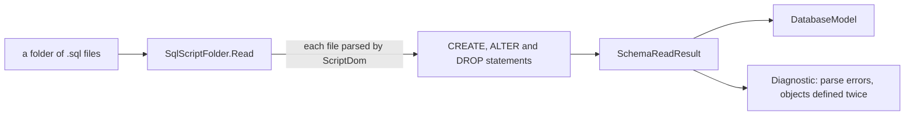

# Haruspex.SqlServer.Sources

Reads a SQL Server database project into a
[Haruspex.SqlServer.Model](https://github.com/sharpblue/haruspex/blob/main/src/Haruspex.SqlServer.Model/README.md): today a
folder of `.sql` scripts, such as an SSDT or `Microsoft.Build.Sql` project's; later a DACPAC's `model.xml` as well. It
parses with [ScriptDom](https://www.nuget.org/packages/Microsoft.SqlServer.TransactSql.ScriptDom), Microsoft's own T-SQL
parser (MIT), and needs neither DacFx nor a database.

## How data flows through it



Files are read in order of their relative path, so the result doesn't depend on the file system. Each file is UTF-8 unless
a byte order mark says otherwise (SSMS writes UTF-16), and is parsed with the SQL Server 2025 grammar. A script written for
sqlcmd is read as the server would receive it: each `:setvar` defines a variable and each `$(name)` is replaced by its value
first (`SqlcmdVariables`). `SqlScriptFolder.Read` can also be given which of a folder's scripts to read, such as the ones a
project file builds.

## Example

```csharp
var read = SqlScriptFolder.Read("path/to/database");
foreach (var diagnostic in read.Diagnostics)
    Console.Error.WriteLine(diagnostic);          // file:line:column: error: message
var orders = read.Model.FindTable(new ObjectName("sales", "orders"));
```

## What it guarantees

- **Everything the model needs is read.** Tables come with their CHECK constraints (a check that a later
  `ALTER TABLE … NOCHECK CONSTRAINT` may disable says so), their primary key, unique constraints and unfiltered unique
  indexes (a key whose index a later `ALTER INDEX … DISABLE` may disable says so), and alias and CLR types from
  `CREATE TYPE`. DML triggers are read from `CREATE`, `CREATE OR ALTER` and `ALTER TRIGGER`, every definition kept, since
  which applies depends on the order the scripts run. Foreign keys with an `ON DELETE` or `ON UPDATE` action are read from
  `CREATE TABLE` and `ALTER TABLE … ADD`, as their actions fire the referencing table's triggers. A view defined once keeps
  its definition and its file, and a synonym the name it stands for.
- **Settings a definition keeps are kept.** A procedure, function or view records whether `SET ANSI_NULLS OFF` came before
  it in its file, since SQL Server keeps the setting it was created with.
- **Problems have a place.** Parse errors and objects defined twice are reported as diagnostics, with their file, line and
  column.

## What it deliberately doesn't do

- **No building or deploying.** It never builds, writes or publishes a DACPAC, and never connects to a server.
- **No DacFx.** DacFx's licence asks anyone who redistributes it to indemnify Microsoft, which no free tool should have to
  take on; ScriptDom is enough to read a project
  ([decision 0004](https://github.com/sharpblue/haruspex/blob/main/docs/decisions/0004-scriptdom-is-the-only-sql-dependency.md)).
- **No other sqlcmd commands.** `:r`, which includes another file, is not followed, so a script that uses it fails to parse
  rather than being read as a different script from the one that runs. Variables defined outside a script (sqlcmd's `-v`,
  the environment, a project's own variables) are not known.
- **One database.** `USE` is not followed: every object the scripts define is read into one model, whichever database a
  script has switched to by then.
- **No project files yet.** It doesn't read a `.sqlproj`'s list of scripts or its settings; given a folder, it reads every
  script in it.
- **No running scripts.** A folder of scripts doesn't say the order they run in, so a statement that changes an object after
  its definition (`ALTER TABLE … ALTER COLUMN`, `DROP TABLE`, `ALTER PROCEDURE`, `DROP PROCEDURE`) is recorded as a
  `Redefinition`, not applied. Changes made only through code that would have to run, such as `EXEC sp_rename` or dynamic
  SQL, are not seen.
- **No name resolution or typing.** What a reference in a body points to, and what type an expression has, are questions
  for a semantic layer over the model.

It is part of [haruspex](https://github.com/sharpblue/haruspex), and pre-release: its API will change. Its chapter of
[the guide](https://github.com/sharpblue/haruspex/blob/main/docs/internals/README.md), *The inputs and the model*, is
planned.
