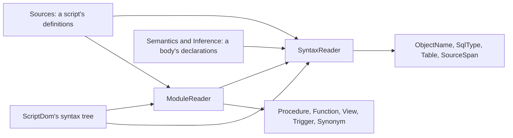

# Haruspex.SqlServer.Syntax

Reads what [ScriptDom](https://www.nuget.org/packages/Microsoft.SqlServer.TransactSql.ScriptDom), Microsoft's T-SQL parser,
parsed into a [Haruspex.SqlServer.Model](https://github.com/sharpblue/haruspex/blob/main/src/Haruspex.SqlServer.Model/README.md):
a name, a type, a table definition, a procedure, a function, a view, a trigger, a synonym, and where each is
(`SourceSpan`). It is the one place a declaration is read, wherever it is written. A script's
`CREATE TABLE` is read with it by
[Haruspex.SqlServer.Sources](https://github.com/sharpblue/haruspex/blob/main/src/Haruspex.SqlServer.Sources/README.md),
and a body's own `CREATE TABLE #t` or `DECLARE @t TABLE` by the layers that bind and infer, so the same declaration means
the same thing in both.

## How data flows through it



## Example

```csharp
var table = SyntaxReader.Table(SyntaxReader.Name(create.SchemaObjectName), create.Definition, SyntaxReader.Span("tables/orders.sql", create));
var procedure = ModuleReader.Procedure(definition, "procedures/get_order.sql");
```

## What it guarantees

- **One reading.** A table declared in a body is read by the same code as one declared in the schema, so the schema's rules
  (which columns are never null, what a CHECK constraint allows) apply to both unchanged.
- **Declarations as written.** It reads what the syntax says and nothing it implies.
- **Only code stays ScriptDom's.** What it reads into the model keeps ScriptDom's types only for bodies and expressions; a
  name, a type, a parameter, a function's kind and its options become the model's own values.

## What it deliberately doesn't do

- **No files.** It reads syntax trees it is given; which scripts there are, and how they are decoded, is Sources' job.
- **No name resolution.** A name is read as the definition writes it (an unqualified one in `dbo`); what a reference in a
  body means is Semantics' question.

It is part of [haruspex](https://github.com/sharpblue/haruspex), and pre-release: its API will change. Its chapter of the guide is
[*The inputs and the model*](https://github.com/sharpblue/haruspex/blob/main/docs/internals/02-the-inputs-and-the-model.md).
