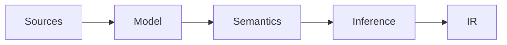

# A diagram that parses

The Mermaid check's self-test expects every diagram here to parse. The class diagram is here because its
labels go through DOMPurify, the step that needs jsdom.

~~~mermaid
classDiagram
  class Shape
  class ScalarShape
  Shape <|-- ScalarShape
~~~
